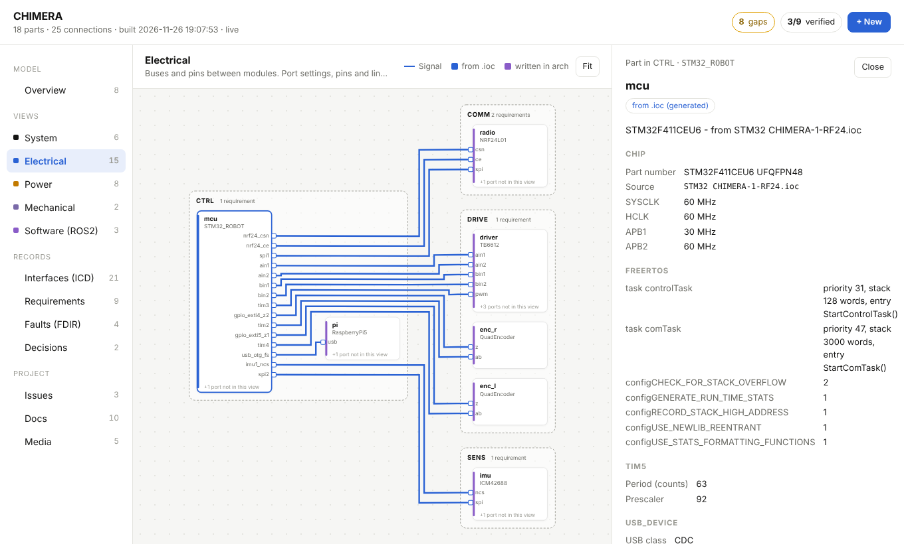
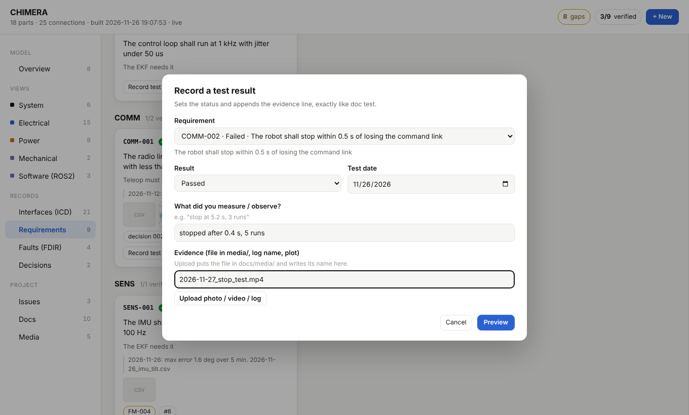

# doc-kit

**One live page for your robot: how it is built, what it must do, how it can
fail and what is proven. Built from the files you already keep, for hardware
and robotics projects.**

doc-kit reads your CubeMX `.ioc` files, your ROS2 and micro-ROS code, and a
plain-text record of requirements, faults and decisions in your repo, and turns
them into one interactive page. You open it on your laptop or phone, click any
part to see its pins, settings, wiring, requirements and faults, and record
what happens (a test result with a photo, a new idea, a decision) straight from
the page. Every change becomes a git commit.

It is a lightweight version of the systems engineering loop used in aerospace
(requirements, design decisions, FMEA, verification, interface control),
scaled down for one person or a small team. No AI and no guessing: the page
only shows what your files say, and only writes what you typed.


## What the page shows

| Section | What you see | Where it comes from |
|---|---|---|
| **System** | Subsystems and everything that crosses between them | your arch file |
| **Electrical, Power, Mechanical** | Parts inside their subsystems, wired port to port. Click a part for every pin, peripheral setting (SPI mode, baud rate, timer period, FreeRTOS tasks, clocks), what it connects to, and its requirements, faults, decisions, issues and photos | `.ioc` + arch file |
| **Software (ROS2)** | Nodes and topics, grouped by the computer each node runs on | read from your code; the robot can be off |
| **Interfaces (ICD)** | Every connection that crosses a subsystem boundary, with pins and bus settings | generated, never typed |
| **Requirements** | Cards per subsystem with status, method, evidence and test photos; search and filters | `docs/requirements.md` |
| **Faults (FDIR)** | Worst first, detect → respond → recover, and whether a passing test proves the response | `docs/fdir.md` |
| **Decisions** | Why each choice was made, linked to the parts and requirements it affects | `docs/decisions/` |
| **Issues** | Open and closed ideas and bugs, placed in their subsystem | GitHub |
| **Docs, Media** | Your procedures and notes, this handbook, and every photo, video and log | `docs/`, `docs/media/` |
| **Overview** | Problems (the wiring no longer matches the hardware) and gaps a design review would ask about | all of the above |



## What you do on the page

**+ New** and the buttons on each card open a form with every field you need
at once: idea, bug, requirement, test result, fault, decision, and edits
(status, text, mark deleted, supersede). Each form shows exactly what will be
written before you confirm. Then the page writes the file, commits and pushes.

Recording a test is where it shines: at the bench, on your phone, pick the
requirement, Passed or Failed, what you measured, take the photo, *Write it*.
The photo lands in `docs/media/`, its name in the evidence, and from then on it
shows on that requirement and on its part.



What the page never touches: the `.ioc` (CubeMX owns it), your code, and the
generated facts file. Nothing is ever removed: a dropped requirement is marked
Deleted with a reason, a replaced decision is Superseded.

## How it stays true

The page is rebuilt from your files, so it cannot drift from them:

| Comes from | What | Written by |
|---|---|---|
| `.ioc` files | boards, peripherals, pins, settings, FreeRTOS tasks, clocks | CubeMX |
| ROS2 / micro-ROS code | nodes, topics, message types | you, in code |
| `docs/requirements.md`, `fdir.md`, `decisions/` | requirements, faults, decisions | the page (or the terminal) |
| `docs/model/<name>_arch.sysml` | subsystems, modules, wiring, which computer runs which node | you, in SysML v2 text |

The first three are facts: doc-kit regenerates `<name>_facts.sysml` from them
and you never edit it. The arch file is the one thing you write by hand. Every
`connect` line in it is checked against the facts, so a pin renamed in CubeMX
or an SPI bus wired to a GPIO stops the commit and shows as a red dashed line,
instead of silently leaving a wrong diagram. Anything a scanner cannot read for
certain (a topic name built at runtime) is listed as unknown, never guessed.
Layout is automatic: you never arrange a diagram.

## Quick start

```bash
git clone https://github.com/sergeikuznev/doc-kit.git
python3 doc-kit/doc.py init /path/to/your/project
cd /path/to/your/project
alias doc='python3 "$(git rev-parse --show-toplevel)/tools/doc.py"'   # add to ~/.zshrc once
doc install-hook        # checks the wiring before each commit
doc model setup         # once: pick each board's .ioc and your ROS2 folders
doc serve               # the page, live, at http://127.0.0.1:8765
```

Then describe your modules and wiring in `docs/model/<name>_arch.sysml`
([how](docs/HANDBOOK.md#15-the-system-model)), and edit the subsystem list in
`docs/README.md` and `.github/ISSUE_TEMPLATE/*.yml`.

**On your phone and other devices:** `doc serve` listens on this machine only.
Share it with your own devices through [Tailscale](https://tailscale.com):
`tailscale serve --bg 8765`. For GitHub issues on the page and the idea/bug
forms, install the [GitHub CLI](https://cli.github.com) and run `gh auth login`.

**No server?** `doc model` writes the same page as a file, `docs/system.html`,
without the forms.

## While `doc serve` runs

- It pulls from GitHub every minute (fast-forward only) and rebuilds when anything changed; issues refresh every 5 minutes.
- Open pages show *The project changed · Reload*; reloading keeps your view and the part you had open.
- Forms commit and push (`--no-push` keeps commits local).
- It refuses to write a file that has uncommitted changes in its working copy, so it never commits half of your own edit.
- Later you can move it to an always-on machine (a lab PC): it is the same command in a clone there.

## The loop: Decide, Verify, Learn

Like FDIR (Fault Detection, Isolation and Recovery) names a loop of functions,
doc-kit implements a loop. Each stage has a trigger in your work:

| Stage | What it does | Trigger | On the page |
|---|---|---|---|
| **Capture** | Record an idea or problem before it is lost | You notice something | + New → Idea / Bug |
| **Decide** | Choose between options and record why | You compare alternatives | + New → Decision |
| **Commit** | Turn a choice into a measurable promise | You decide to build it | + New → Requirement |
| **Anticipate** | Plan how failures are detected and handled | You ask "what if it breaks?" | + New → Fault |
| **Verify** | Prove the promise with evidence | You test it | Record test (with upload) |
| **Learn** | Turn incidents and experience into rules | Something breaks, or the week ends | terminal: `doc check`, `doc procedure`, `doc log` |

Around the loop: **Trace** (the page links faults, requirements, evidence,
parts and issues) and **Revise** (Edit / Mark deleted / Change status; every
requirement change is logged).

The core is **Decide, Verify, Learn**: reasons are recorded, claims are proven,
and mistakes turn into rules. That is what separates it from a notes folder.

## Why

Documentation written upfront becomes fiction; documentation written at the end
forgets *why* things were done. The habit that works is writing a little at the
moment something happens: a decision, a test, a near miss. doc-kit makes that a
30-second job, so it actually happens, and keeps a picture of the whole robot
that is never out of date.

It builds on established practices:

- **Docs-as-code:** everything in plain text, in the repo, versioned with git and reviewed like code.
- **Requirements traceability:** every requirement linked to its rationale, the failures it covers, the evidence that it is met, and the parts it belongs to.
- **Lightweight MBSE:** one model of the system in SysML v2 text, with generated views and interfaces, without the heavyweight tools.

**New to this? Read the [handbook](docs/HANDBOOK.md).** It explains each record
(issue, decision, requirement, fault, evidence, procedure, checklist, devlog):
when to write one, what a good one looks like next to a weak one, how they
connect, [how to use the record afterwards](docs/HANDBOOK.md#14-using-the-record),
and [the system model](docs/HANDBOOK.md#15-the-system-model). [examples/](examples/) shows real output.

## The terminal: for manual work

Everything the page writes, the terminal writes too, through the same code, so
the files are identical either way. Use it when you are already in a shell, on
a machine without the server, or for the records that have no form yet
(procedures, checklist lines, devlog). `doc` alone opens a menu: *what just happened?*

| Command | Does | Writes to |
|---|---|---|
| `doc` | Menu: "what just happened?" | |
| `doc idea` | Creates a GitHub issue from your answers | GitHub Issues |
| `doc bug` | Creates a bug report issue | GitHub Issues |
| `doc decision` | Decision record, auto-numbered | `docs/decisions/NNN-title.md` |
| `doc req` | Requirement with the next ID for its subsystem | `docs/requirements.md` |
| `doc test ID` | Test result and evidence for a requirement | `docs/requirements.md` |
| `doc fault` | Failure mode row (FM-001, ...) | `docs/fdir.md` |
| `doc procedure` | Numbered procedure | `docs/procedures/<title>.md` |
| `doc check` | Checklist line plus a dated reason | `docs/procedures/pre_power_checklist.md` |
| `doc log` | This week's devlog entry (adds to it if it exists) | `docs/devlog.md` |
| `doc update [ID]` | Change a status, text or link written earlier; requirement changes are logged | the document that holds it |
| `doc report` | Status page: what is verified, failed, untested or uncovered; opens in your browser | `docs/report.html` |
| `doc model setup` | Points the system model at your `.ioc` files and ROS2 code (once) | `docs/model/model.toml`, starter arch file |
| `doc model` | Rebuilds the facts, checks your architecture against them, opens the system map | `docs/model/<name>_facts.sysml`, `docs/system.html` |
| `doc serve` | Serves the system map with forms; pulls, rebuilds, commits and pushes | `http://127.0.0.1:8765` (share with `tailscale serve --bg 8765`) |
| `doc tidy` | Regroups requirements by subsystem | `docs/requirements.md` |
| `doc install-hook` | After commits with `fixes #N`, asks if a document is needed; before each commit, checks the model | `.git/hooks/post-commit`, `.git/hooks/pre-commit` |

While answering:

- **Choices are menus:** ↑↓ to move, Enter to select, or start typing to filter
  (e.g. `nav` jumps to NAV). You only type free text.
- **A preview pane under every menu** shows the highlighted item in full: the
  whole requirement with its evidence, every column of a fault row, your full
  answer in the `<<` list. Rows stay one line each.
- `<` goes back one question (inside a list, it removes the last line)
- `<<` opens a list of all your answers so far; pick one to change it, and the rest are kept
- After `<` or `<<` your previous answer comes back **filled in**, so you fix a typo
  instead of retyping. Lists come back line by line. Editing keys: ←→, Option+←→
  (word), Home/End or Ctrl+A/Ctrl+E, Ctrl+U (clear line), Ctrl+W (delete word)
- At the end you choose **Write it**, **Change an answer** or **Cancel**; nothing is written before that
- Ctrl+C cancels at any point

When input is piped (scripts, CI) or on Windows, menus fall back to typing a
number or key. Set `DOC_PLAIN=1` to force that mode.

`doc report` writes a printable status summary, `docs/report.html`: requirement
progress per subsystem, everything that needs attention, fault-to-requirement
links, decisions, the latest devlog entry and recent requirement changes.
Options: `--no-open`, `--no-issues`.

## What it creates in your project

```
docs/
  README.md                 how the docs work + your subsystem list
  requirements.md           one section per subsystem, with test evidence
  fdir.md                   fault table
  devlog.md                 weekly log
  decisions/                one file per decision
  procedures/               procedures and the pre-power checklist
  icd/                      interface definitions (written by hand)
  media/                    photos, videos, logs (shown in the system map)
  model/                    created by doc model setup: model.toml, <name>_arch.sysml (yours),
                            <name>_facts.sysml (generated)
  report.html, system.html  generated pages
.github/ISSUE_TEMPLATE/     Idea and Bug forms for the GitHub website
tools/doc.py                the tool
tools/docmodel.py, docmodel_page.html, docserve.py, vendor/   system map and server
tools/guides/               README and handbook, shown in the system map's Docs section
```

Everything is plain Markdown, so you can edit any file by hand and the tool keeps working.

## Customising

- **Subsystems for requirement IDs:** edit the `| Prefix | Subsystem |` table in
  `docs/README.md`. The tool reads it every time.
- **Subsystems for issues:** edit the `options:` list in `.github/ISSUE_TEMPLATE/idea.yml`
  and `bug.yml`. `doc idea` and `doc bug` read it too, so the web form and the CLI match.
- **Templates:** change the files in `docs/`; the tool only relies on the table headers.

## Using it in a team

The tool and templates live in the project repo, so teammates get them by cloning.
Each person adds the `doc` shortcut and runs `doc install-hook` once (git hooks
are not shared through the repo).

## Updating

Pull the latest doc-kit and run `python3 doc.py init /path/to/your/project` again.
It replaces everything in `tools/` and leaves all your existing docs untouched.
Then run `doc install-hook` once more if the new version added hooks.

## Requirements

- Python 3.8 or newer, git; `doc model` and `doc serve` need Python 3.11 or newer
- Optional: [GitHub CLI](https://cli.github.com) for `doc idea`, `doc bug` and issues in the system map
- Optional: [Tailscale](https://tailscale.com) to open `doc serve` from your phone and other devices
- macOS and Linux. Windows is untested (the commit hook needs a Unix shell).

## License

MIT, see [LICENSE](LICENSE). `vendor/elk.bundled.js` is
[ELK](https://github.com/kieler/elkjs) (Eclipse Public License 2.0), see `vendor/LICENSE-elkjs.md`.
