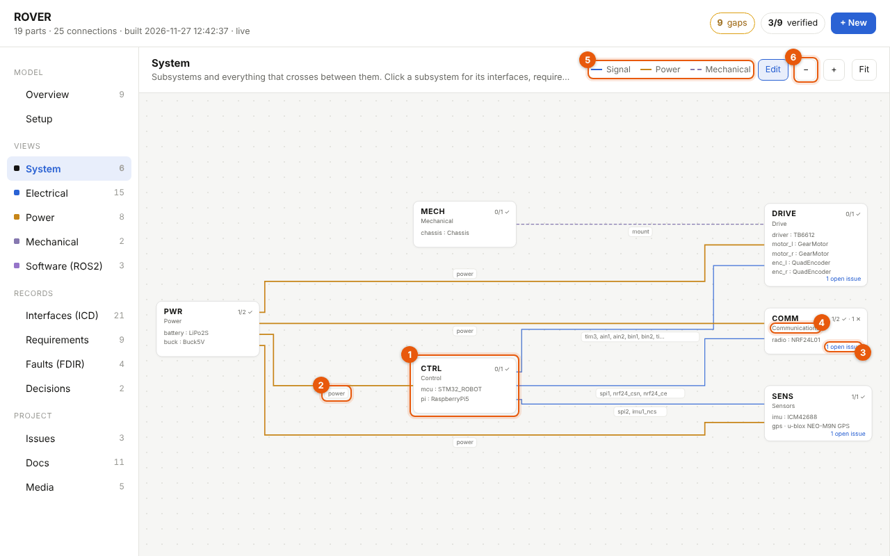
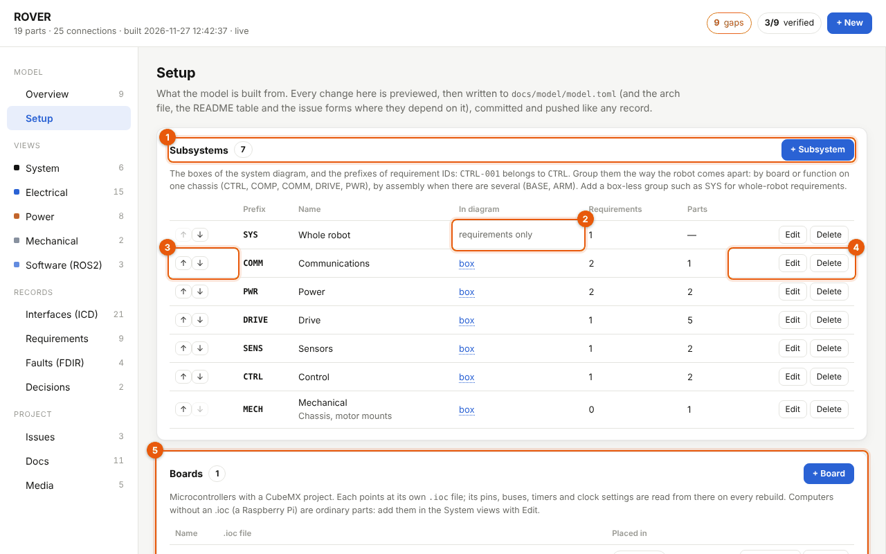
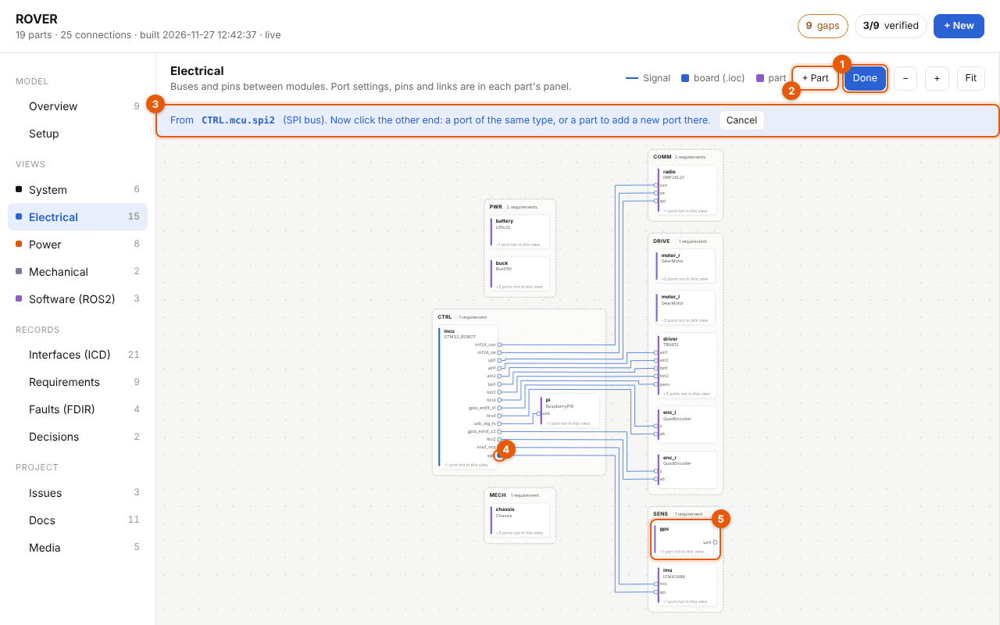
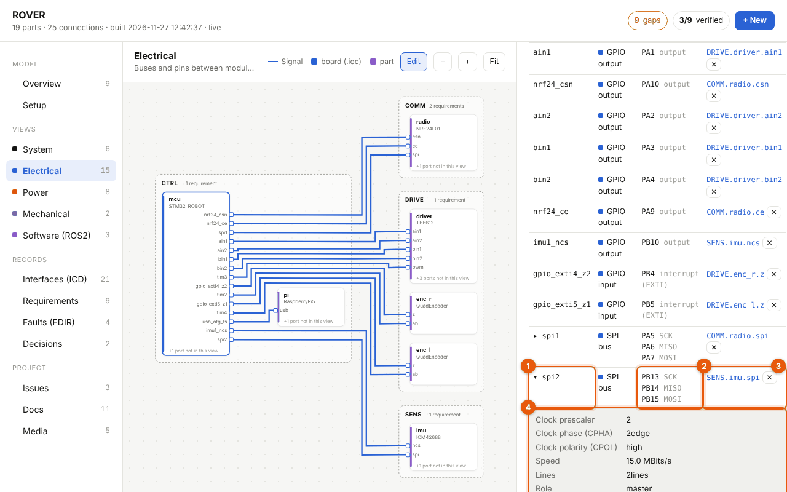
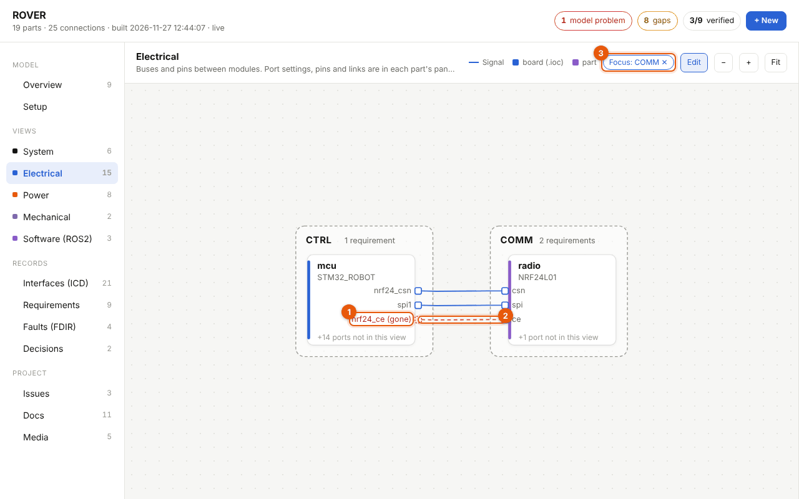
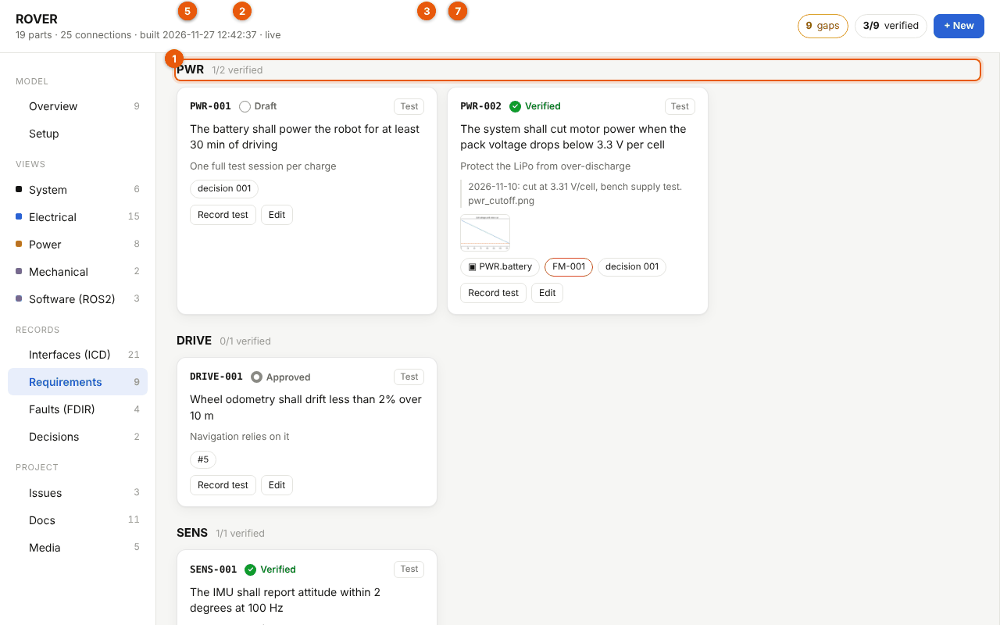

# doc-kit

**One live page for your robot: how it is built, what it must do, how it can
fail and what is proven. Built from the files you already keep, for hardware
and robotics projects.**



doc-kit reads your CubeMX `.ioc` files, your ROS2 and micro-ROS code, and a
plain-text record of requirements, faults and decisions in your repo, and turns
them into one interactive page. The page is also where you work: you set up
subsystems and boards, draw the wiring, and record tests, decisions and ideas
on it. Every change becomes a git commit.

- **See the whole robot.** Subsystems, wiring port to port, every pin and
  peripheral setting, the ROS2 graph, the interfaces between subsystems,
  requirements, faults, decisions, GitHub issues, docs and photos, all linked.
- **Build it by clicking.** Add your subsystems and point each board at its
  `.ioc` in Setup; add parts and wire them in the diagrams: click a pin, click
  the module. No modelling language to learn, no boxes to arrange.
- **Design the software too.** Move ROS nodes into the computers they run on,
  add topics and connect them with arrows before the code exists (dashed until
  it does), delete what you planned with the Delete key, and mark the wire that
  carries micro-ROS between MCU and computer. Every diagram's blocks can be
  moved by hand; the wires follow.
- **Engineering numbers from the same model.** Power budget per rail, voltage
  and I²C address checks, a bill of materials (Excel, PNG, PDF) with wire
  lengths per gauge, and a design review pack as a PDF.
- **Reuse.** A parts library shared between projects, and launch files read
  for which computer runs what. Undo and redo any number of steps.
- **Record what happens, where it happens.** At the bench, on your phone:
  pick the requirement, Passed, what you measured, take the photo, *Write it*.
  Every change becomes a git commit.
- **Never out of date.** The page is rebuilt from your files. A pin renamed in
  CubeMX that your wiring still uses shows up in red and stops the commit,
  instead of leaving a wrong diagram.

It is a lightweight version of the systems engineering loop used in aerospace
(requirements, design decisions, FMEA, verification, interface control),
scaled down for one person or a small team. No AI and no guessing: the page
only shows what your files say, and only writes what you typed.

| | |
|---|---|
|  |  |
| Setup: your subsystems, boards and code | Wiring: click a pin, then the module |
|  |  |
| Click a part: every pin, setting and link | Record a test, with the photo |
|  |  |
| A renamed pin shows up in red | Requirements with evidence and photos |

## Documentation

| Read | For |
|---|---|
| **[Using the page](docs/PAGE.md)** | the main guide: Setup, building the wiring, every view and form with annotated screenshots, and step-by-step workflows (first setup, adding a module, a test from your phone, idea to verified requirement, a failing test, a pin changed in CubeMX, the weekly review) |
| [Using the terminal](docs/TERMINAL.md) | the few commands: install, hooks, the server, checks in CI, updating |
| [The handbook](docs/HANDBOOK.md) | the method: what each record is for, good and weak examples, how they connect, how to use the record afterwards, and how the system model is organised |
| [examples/](examples/) | real output from two worked examples |

## Quick start

```bash
git clone https://github.com/sergeikuznev/doc-kit.git
python3 doc-kit/doc.py init /path/to/your/project
cd /path/to/your/project
alias doc='python3 "$(git rev-parse --show-toplevel)/tools/doc-kit/doc.py"'   # add to ~/.zshrc once
git add -A && git commit -m "docs: doc-kit"
doc install-hook        # checks the wiring before each commit
doc serve               # the page, live, at http://127.0.0.1:8765
```

`init` asks only for the project name; there are no default subsystems. On the
page, open **Setup** and add your subsystems, boards (each with its `.ioc`) and
ROS2 code folders, then add parts in the Electrical view and wire them there and in Power ([step by step](docs/PAGE.md#a-first-setup-on-a-project)).

**On your phone:** `doc serve` listens on this machine only. Share it with your
own devices through [Tailscale](https://tailscale.com): `tailscale serve --bg 8765`.
**For GitHub issues** on the page and the idea and bug forms: install the
[GitHub CLI](https://cli.github.com) and run `gh auth login`.
**No server?** `doc model` writes the same page as a file, `docs/system.html`, without the forms.

## The loop: Decide, Verify, Learn

Like FDIR (Fault Detection, Isolation and Recovery) names a loop of functions,
doc-kit implements a loop. Each stage has a trigger in your work:

| Stage | What it does | Trigger | On the page |
|---|---|---|---|
| **Capture** | Record an idea or problem before it is lost | You notice something | + New → Idea / Bug |
| **Decide** | Choose between options and record why | You compare alternatives | + New → Decision |
| **Commit** | Turn a choice into a measurable promise | You decide to build it | + New → Requirement |
| **Anticipate** | Plan how failures are detected and handled | You ask "what if it breaks?" | + New → Fault |
| **Verify** | Prove the promise with evidence | You test it | Record test, with upload |
| **Learn** | Turn incidents and experience into rules | Something breaks, or the week ends | + New → Checklist line / Procedure / Devlog |

Around the loop: **Trace** (the page links faults, requirements, evidence,
parts and issues) and **Revise** (Edit, Mark deleted, Change status; every
requirement change is logged).

The core is **Decide, Verify, Learn**: reasons are recorded, claims are proven,
and mistakes turn into rules. That is what separates it from a notes folder.

## How it stays true

| Comes from | What | Written by |
|---|---|---|
| `.ioc` files | boards, peripherals, pins, settings, FreeRTOS tasks, clocks | CubeMX |
| ROS2 / micro-ROS code | nodes, topics, message types (the robot can be off) | you, in code |
| `docs/requirements.md`, `fdir.md`, `decisions/`, ... | requirements, faults, decisions, procedures | the page's forms |
| `docs/model/model.toml`, `<name>_arch.sysml` | subsystems, boards, parts, wiring, which computer runs which node | the page's Setup and Edit |

The first three are facts: doc-kit regenerates `<name>_facts.sysml` from them
and nobody edits it. The architecture is what only you know (what is plugged
into SPI1); you enter it on the page, it is stored as SysML v2 text, and every
line of it is checked against the facts. Anything a scanner cannot read
for certain (a topic name built at runtime) is listed as unknown, never
guessed. Layout is automatic: you never arrange a diagram.

## Why

Documentation written upfront becomes fiction; documentation written at the end
forgets *why* things were done. The habit that works is writing a little at the
moment something happens: a decision, a test, a near miss. doc-kit makes that a
30-second job, so it actually happens, and keeps a picture of the whole robot
that is never out of date. It builds on docs-as-code (plain text in git),
requirements traceability, and lightweight MBSE (one SysML v2 model with
generated views and interfaces, without the heavyweight tools).

## What it creates in your project

```
docs/
  README.md                 how the docs work + your subsystem list
  requirements.md           one section per subsystem, with test evidence
  fdir.md                   fault table
  devlog.md                 weekly log
  decisions/                one file per decision
  procedures/               procedures and the pre-power checklist
  icd/                      interface notes the wiring cannot show (message formats, timing);
                            the wired interfaces are generated on the page
  media/                    photos, videos, logs (shown in the system map)
  model/                    model.toml and <name>_arch.sysml (written by the page),
                            <name>_facts.sysml (generated)
  report.html, system.html  generated pages
.github/ISSUE_TEMPLATE/     Idea and Bug forms for the GitHub website
tools/doc-kit/              everything doc-kit installs, in one folder: doc.py, the page and its
                            server (docmodel.py, docserve.py, docedit.py, docmodel_page.html, vendor/),
                            guides/ (shown in the page's Docs section)
```

Everything is plain text, so you can read and edit any file by hand and the tool keeps working.

## Customising

- **Subsystems:** Setup on the page. They set the requirement ID prefixes, the
  boxes of the system diagram, the table in `docs/README.md` and the subsystem
  labels of the GitHub issue forms, all from one list.
- **Port types:** Setup → Port types, e.g. `Power5V` so a 12 V output cannot be wired to a 5 V input.
- **Templates:** change the files in `docs/`; the tool only relies on the table headers.

## Using it in a team

The tool and templates live in the project repo, so teammates get them by
cloning. Run `doc serve` on one always-on machine and share it over Tailscale:
everyone uses the same live page, and every form becomes a commit under that
machine's git identity. Each person who also commits from their own clone runs
`doc install-hook` once (git hooks are not shared through the repo).

## Updating

Pull the latest doc-kit and run `python3 doc.py init /path/to/your/project` again.
It replaces everything in `tools/doc-kit/` and leaves all your existing docs untouched.
Then run `doc install-hook` once more and restart `doc serve`
([details](docs/TERMINAL.md#7-updating-doc-kit-in-a-project)).

## Requirements

- Python 3.11 or newer, git
- Optional: [GitHub CLI](https://cli.github.com) for issues on the page and the idea and bug forms
- Optional: [Tailscale](https://tailscale.com) to open `doc serve` from your phone and other devices
- macOS and Linux. Windows is untested (the commit hook needs a Unix shell).

## License

MIT, see [LICENSE](LICENSE). `vendor/elk.bundled.js` is
[ELK](https://github.com/kieler/elkjs) (Eclipse Public License 2.0), see `vendor/LICENSE-elkjs.md`.
