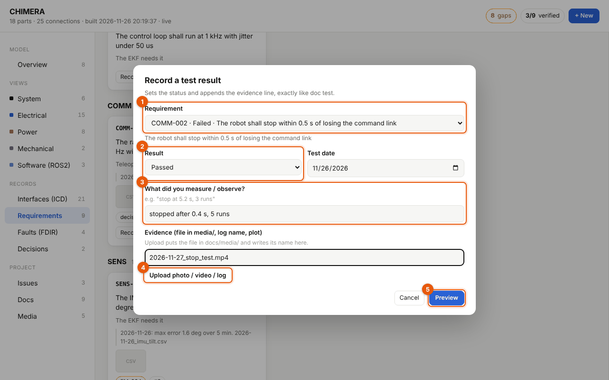

# doc-kit

**One live page for your robot: how it is built, what it must do, how it can
fail and what is proven. Built from the files you already keep, for hardware
and robotics projects.**


doc-kit reads your CubeMX `.ioc` files, your ROS2 and micro-ROS code, and a
plain-text record of requirements, faults and decisions in your repo, and turns
them into one interactive page:

- **See the whole robot.** Subsystems, wiring port to port, every pin and
  peripheral setting, the ROS2 graph, the interfaces between subsystems,
  requirements, faults, decisions, GitHub issues, docs and photos, all linked.
- **Record what happens, where it happens.** At the bench, on your phone:
  pick the requirement, Passed, what you measured, take the photo, *Write it*.
  Every change becomes a git commit.
- **Never out of date.** The page is rebuilt from your files. A pin renamed in
  CubeMX that your wiring still uses shows up in red and stops the commit,
  instead of leaving a wrong diagram.

It is a lightweight version of the systems engineering loop used in aerospace
(requirements, design decisions, FMEA, verification, interface control),
scaled down for one person or a small team. No AI and no guessing: the page
only shows what your files say, and only writes what you typed.

| | |
|---|---|
|  |  |
| Click a part: every pin, setting and link | Record a test, with the photo |
|  |  |
| A renamed pin shows up in red | Requirements with evidence and photos |

## Documentation

| Read | For |
|---|---|
| **[Using the page](docs/PAGE.md)** | the main guide: every view and form with annotated screenshots, and step-by-step workflows (first setup, a test from your phone, idea to verified requirement, a failing test, a pin changed in CubeMX, the weekly review) |
| [Using the terminal](docs/TERMINAL.md) | the same actions from a shell, the commands, keys and hooks, scripting and CI |
| [The handbook](docs/HANDBOOK.md) | the method: what each record is for, good and weak examples, how they connect, how to use the record afterwards, and how to describe your robot in the arch file |
| [examples/](examples/) | real output from two worked examples |

## Quick start

```bash
git clone https://github.com/sergeikuznev/doc-kit.git
python3 doc-kit/doc.py init /path/to/your/project
cd /path/to/your/project
alias doc='python3 "$(git rev-parse --show-toplevel)/tools/doc.py"'   # add to ~/.zshrc once
doc install-hook        # checks the wiring before each commit
doc model setup         # once: pick each board's .ioc and your ROS2 folders
doc serve               # the page, live, at http://127.0.0.1:8765
```

Then describe your modules and wiring in `docs/model/<name>_arch.sysml`
([how](docs/HANDBOOK.md#15-the-system-model)) and edit the subsystem lists in
`docs/README.md` and `.github/ISSUE_TEMPLATE/*.yml`.

**On your phone:** `doc serve` listens on this machine only. Share it with your
own devices through [Tailscale](https://tailscale.com): `tailscale serve --bg 8765`.
**For GitHub issues** on the page and the idea and bug forms: install the
[GitHub CLI](https://cli.github.com) and run `gh auth login`.
**No server?** `doc model` writes the same page as a file, `docs/system.html`, without the forms.

## The loop: Decide, Verify, Learn

Like FDIR (Fault Detection, Isolation and Recovery) names a loop of functions,
doc-kit implements a loop. Each stage has a trigger in your work:

| Stage | What it does | Trigger | On the page | Terminal |
|---|---|---|---|---|
| **Capture** | Record an idea or problem before it is lost | You notice something | + New → Idea / Bug | `doc idea`, `doc bug` |
| **Decide** | Choose between options and record why | You compare alternatives | + New → Decision | `doc decision` |
| **Commit** | Turn a choice into a measurable promise | You decide to build it | + New → Requirement | `doc req` |
| **Anticipate** | Plan how failures are detected and handled | You ask "what if it breaks?" | + New → Fault | `doc fault` |
| **Verify** | Prove the promise with evidence | You test it | Record test, with upload | `doc test` |
| **Learn** | Turn incidents and experience into rules | Something breaks, or the week ends | | `doc check`, `doc procedure`, `doc log` |

Around the loop: **Trace** (the page links faults, requirements, evidence,
parts and issues) and **Revise** (Edit, Mark deleted, Change status; every
requirement change is logged).

The core is **Decide, Verify, Learn**: reasons are recorded, claims are proven,
and mistakes turn into rules. That is what separates it from a notes folder.

## How it stays true

| Comes from | What | Written by |
|---|---|---|
| `.ioc` files | boards, peripherals, pins, settings, FreeRTOS tasks, clocks | CubeMX |
| ROS2 / micro-ROS code | nodes, topics, message types (the robot can be off) | you, in code |
| `docs/requirements.md`, `fdir.md`, `decisions/` | requirements, faults, decisions | the page or the terminal |
| `docs/model/<name>_arch.sysml` | subsystems, modules, wiring, which computer runs which node | you, in SysML v2 text |

The first three are facts: doc-kit regenerates `<name>_facts.sysml` from them
and you never edit it. The arch file is the one thing you write by hand, and
every line of it is checked against the facts. Anything a scanner cannot read
for certain (a topic name built at runtime) is listed as unknown, never
guessed. Layout is automatic: you never arrange a diagram.

## Why

Documentation written upfront becomes fiction; documentation written at the end
forgets *why* things were done. The habit that works is writing a little at the
moment something happens: a decision, a test, a near miss. doc-kit makes that a
30-second job, so it actually happens, and keeps a picture of the whole robot
that is never out of date. It builds on docs-as-code (plain text in git),
requirements traceability, and lightweight MBSE (one SysML v2 model with
generated views and interfaces, without the heavyweight tools).

## What it creates in your project

```
docs/
  README.md                 how the docs work + your subsystem list
  requirements.md           one section per subsystem, with test evidence
  fdir.md                   fault table
  devlog.md                 weekly log
  decisions/                one file per decision
  procedures/               procedures and the pre-power checklist
  icd/                      interface notes the wiring cannot show (message formats, timing);
                            the wired interfaces are generated on the page
  media/                    photos, videos, logs (shown in the system map)
  model/                    created by doc model setup: model.toml, <name>_arch.sysml (yours),
                            <name>_facts.sysml (generated)
  report.html, system.html  generated pages
.github/ISSUE_TEMPLATE/     Idea and Bug forms for the GitHub website
tools/doc.py                the tool
tools/docmodel.py, docmodel_page.html, docserve.py, vendor/   system map and server
tools/guides/               README and guides, shown in the page's Docs section
```

Everything is plain Markdown, so you can edit any file by hand and the tool keeps working.

## Customising

- **Subsystems for requirement IDs:** edit the `| Prefix | Subsystem |` table in
  `docs/README.md`. The tool reads it every time.
- **Subsystems for issues:** edit the `options:` list in `.github/ISSUE_TEMPLATE/idea.yml`
  and `bug.yml`. The page's forms and `doc idea` / `doc bug` read it too, so GitHub, the page and the terminal match.
- **Templates:** change the files in `docs/`; the tool only relies on the table headers.

## Using it in a team

The tool and templates live in the project repo, so teammates get them by
cloning. Run `doc serve` on one always-on machine and share it over Tailscale:
everyone uses the same live page, and every form becomes a commit under that
machine's git identity. Each person who also commits from their own clone runs
`doc install-hook` once (git hooks are not shared through the repo).

## Updating

Pull the latest doc-kit and run `python3 doc.py init /path/to/your/project` again.
It replaces everything in `tools/` and leaves all your existing docs untouched.
Then run `doc install-hook` once more if the new version added hooks.

## Requirements

- Python 3.8 or newer, git; `doc model` and `doc serve` need Python 3.11 or newer
- Optional: [GitHub CLI](https://cli.github.com) for `doc idea`, `doc bug` and issues in the system map
- Optional: [Tailscale](https://tailscale.com) to open `doc serve` from your phone and other devices
- macOS and Linux. Windows is untested (the commit hook needs a Unix shell).

## License

MIT, see [LICENSE](LICENSE). `vendor/elk.bundled.js` is
[ELK](https://github.com/kieler/elkjs) (Eclipse Public License 2.0), see `vendor/LICENSE-elkjs.md`.
