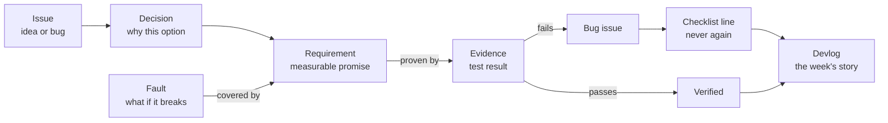

# The engineering record handbook

The [README](../README.md) explains how to run `doc`. This handbook explains the
thinking behind each record: what it is for, when to write one, what a good one
looks like, and how the records connect into one picture of your project.

Every example comes from the two worked projects in [examples/](../examples/):
the **power system** (choosing a battery) and the **odometry** feature.

**Contents**

1. [Why keep an engineering record](#1-why-keep-an-engineering-record)
2. [How the records connect](#2-how-the-records-connect)
3. [Issue: ideas and bugs](#3-issue-ideas-and-bugs)
4. [Decision](#4-decision)
5. [Requirement](#5-requirement)
6. [Fault (FDIR)](#6-fault-fdir)
7. [Verification and evidence](#7-verification-and-evidence)
8. [Interface (ICD)](#8-interface-icd)
9. [Procedure](#9-procedure)
10. [Checklist](#10-checklist)
11. [Devlog](#11-devlog)
12. [Changing things later](#12-changing-things-later)
13. [Common confusions](#13-common-confusions)
14. [Quick reference](#14-quick-reference)

---

## 1. Why keep an engineering record

A project's code and hardware show **what** you built. They never show **why**
it is that way, **what it must achieve**, **what happens when it breaks**, or
**how you know it works**. Those four answers are what the record holds:

| Question | Answered by |
|---|---|
| Why is it built this way? | Decisions |
| What must it achieve? | Requirements |
| What happens when it breaks? | Fault table (FDIR) |
| How do we know it works? | Verification evidence |
| What have we learned the hard way? | Checklist, procedures, devlog |

Six months later, you are a stranger to your own project. A teammate, a reviewer
or an interviewer is a stranger from day one. The record is written for them.

The rule that makes it work: **write each record at the moment something
happens**, in a few minutes, while the details are fresh. Not upfront, not at the end.

---

## 2. How the records connect

Each record is small. The value is in the links between them.

Three chains you will see again and again:

### Chain 1: a decision creates requirements

From [examples/power-system](../examples/power-system/docs/):

1. **Issue #12:** "The robot needs a battery for 30-minute test sessions."
2. **Decision 001:** *Use a 3S LiPo battery instead of NiMH.* NiMH is robust but
   twice as heavy; only LiPo fits 30 minutes into the 400 g mass budget. The
   downside: LiPo cells are destroyed if over-discharged.
3. The decision creates **two requirements**:
   - **PWR-001:** *The robot shall drive for at least 30 min on flat ground from
     one full battery charge.* This is the promise that justified choosing LiPo.
   - **PWR-002:** *The robot shall stop all motors within 1 s when any battery
     cell drops below 3.3 V under load.* This is the LiPo downside turned into a
     safety rule.

The decision says **why LiPo**. The requirements say **what LiPo must deliver,
and what must protect it**. When PWR-001 passes its test, the decision is proven right.

### Chain 2: a fault creates a requirement

1. You ask: *what if a cell over-discharges?*
2. **FM-001** in the fault table: detected by per-cell voltage from the balance
   lead; response: stop motors; recovery: recharge and inspect for swelling.
3. The response must be promised and tested, so it links to **PWR-002**.

Usually the fault comes first: failure analysis is where safety requirements
come from. A fault row with no linked requirement is a plan nobody has promised
or tested yet. The example deliberately leaves **FM-002** (brownout on motor
stall) unlinked, and `doc report` lists it under *Needs attention*.

### Chain 3: a failure becomes a lesson

1. **Test of PWR-001 fails:** only 22 minutes.
2. Cause: the pack was at storage charge (3.85 V per cell), not full.
3. **Checklist line:** *Battery packs balance-charged to 4.2 V/cell before every
   test session*, with the date and the reason.
4. **Retest:** 34, 33 and 35 minutes. PWR-001 is **Verified**; both results stay
   in the evidence column.
5. **Devlog:** one line on what broke and what changed.

The failed test is not deleted. It is the most useful part of the record.

---

## 3. Issue: ideas and bugs

**What:** a GitHub issue that captures an idea or a problem in 30 seconds so it
is not lost. Command: `doc idea`, `doc bug`.

**Write one when:** you think "we should..." or "that's wrong" and are not going
to act on it in the next few minutes.

**Don't write one for:** things you will fix right now. Just fix them.

| Weak | Strong |
|---|---|
| "Lidar" | **Title:** 3D lidar for tunnel mapping. **What:** replace the 2D lidar with a 3D one. **Why:** a 2D scan misses overhangs in tunnel ceilings. **Open question:** weight and power budget? |
| "Robot broken" | **What happened:** robot kept driving 10 s after the radio link was lost. **Expected:** stop within 1 s (COMM-004). **Steps:** manual radio mode, drive, switch off base station. |

**Connects to:** decisions and requirements mention the issue number (`#12`);
commits close it (`fixes #12`).

**Common mistakes:** treating issues as a to-do list for everything; writing
bugs without the expected behaviour, so nobody knows when it is fixed.

---

## 4. Decision

**What:** a short record of **why** you chose one option over others. Written
once, never edited. Command: `doc decision`.

**Write one when:**
- you compared two or more real options, or
- you hesitated, or someone could ask "why didn't you just...?", or
- the choice is expensive to undo (a part ordered, a protocol others depend on).

**Don't write one for:** trivial or easily reversed choices (a variable name,
which GPIO lights an LED).

**What makes it good:**

| Part | Weak | Strong |
|---|---|---|
| Title | "Battery" | "Use a 3S LiPo battery instead of NiMH" |
| Context | "We need a battery" | "Must drive 30 min; battery mass budget 400 g; motors draw up to 6 A on stall" |
| Options | Only the winner listed | NiMH **and** LiPo, each with honest pros and cons |
| Deciding factor | "LiPo is better" | "Only LiPo fits 30 min of driving into 400 g" |
| Consequences | (missing) | "Need a per-cell cutoff (PWR-002), a balance charger, fire-safe storage. Revisit if runtime needs grow" |

The **deciding factor** is the most valuable line: if it ever stops being true,
you know the decision should be revisited.

**Connects to:** the issue it came from (Related), the requirements it creates
(Consequences), and a newer decision that supersedes it.

**Common mistakes:** writing it weeks later and inventing a tidy story;
listing a rejected option with no pros (that is a justification, not a
comparison); editing an old decision instead of superseding it.

Full example: [decision 001](../examples/power-system/docs/decisions/001-use-a-3s-lipo-battery-instead-of-nimh.md).

---

## 5. Requirement

**What:** a measurable promise about what the system **shall** do, written so it
can be tested and end up Verified or Failed. Command: `doc req`.

**Write one when:** you commit to building something, or a decision or fault
needs a promise behind it.

**The form:** *The &lt;thing&gt; shall &lt;do what&gt; &lt;measurable limit&gt;.*

| Weak | Why it fails | Strong |
|---|---|---|
| "The battery should last long" | No number, nothing to test | "...drive for at least **30 min** on flat ground from one full charge" |
| "The robot must be safe on low battery" | What does safe mean? | "...stop all motors within **1 s** when any cell drops below **3.3 V** under load" |
| "Odometry must be accurate" | Accurate how? Under what conditions? | "...estimate position with less than **0.1 m** error after driving a **2 m** square" |
| "Use a LiPo battery" | That is a decision, not a requirement | (record it as decision 001) |

**Fields:**
- **ID:** subsystem prefix plus number (PWR-001). Never reused, never renumbered.
- **Rationale:** why it matters. Often "because of decision 001" or "covers FM-001".
- **Method:** how it will be verified: Test, Inspection, Analysis or Demonstration.
- **Status:** Draft → Approved → Verified or Failed. Deleted if dropped.

**Connects to:** decisions (why it exists), faults (what it protects against),
evidence (proof), and the change log (how it evolved).

**Common mistakes:** requirements with no number; requirements that describe a
design choice ("use X") instead of a result; marking something Verified with no
evidence.

---

## 6. Fault (FDIR)

**What:** one row per thing that can go wrong, planning how it is **detected**,
**isolated** and **recovered from**. FDIR stands for Fault Detection, Isolation
and Recovery. Command: `doc fault`.

**Write one when:** you ask "what if this breaks?" about a part, a link or a
power rail. Best done while designing, before it happens for real.

| Column | Question | Example (FM-001) |
|---|---|---|
| Failure | What fails? | Battery cell over-discharged |
| Effect | What does that do to the system or mission? | Permanent cell damage; pack may swell |
| Detection | How do we notice, automatically? | Per-cell voltage from the balance lead below threshold |
| Response | What makes it safe **right now**? | Stop motors, set low-battery flag |
| Recovery | How do we get back to normal? | Recharge on a balance charger; inspect for swelling |
| Severity | How bad? 1 annoying, 2 degraded, 3 mission lost, 4 hardware damage | 4 |
| Req | Which requirement promises this is handled? | PWR-002 |

**Response vs recovery:** the response stops the damage spreading and does not
fix the cause (stop the motors). Recovery returns to normal, automatically or by
a person (recharge, re-arm).

**Severity rules:**
- If the same cause has different effects depending on what fails (a loose wire
  that kills either the motor driver or a sensor), write **separate rows**, each
  with its own severity.
- If one row can lead to several outcomes, rate the **worst credible** one.

**A detection you cannot implement is not a detection.** "The operator notices"
is weak; "zero encoder ticks for 0.5 s while PWM is above 20%" is something you
can write in firmware.

**Common mistakes:** listing failures with no detection; confusing response with
recovery; leaving the Req column empty forever (see Chain 2).

---

## 7. Verification and evidence

**What:** proof that a requirement is met: what you measured, and where the
proof is stored. Command: `doc test ID`.

**Evidence has two parts:**
1. **The result:** "34, 33 and 35 min over 3 runs from a full balance charge."
2. **Where the proof is:** a video, a log file, a plot, a photo of the tape measure.

| Weak | Strong |
|---|---|
| "Works" | "Max 0.08 m error over 5 runs of a 2 m square. media/2026-11-26_odom_square.mp4" |
| "Tested, fine" | "Motors stopped at 3.29 V/cell, 0.4 s after crossing. logs/2026-11-26_cutoff_bench.mcap" |

**Verification methods:**
- **Test:** run it and measure (most common).
- **Inspection:** look at it (connector is the right type, label is present).
- **Analysis:** calculate or simulate (thermal margin, link budget).
- **Demonstration:** show it working without measuring a number.

**Keep failures.** A failed result stays in the evidence column next to the
later pass. It shows what went wrong and that it was fixed.

**Retest when:** the requirement's wording changes, the design under it changes,
or the evidence is older than a significant hardware change. `doc update` offers
to reset a Verified requirement when you reword it.

---

## 8. Interface (ICD)

**What:** an Interface Control Document: the contract between two parts that
must agree. A packet format, a pinout, a topic list, a UART protocol. Written
by hand in `docs/icd/`.

**Write one when:** two parts (or two teams, or two repositories) exchange data
or connect physically.

**What makes it good:** every field defined (bytes, types, units, meaning), a
version number, and a change log. **Change the ICD first, then the code on both sides.**

**Shared interfaces live in one place.** If two robots talk to the same base
station, the packet definition lives in the base station's repository and the
robots link to it, so there is never a second, drifting copy.

---

## 9. Procedure

**What:** numbered steps for something you would otherwise forget or do wrong.
Command: `doc procedure`.

**Write one when:** a task took you more than one attempt to get right, or a
mistake in it damages hardware (charging, flashing, calibrating, mounting).

**What makes it good:** one action per step, starting with a verb; a "you need"
list; warnings for anything that breaks if skipped.

Example: [charging a LiPo pack](../examples/power-system/docs/procedures/charging_a_lipo_pack.md).

---

## 10. Checklist

**What:** the pre-power checklist: short checks run before powering up after any
hardware change. Command: `doc check`.

**Write a line when:** something broke, or nearly did. Each line carries the
date and the reason in the history table, so nobody deletes it as "obvious".

| Checklist line | Procedure |
|---|---|
| One check, ticked every time | Several steps, followed when doing a specific task |
| "Packs balance-charged before every session" | "How to balance-charge a pack" |

**Common mistakes:** a checklist that never grows (then it is not learning);
lines with no reason (then they get removed).

---

## 11. Devlog

**What:** ten minutes a week: what was done, what broke or was learned, what is
next. Command: `doc log`.

**Why bother:** it is the most readable record of how the project evolved, and
it catches anything the other records missed.

**What makes it good:** mention IDs (decision 001, PWR-001) so entries link to
the details; put failures and lessons in, not only progress.

---

## 12. Changing things later

Projects change. The record should show how, not hide it.

| Situation | What to do | Command |
|---|---|---|
| A requirement's number turns out wrong | Change it; the old text goes in the change log; retest if it was Verified | `doc update ID` |
| A requirement is no longer needed | Mark it **Deleted** with a reason. Never reuse the ID | `doc update ID` |
| You change your mind about a decision | Write a **new** decision that supersedes the old one; the old one is marked "Superseded by NNN" | `doc decision` |
| A proposed decision is agreed | Change its status to Accepted | `doc update NNN` |
| A fault now has a requirement covering it | Fill in the Req column | `doc update FM-NNN` |

From the power-system example: PWR-002 was first written with a 3.0 V cutoff.
Under load, cell voltage sags, so 3.0 V left no margin. It was changed to 3.3 V,
and the change log keeps the old wording with the date.

---

## 13. Common confusions

**Decision or requirement?**
A decision is **why** you chose something; it is written once. A requirement is
**what** the system must achieve; it is tested. "Use LiPo" is a decision. "Drive
30 min" is a requirement. Decisions often create requirements.

**Fault row, bug issue or checklist line?**
- **Fault row:** planned in advance. *What could go wrong, and how is it handled?*
- **Bug issue:** it actually went wrong. *What happened, and what should have happened?*
- **Checklist line:** the lesson. *What do we check so it never happens again?*

One incident can create all three.

**Response or recovery?**
Response makes it safe now and does not fix the cause. Recovery gets back to normal.

**Which comes first, fault or requirement?**
Usually the fault: you spot the failure, plan the response, then promise it as
a requirement. If the requirement already exists, link to it.

**What counts as evidence?**
A measured result plus a file someone else can look at. "It works" is not evidence.

**When does a Verified requirement need retesting?**
When its wording changes, when the design under it changes, or when the evidence
predates a significant hardware change.

**Edit or supersede?**
Requirements are edited (with a change log). Decisions are superseded, never edited.

**Is this worth a decision record?**
If someone could reasonably ask "why didn't you just...?", yes. If it is trivial
or undone in a minute, no.

**Procedure or checklist?**
A procedure is how to do a task. A checklist is what to check every time.

---

## 14. Quick reference

| When this happens | Write | Command |
|---|---|---|
| You get an idea | Issue | `doc idea` |
| Something behaves wrong | Bug issue | `doc bug` |
| You choose between options | Decision | `doc decision` |
| You commit to building something | Requirement | `doc req` |
| You ask "what if it breaks?" | Fault row | `doc fault` |
| You test a requirement | Evidence | `doc test ID` |
| You do a task with steps you'd forget | Procedure | `doc procedure` |
| Something breaks or nearly breaks | Checklist line | `doc check` |
| Something written earlier changes | Update | `doc update` |
| End of the week | Devlog entry | `doc log` |
| You want the big picture | Status report | `doc report` |
