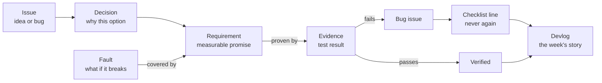

# The engineering record handbook

[Using the page](PAGE.md) explains how to use doc-kit (and
[TERMINAL.md](TERMINAL.md) the few setup commands). This handbook explains the thinking behind each record: what it is for, when to write one, what a good one
looks like, and how the records connect into one picture of your project.

Every example comes from the two worked projects in [examples/](../examples/):
the **power system** (choosing a battery) and the **odometry** feature.

**Contents**

1. [Why keep an engineering record](#1-why-keep-an-engineering-record)
2. [How the records connect](#2-how-the-records-connect)
3. [Issue: ideas and bugs](#3-issue-ideas-and-bugs)
4. [Decision](#4-decision)
5. [Requirement](#5-requirement)
6. [Fault (FDIR)](#6-fault-fdir)
7. [Verification and evidence](#7-verification-and-evidence)
8. [Interface (ICD)](#8-interface-icd)
9. [Procedure](#9-procedure)
10. [Checklist](#10-checklist)
11. [Devlog](#11-devlog)
12. [Changing things later](#12-changing-things-later)
13. [Common confusions](#13-common-confusions)
14. [Using the record](#14-using-the-record)
15. [The system model](#15-the-system-model)
16. [Quick reference](#16-quick-reference)

---

## 1. Why keep an engineering record

A project's code and hardware show **what** you built. They never show **why**
it is that way, **what it must achieve**, **what happens when it breaks**, or
**how you know it works**. Those four answers are what the record holds:

| Question | Answered by |
|---|---|
| Why is it built this way? | Decisions |
| What must it achieve? | Requirements |
| What happens when it breaks? | Fault table (FDIR) |
| How do we know it works? | Verification evidence |
| What have we learned the hard way? | Checklist, procedures, devlog |

Six months later, you are a stranger to your own project. A teammate, a reviewer
or an interviewer is a stranger from day one. The record is written for them.

The rule that makes it work: **write each record at the moment something
happens**, in a few minutes, while the details are fresh. Not upfront, not at the end.

- Upfront documents become fiction: they describe a system you have not built yet.
- End-of-project documents are incomplete: you remember what you chose, but not why.
- Event-driven documents are cheap and accurate: 2 to 5 minutes each.

An empty template is fine. It is a slot waiting for the moment it is needed.

---

## 2. How the records connect

Each record is small. The value is in the links between them.



An idea moves through four stages:

| Stage | Lives in | Means |
|---|---|---|
| Idea | Issue | Maybe. Cheap to write, cheap to reject. |
| Decision | Decision record | We compared options and chose one. |
| Requirement | `requirements.md` | We are doing it, and here is how we will know it works. |
| Done | Closed issue + evidence | Built, tested, proven. |

### One feature, start to finish

| Step | You do | You write |
|---|---|---|
| Idea | Notice the robot cannot tell how far it moved | Issue #3 "Odometry from encoders + IMU" |
| Decide | Compare encoders only vs. encoders fused with IMU | `decisions/001-fuse-encoders-and-imu.md` |
| Commit | Decide to build it | NAV-001 in `requirements.md` |
| Faults | Ask what happens if an encoder stops | FM-001 in `fdir.md` |
| Build | Write the code | `feat(nav): add odometry, fixes #3` |
| Test | Drive a square: 0.6 m error, loose connector | NAV-001 Failed + checklist line |
| Fix and retest | Secure connector: 0.08 m error | NAV-001 Verified, evidence added |
| Procedure | Calibration took an hour to figure out | `procedures/calibrating_the_imu.md` |
| Week ends | | Devlog entry |

One feature touched every document, a few minutes each, with no separate
documentation day. See [../examples/](../examples/) for the resulting files.

Three chains you will see again and again:

### Chain 1: a decision creates requirements

From [examples/power-system](../examples/power-system/docs/):

1. **Issue #12:** "The robot needs a battery for 30-minute test sessions."
2. **Decision 001:** *Use a 3S LiPo battery instead of NiMH.* NiMH is robust but
   twice as heavy; only LiPo fits 30 minutes into the 400 g mass budget. The
   downside: LiPo cells are destroyed if over-discharged.
3. The decision creates **two requirements**:
   - **PWR-001:** *The robot shall drive for at least 30 min on flat ground from
     one full battery charge.* This is the promise that justified choosing LiPo.
   - **PWR-002:** *The robot shall stop all motors within 1 s when any battery
     cell drops below 3.3 V under load.* This is the LiPo downside turned into a
     safety rule.

The decision says **why LiPo**. The requirements say **what LiPo must deliver,
and what must protect it**. When PWR-001 passes its test, the decision is proven right.

### Chain 2: a fault creates a requirement

1. You ask: *what if a cell over-discharges?*
2. **FM-001** in the fault table: detected by per-cell voltage from the balance
   lead; response: stop motors; recovery: recharge and inspect for swelling.
3. The response must be promised and tested, so it links to **PWR-002**.

Usually the fault comes first: failure analysis is where safety requirements
come from. A fault row with no linked requirement is a plan nobody has promised
or tested yet. The example deliberately leaves **FM-002** (brownout on motor
stall) unlinked, and the page lists it under *Gaps*.

### Chain 3: a failure becomes a lesson

1. **Test of PWR-001 fails:** only 22 minutes.
2. Cause: the pack was at storage charge (3.85 V per cell), not full.
3. **Checklist line:** *Battery packs balance-charged to 4.2 V/cell before every
   test session*, with the date and the reason.
4. **Retest:** 34, 33 and 35 minutes. PWR-001 is **Verified**; both results stay
   in the evidence column.
5. **Devlog:** one line on what broke and what changed.

The failed test is not deleted. It is the most useful part of the record.

---

## 3. Issue: ideas and bugs

**What:** a GitHub issue that captures an idea or a problem in 30 seconds so it
is not lost. Write it: **+ New → Idea / Bug** on the page.

**Write one when:** you think "we should..." or "that's wrong" and are not going
to act on it in the next few minutes.

**Don't write one for:** things you will fix right now. Just fix them.

| Weak | Strong |
|---|---|
| "Lidar" | **Title:** 3D lidar for tunnel mapping. **What:** replace the 2D lidar with a 3D one. **Why:** a 2D scan misses overhangs in tunnel ceilings. **Open question:** weight and power budget? |
| "Robot broken" | **What happened:** robot kept driving 10 s after the radio link was lost. **Expected:** stop within 1 s (COMM-004). **Steps:** manual radio mode, drive, switch off base station. |

**Connects to:** decisions and requirements mention the issue number (`#12`);
commits close it (`fixes #12`).

**Common mistakes:** treating issues as a to-do list for everything; writing
bugs without the expected behaviour, so nobody knows when it is fixed.

---

## 4. Decision

**What:** a short record of **why** you chose one option over others. Written
once, never edited. Write it: **+ New → Decision**.

**Write one when:**
- you compared two or more real options, or
- you hesitated, or someone could ask "why didn't you just...?", or
- the choice is expensive to undo (a part ordered, a protocol others depend on).

**Don't write one for:** trivial or easily reversed choices (a variable name,
which GPIO lights an LED).

**What makes it good:**

| Part | Weak | Strong |
|---|---|---|
| Title | "Battery" | "Use a 3S LiPo battery instead of NiMH" |
| Context | "We need a battery" | "Must drive 30 min; battery mass budget 400 g; motors draw up to 6 A on stall" |
| Options | Only the winner listed | NiMH **and** LiPo, each with honest pros and cons |
| Deciding factor | "LiPo is better" | "Only LiPo fits 30 min of driving into 400 g" |
| Consequences | (missing) | "Need a per-cell cutoff (PWR-002), a balance charger, fire-safe storage. Revisit if runtime needs grow" |

The **deciding factor** is the most valuable line: if it ever stops being true,
you know the decision should be revisited.

**Connects to:** the issue it came from (Related), the requirements it creates
(Consequences), and a newer decision that supersedes it.

**Common mistakes:** writing it weeks later and inventing a tidy story;
listing a rejected option with no pros (that is a justification, not a
comparison); editing an old decision instead of superseding it.

Full example: [decision 001](../examples/power-system/docs/decisions/001-use-a-3s-lipo-battery-instead-of-nimh.md).

---

## 5. Requirement

**What:** a measurable promise about what the system **shall** do, written so it
can be tested and end up Verified or Failed. Write it: **+ New → Requirement**.

**Write one when:** you commit to building something, or a decision or fault
needs a promise behind it.

**The form:** *The &lt;thing&gt; shall &lt;do what&gt; &lt;measurable limit&gt;.*

| Weak | Why it fails | Strong |
|---|---|---|
| "The battery should last long" | No number, nothing to test | "...drive for at least **30 min** on flat ground from one full charge" |
| "The robot must be safe on low battery" | What does safe mean? | "...stop all motors within **1 s** when any cell drops below **3.3 V** under load" |
| "Odometry must be accurate" | Accurate how? Under what conditions? | "...estimate position with less than **0.1 m** error after driving a **2 m** square" |
| "Use a LiPo battery" | That is a decision, not a requirement | (record it as decision 001) |

**Fields:**
- **ID:** subsystem prefix plus number (PWR-001). Never reused, never renumbered.
- **Rationale:** why it matters. Often "because of decision 001" or "covers FM-001".
- **Method:** how it will be verified: Test, Inspection, Analysis or Demonstration.
- **Status:** Draft → Approved → Verified or Failed. Deleted if dropped.

**Connects to:** decisions (why it exists), faults (what it protects against),
evidence (proof), and the change log (how it evolved).

**Common mistakes:** requirements with no number; requirements that describe a
design choice ("use X") instead of a result; marking something Verified with no
evidence.

---

## 6. Fault (FDIR)

**What:** one row per thing that can go wrong, planning how it is **detected**,
**isolated** and **recovered from**. FDIR stands for Fault Detection, Isolation
and Recovery. Write it: **+ New → Fault**.

**Write one when:** you ask "what if this breaks?" about a part, a link or a
power rail. Best done while designing, before it happens for real.

| Column | Question | Example (FM-001) |
|---|---|---|
| Failure | What fails? | Battery cell over-discharged |
| Effect | What does that do to the system or mission? | Permanent cell damage; pack may swell |
| Detection | How do we notice, automatically? | Per-cell voltage from the balance lead below threshold |
| Response | What makes it safe **right now**? | Stop motors, set low-battery flag |
| Recovery | How do we get back to normal? | Recharge on a balance charger; inspect for swelling |
| Severity | How bad? 1 annoying, 2 degraded, 3 mission lost, 4 hardware damage | 4 |
| Req | Which requirement promises this is handled? | PWR-002 |

**Response vs recovery:** the response stops the damage spreading and does not
fix the cause (stop the motors). Recovery returns to normal, automatically or by
a person (recharge, re-arm).

**Severity rules:**
- If the same cause has different effects depending on what fails (a loose wire
  that kills either the motor driver or a sensor), write **separate rows**, each
  with its own severity.
- If one row can lead to several outcomes, rate the **worst credible** one.

**A detection you cannot implement is not a detection.** "The operator notices"
is weak; "zero encoder ticks for 0.5 s while PWM is above 20%" is something you
can write in firmware.

**Common mistakes:** listing failures with no detection; confusing response with
recovery; leaving the Req column empty forever (see Chain 2).

---

## 7. Verification and evidence

**What:** proof that a requirement is met: what you measured, and where the
proof is stored. Write it: **Record test** on the requirement (with the photo or log as an upload).

**Evidence has two parts:**
1. **The result:** "34, 33 and 35 min over 3 runs from a full balance charge."
2. **Where the proof is:** a video, a log file, a plot, a photo of the tape measure.

| Weak | Strong |
|---|---|
| "Works" | "Max 0.08 m error over 5 runs of a 2 m square. media/2026-11-26_odom_square.mp4" |
| "Tested, fine" | "Motors stopped at 3.29 V/cell, 0.4 s after crossing. logs/2026-11-26_cutoff_bench.mcap" |

**Verification methods:**
- **Test:** run it and measure (most common).
- **Inspection:** look at it (connector is the right type, label is present).
- **Analysis:** calculate or simulate (thermal margin, link budget).
- **Demonstration:** show it working without measuring a number.

**Keep failures.** A failed result stays in the evidence column next to the
later pass. It shows what went wrong and that it was fixed.

**Retest when:** the requirement's wording changes, the design under it changes,
or the evidence is older than a significant hardware change. Editing the text
of a Verified requirement offers to set it back to Approved for a retest.

---

## 8. Interface (ICD)

**What:** an Interface Control Document: the contract between two parts that
must agree. A packet format, a pinout, a topic list, a UART protocol. Written
by hand in `docs/icd/`.

**Write one when:** two parts (or two teams, or two repositories) exchange data
or connect physically.

**What makes it good:** every field defined (bytes, types, units, meaning), a
version number, and a change log. **Change the ICD first, then the code on both sides.**

**Shared interfaces live in one place.** If two robots talk to the same base
station, the packet definition lives in the base station's repository and the
robots link to it, so there is never a second, drifting copy.

---

## 9. Procedure

**What:** numbered steps for something you would otherwise forget or do wrong.
Write it: **+ New → Procedure**.

**Write one when:** a task took you more than one attempt to get right, or a
mistake in it damages hardware (charging, flashing, calibrating, mounting).

**What makes it good:** one action per step, starting with a verb; a "you need"
list; warnings for anything that breaks if skipped.

Example: [charging a LiPo pack](../examples/power-system/docs/procedures/charging_a_lipo_pack.md).

---

## 10. Checklist

**What:** the pre-power checklist: short checks run before powering up after any
hardware change. Write it: **+ New → Checklist line**.

**Write a line when:** something broke, or nearly did. Each line carries the
date and the reason in the history table, so nobody deletes it as "obvious".

| Checklist line | Procedure |
|---|---|
| One check, ticked every time | Several steps, followed when doing a specific task |
| "Packs balance-charged before every session" | "How to balance-charge a pack" |

**Common mistakes:** a checklist that never grows (then it is not learning);
lines with no reason (then they get removed).

---

## 11. Devlog

**What:** ten minutes a week: what was done, what broke or was learned, what is
next. Write it: **+ New → Devlog**.

**Why bother:** it is the most readable record of how the project evolved, and
it catches anything the other records missed.

**What makes it good:** mention IDs (decision 001, PWR-001) so entries link to
the details; put failures and lessons in, not only progress.

---

## 12. Changing things later

Projects change. The record should show how, not hide it.

| Situation | What to do | On the page |
|---|---|---|
| A requirement's number turns out wrong | Change it; the old text goes in the change log; retest if it was Verified | Edit |
| A requirement is no longer needed | Mark it **Deleted** with a reason. Never reuse the ID | Mark deleted |
| You change your mind about a decision | Write a **new** decision that supersedes the old one; the old one is marked "Superseded by NNN" | + New → Decision, "Replaces" |
| A proposed decision is agreed | Change its status to Accepted | Change status |
| A fault now has a requirement covering it | Fill in the Req column | Edit on the fault |
| A subsystem is renamed | Change its name; its prefix stays, because requirement IDs never change | Setup → Edit |

From the power-system example: PWR-002 was first written with a 3.0 V cutoff.
Under load, cell voltage sags, so 3.0 V left no margin. It was changed to 3.3 V,
and the change log keeps the old wording with the date.

---

## 13. Common confusions

**Decision or requirement?**
A decision is **why** you chose something; it is written once. A requirement is
**what** the system must achieve; it is tested. "Use LiPo" is a decision. "Drive
30 min" is a requirement. Decisions often create requirements.

**Fault row, bug issue or checklist line?**
- **Fault row:** planned in advance. *What could go wrong, and how is it handled?*
- **Bug issue:** it actually went wrong. *What happened, and what should have happened?*
- **Checklist line:** the lesson. *What do we check so it never happens again?*

One incident can create all three.

**Response or recovery?**
Response makes it safe now and does not fix the cause. Recovery gets back to normal.

**Which comes first, fault or requirement?**
Usually the fault: you spot the failure, plan the response, then promise it as
a requirement. If the requirement already exists, link to it.

**What counts as evidence?**
A measured result plus a file someone else can look at. "It works" is not evidence.

**When does a Verified requirement need retesting?**
When its wording changes, when the design under it changes, or when the evidence
predates a significant hardware change.

**Edit or supersede?**
Requirements are edited (with a change log). Decisions are superseded, never edited.

**Is this worth a decision record?**
If someone could reasonably ask "why didn't you just...?", yes. If it is trivial
or undone in a minute, no.

**Procedure or checklist?**
A procedure is how to do a task. A checklist is what to check every time.

---

## 14. Using the record

Writing records only pays off if they are read again. These are the moments
they get used, and what to open in each.

### Every time you power up: the checklist

Before powering the robot after any hardware change, open
`docs/procedures/pre_power_checklist.md` and tick through it. This is the one
record you use every session. If it saved you from a mistake, it worked.

### Every time you do a known task: the procedure

Before charging, flashing, calibrating or mounting something, open its procedure
and follow the steps instead of remembering. If a step was wrong or missing,
fix the procedure right then.

### Every week: the review

At the end of the week (10-15 minutes):

1. Open the page: **Overview** (problems must be zero, then the gaps),
   **Requirements → Failed** and **Approved** (not yet tested), warnings on **Faults**.
2. Turn each item you will act on into an issue (+ New → Idea) or plan the test.
3. Write the devlog entry (**+ New → Devlog**): what was done, what broke, what is next.

That list is your to-do list for the next week, generated from the record
instead of from memory.

### Before you start building something: check what is already promised

Before touching a subsystem, read its section in `requirements.md` and the
decisions related to it. Changing the battery wiring? Check PWR-002 first: you
are about to touch the thing that protects the cells. If your change affects a
Verified requirement, plan to retest it.

### When something breaks: debugging

1. **Fault table:** is this failure already planned for? If yes, did the
   detection and response actually happen? If not, that is a bug in the
   protection, not only in the part.
2. **Evidence and logs:** the last passing test tells you the setup that worked
   (`logs/...mcap`, firmware commit). Compare it with today's.
3. **Devlog and change log:** what changed since it last worked?
4. **Git history:** find when a record or file changed:
   ```bash
   git log -S "3.3 V" -- docs/          # when did this text appear or disappear?
   git log --oneline -- docs/fdir.md    # every change to the fault table
   ```
5. Afterwards: a bug issue, a checklist line if it can recur, and a new fault
   row if it was a failure nobody had planned for.

### When a decision's reason changes: revisit it

Each decision has a **deciding factor**. When that fact changes (the mass budget
grows, a part is discontinued, the requirement moves), the decision is due for a
second look. Search for it:

```bash
grep -ril "mass budget" docs/decisions/
```

If you choose differently, write a new decision that supersedes the old one, and
update the requirements it created.

### When someone new joins: onboarding

Point them to, in this order:

1. The page: **System**, then a subsystem's panel, then **Requirements**.
2. `docs/decisions/`: why things are the way they are. Reading these saves weeks
   of "why didn't you just...?" conversations.
3. `requirements.md`: what the robot must do and what is proven.
4. The pre-power checklist and procedures, before they touch hardware.

### At a design review: the agenda

For a supervisor meeting, a competition design review or a sponsor update, the
record is the material:

| Review question | Show |
|---|---|
| What does the system need to do? | Requirements, per subsystem |
| Why this design? | Decisions with their options and deciding factors |
| What happens when it fails? | The fault table and which requirements cover it |
| How do you know it works? | Verified requirements and their evidence |
| What is still open? | The *Gaps* on the page, or *Needs attention* in `doc report` |

### When you start the next robot: reuse

A new project does not start from zero:

- **Checklist:** copy the lines that apply. They are lessons already paid for.
- **Procedures:** charging, flashing and calibration rarely change between robots.
- **Requirements:** use the old ones as a starting list. Keep, adjust the numbers,
  or drop each one, and record why.
- **Fault table:** the same parts fail the same ways. Start from the old rows.
- **Decisions:** do not copy them. Re-decide with the new constraints, and link
  the old decision as context.

### For your portfolio, CV and interviews

The record is evidence of how you work, not only what you built:

- A decision with real options and a deciding factor shows engineering judgement.
- A requirement that **failed**, was fixed and then verified shows honest testing.
- A fault table shows you think about failure before it happens.
- The status page is a one-glance summary for a reviewer.

In an interview, "the runtime requirement failed at 22 minutes because the pack
was at storage charge; we added a checklist line and it passed at 34 minutes"
is a stronger answer than "it worked". The record is what lets you tell that
story accurately months later.

### For reports and theses

A thesis chapter or a project report follows the same structure as the record:
requirements, design decisions, failure analysis, verification. Write it from
the record instead of from memory, and cite the evidence files for every claim.


## 15. The system model

The record answers *what we decided and whether it works*. The system model
answers *what the robot is made of and how the pieces connect*, across
electrical, power, mechanical and ROS2, in one place.

### Facts and architecture

Two kinds of information, kept apart on purpose:

- **Facts** are already written down somewhere else: pins and peripheral
  settings in the `.ioc`, topics in the ROS2 code, requirements and faults in
  `docs/`. doc-kit reads them on every build and writes
  `docs/model/<name>_facts.sysml`. Nobody edits that file; change the source instead.
- **Architecture** is what only you know: that the nRF24 sits on SPI1, that the
  radio belongs to COMM, that the EKF runs on the Pi. You enter it on the page
  (Setup, and **Edit** in the diagrams), and the page keeps it in
  `docs/model/model.toml` and `docs/model/<name>_arch.sysml`.

The facts say SPI1 exists on PA5 to PA7 at 3.75 Mbit/s. Only the architecture
can say what is plugged into it.

### Subsystems

Subsystems are the boxes of the system diagram and the prefixes of requirement
IDs: every `PWR-###` requirement lands in `PWR` without any extra step, and
faults land where their covering requirement lands. A subsystem can also be
*requirements only* (no box), for requirements about the whole robot (`SYS`)
or about fault handling (`FDIR`).

Group them the way the robot comes apart:

- **One chassis**: by function. `CTRL` (the MCU and what is wired to it),
  `COMP` (the onboard computer), `COMM` (radios), `DRIVE` (drivers, motors),
  `PWR` (battery, regulators).
- **Several assemblies**, each with its own MCU (a base and an arm): by
  assembly, `BASE` and `ARM`. The base ↔ arm link then becomes an interface in
  the generated ICD, which is exactly what you want to agree on between them.

A prefix is permanent once a requirement uses it; the name can change any time.

### Boards, parts, ports, wires

- **A board** is a microcontroller with a CubeMX project. It points at its own
  `.ioc` file; its ports are read from there: one per peripheral (`spi1`,
  `tim3`, `usb_otg_fs`) and one per labelled GPIO (`nrf24_csn`), each with its
  pins and saved settings. Several `.ioc` files in one folder are never guessed
  between.
- **A part** is anything else: a module, sensor, driver, battery, computer.
  You give it ports.
- **A port type** says what a port carries, and so which view shows it:
  Signal (SPI, I²C, UART, GPIO, …), Power or Mechanical. A wire joins two
  ports of the same type. Make your own types (`Power5V`, `MotorMount`) when
  the check should be stricter.
- **A wire** (`connect` in the file) joins two ports.
- **Runs on** (`allocate`) says which computer or board runs a ROS node.
- **Pinned to** (`satisfy`) ties a requirement to one part instead of its whole subsystem.
- **Decisions** link to parts by naming them on their Related line
  (`**Related:** PWR-001, battery`).

### What the file looks like

You do not need to read or write it, but it is plain text, so here is what a
diff in a pull request looks like. SysML v2 textual notation, a small subset:

```
package ROVER_arch {
    private import ROVER_facts::*;

    port def PowerRail :> Power;                  // a port type of your own

    part rover {                                  // the robot
        part CTRL {
            part mcu : STM32_ROBOT;               // a board: ports from its .ioc
        }
        part COMM {
            part radio {
                doc /* nRF24L01+ 2.4 GHz radio */
                port spi : ~SpiBus;               // ~ = the mirror end; the page sets it
                port csn : ~GpioOut;
                port vcc : ~PowerRail;
            }
        }

        connect CTRL.mcu.spi1 to COMM.radio.spi;
        connect CTRL.mcu.nrf24_csn to COMM.radio.csn;
    }

    allocate ROS::rover_ekf to rover.CTRL.pi;     // which computer runs a node
    satisfy 'PWR-002' by rover.PWR.battery;       // a requirement owned by one part
}
```

The page rewrites this file in one fixed layout on every change. Hand edits
are allowed and checked the same way, but `//` comments do not survive the next
page edit. Files written by earlier doc-kit versions, with `part def` types of
their own, keep working: such parts get their ports from their type.

### What the check catches

The page, `doc model --check` and the pre-commit hook stop on: a wire to a port
that is not in the facts (pin renamed or removed in CubeMX), mismatched types
(an SPI bus wired to a GPIO), an unknown part type, a node allocated to a part
that does not exist, a pin for a requirement that does not exist, one topic used
with two message types. Broken wires are drawn red and dashed instead of
disappearing, and every page edit previews the problems it adds or fixes.

Gaps are not errors, they are review questions: a subsystem with no
requirements or no fault analysed, a fault no requirement covers, a topic
nobody subscribes to, a ROS node not allocated to any computer, a part with
nothing connected, a board not placed in any subsystem.

### Seeing it

Every view, panel and form is explained with screenshots in
[Using the page](PAGE.md): Setup in [section 3](PAGE.md#3-setup-subsystems-boards-code),
parts and wiring in [section 4](PAGE.md#4-building-the-robot-parts-and-wiring).

---

## 16. Quick reference

| When this happens | Write | On the page |
|---|---|---|
| You get an idea | Issue | + New → Idea |
| Something behaves wrong | Bug issue | + New → Bug |
| You choose between options | Decision | + New → Decision |
| You commit to building something | Requirement | + New → Requirement |
| You ask "what if it breaks?" | Fault row | + New → Fault |
| You test a requirement | Evidence | Record test |
| You do a task with steps you'd forget | Procedure | + New → Procedure |
| Something breaks or nearly breaks | Checklist line | + New → Checklist line |
| Something written earlier changes | Update | Edit, Mark deleted, Change status |
| End of the week | Devlog entry | + New → Devlog |
| You want the big picture | | Overview |
| You add a module or a wire | Part, wire | System views → Edit |
| A new board, subsystem or ROS2 folder | Setup entry | Setup |
| A pin or a topic changed in the code | nothing: the page rebuilds itself | (fix any red wire with Edit) |

### Habits

- **Close the loop:** when you close an issue, ask whether it created a decision,
  requirement or procedure. After `doc install-hook`, a commit with `fixes #N` reminds you.
- **Commit messages:** `type(area): what changed (#issue)`, with types
  `feat`, `fix`, `docs`, `refactor`, `chore`.
- **Names:** lowercase, underscores, no spaces. Media starts with the date.
- **Do not commit build outputs or large binaries:** use `.gitignore`, and GitHub
  Releases for files over a few MB.

- **Use what you wrote:** tick the checklist before every power-up, follow procedures
  instead of memory, and read the Overview during the weekly review. More in [chapter 14](#14-using-the-record).

### Start small

| Phase | Set up |
|---|---|
| Day one | Issues, decisions, procedures |
| When building safety-critical features | Requirements, fault table, ICDs |
| Every week from the start | Devlog |
| More than ~100 requirements, or a team with formal reviews | Consider a dedicated requirements tool such as StrictDoc or Doorstop |

### How this maps to industry

| Here | Small company | Aerospace / large company |
|---|---|---|
| GitHub Issues | Jira, Linear | Jira |
| `requirements.md` | Wiki or Markdown | DOORS, Jama, Polarion |
| Decision records | Markdown, Confluence | Trade studies, design review minutes |
| `fdir.md` | Spreadsheet | Formal FMEA/FMECA, reliability sign-off |
| Checklist entries | Bug tickets | Nonconformance reports |

The tools differ; the habits are the same: measurable requirements, recorded
reasons, planning for failure, and evidence for every claim.
