# Using the page

The page is how you use doc-kit. It shows the whole robot in one place (wiring,
software, requirements, faults, decisions, issues, docs, photos), and it is
where you change it: subsystems and boards, parts and wires, test results with
a photo, ideas, decisions, procedures. **Save** writes the change to plain
files in your repo, commits and pushes it; **↶ / ↷** undo and redo, any number of steps.

**Search** (top right, or **⌘K** / **Ctrl K** anywhere) finds parts, pins,
subsystems, ROS nodes and topics, requirements, faults, decisions, issues,
docs and views as you type; ↑ / ↓ and Enter open the one you want in its own
view, with its panel.

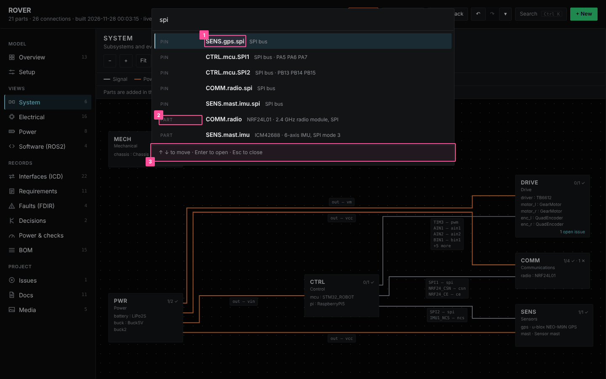

1. **A result**, here a pin; ↑ / ↓ moves through the list, Enter opens it.
2. **What it is**: pin, part, subsystem, node, topic, requirement, fault, decision, issue, doc or view.
3. **The keys**: ↑ ↓ to move, Enter to open, Esc to close.

The page follows your system's light or dark setting. Dark is a strict,
square "operations" look: black canvas, hairlines, monospace for IDs and
values, and colour only where it means something (cyan: selected, links and
MCUs; green: OK and add; red: problems and delete; amber: gaps and warnings;
grey: signal wires; orange: power; violet: ROS). Everything clickable shows a
pointing hand and lights up on hover; nothing else does.

- **Buttons.** An action lights up cyan as you point at it (text, border and a
  light cyan tint, like the selected item in the sidebar); an add button
  lights up green; Delete is red. Small controls (zoom − + Fit, switches)
  just brighten.
- **Blocks.** Buttons that belong together sit side by side in one block,
  each with its own border (add and edit; zoom; export; a filter or currency
  switch), a little apart from the next block. Delete always stands on its own.
- **Object links.** Names with a dotted underline are objects (parts, ports,
  subsystems, BOM items): click one to open it; the underline turns solid as
  you point at it.
- **Status badges** (Verified, Failed, Approved, Draft, Deleted) show an icon
  and the status in the status colour: a tick, a cross, a dot, an empty circle,
  a dash. The icon and the capitals are centred in the badge in any font (this
  uses CSS `text-box`, in Safari 18.2+ and Chrome 133+; older browsers centre
  the text approximately).
- **Dropdowns** are the page's own: ↑ / ↓, Enter and Esc work in them.

Concepts (what a requirement is, what makes a good fault row) are in the
[handbook](HANDBOOK.md). The few terminal commands (install, hooks, CI) are in
[TERMINAL.md](TERMINAL.md).

All screenshots come from a demo rover (dark theme, 1440 × 900): the `.ioc`
is real, the modules, wiring, ROS2 code and records are invented. The pink
numbered boxes on a screenshot match the numbered list under it.

**Contents**

1. [Opening the page](#1-opening-the-page)
2. [Finding your way around](#2-finding-your-way-around)
3. [Setup: subsystems, boards, code](#3-setup-subsystems-boards-code)
4. [Building the robot: parts and wiring](#4-building-the-robot-parts-and-wiring)
5. [The views](#5-the-views)
6. [The records](#6-the-records)
7. [Issues, docs and media](#7-issues-docs-and-media)
8. [Writing records](#8-writing-records)
9. [Staying up to date](#9-staying-up-to-date)
10. [When the wiring no longer matches the hardware](#10-when-the-wiring-no-longer-matches-the-hardware)
11. [Workflows](#11-workflows)
12. [On your phone](#12-on-your-phone)
13. [What the page will and will not do](#13-what-the-page-will-and-will-not-do)
14. [Running the server long-term](#14-running-the-server-long-term)

---

## 1. Opening the page

In your project (after `doc init`, see the [README](../README.md#quick-start)):

```bash
doc serve
```

It opens `http://127.0.0.1:8765` in your browser. Leave that terminal window open; Ctrl+C stops
the server. Options: `--port 8765`, `--interval 60` (seconds between GitHub
checks), `--no-push` (commit locally only), `--no-open` (don't open the browser).

**Why `127.0.0.1`?** It means only this computer can connect. The page can
commit and push to your repo and has no login, so it must not be open to
everyone on the Wi-Fi. **Why 8765?** Just a free port; any other works with `--port`.

**From your phone or another laptop**, share it through
[Tailscale](https://tailscale.com):

```bash
tailscale serve --bg 8765
```

It prints an address like `https://your-mac.tailXXXX.ts.net/`. Open that on any
device signed into your tailnet: your tailnet is the login.
`tailscale serve --https=443 off` stops sharing.

**Without a server**, `doc model` writes the same page to `docs/system.html`:
read-only, a snapshot of when you ran it.

---

## 2. Finding your way around

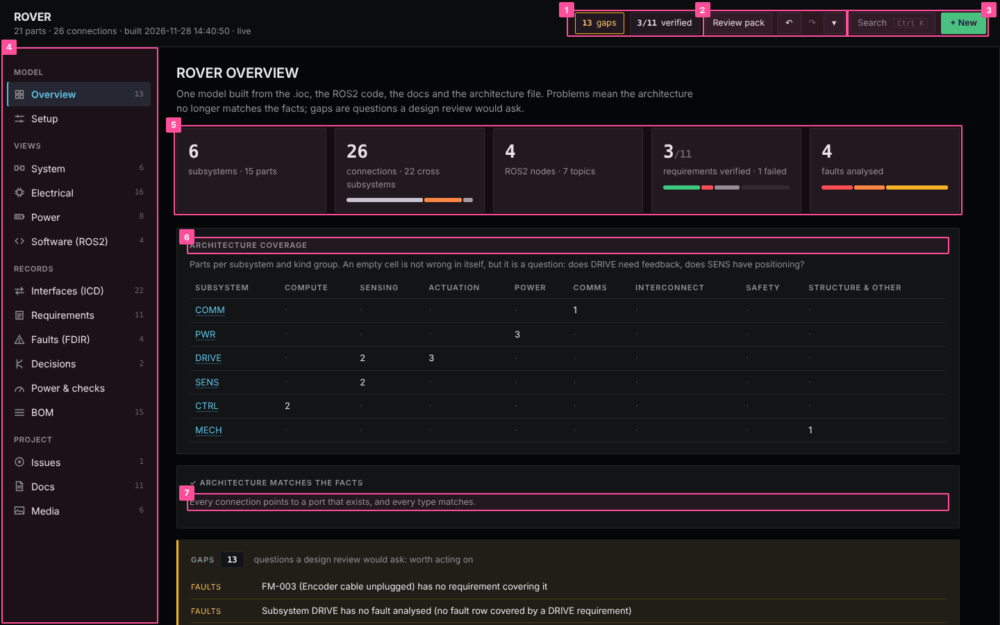

1. **Counters.** *Model problems* (red, when there are any), *gaps* (amber)
   and requirements *verified*. Click one to jump to what it counts.
2. **Review pack** (section 6) and **↶ ↷ ▾**: undo, redo and history (section 8).
3. **Search** (⌘K) and **+ New**, the forms for every record.
4. **Sidebar.** *Model* (Overview, Setup), *Views* (System, Electrical, Power,
   Software), *Records* (Interfaces, Requirements, Faults, Decisions, Power &
   checks, BOM), *Project* (Issues, Docs, Media). The grey number is how many
   items each holds.
5. **Tiles**: subsystems and parts, connections (the bar splits signal and
   power), ROS nodes and topics, requirements verified (and failed), faults by
   severity.
6. **Architecture coverage**: parts per subsystem and kind group (section 6).
7. **Problems**: everything the commit check would stop on. When the wiring is
   consistent it says *Architecture matches the facts*.

Below them, the **gaps**:

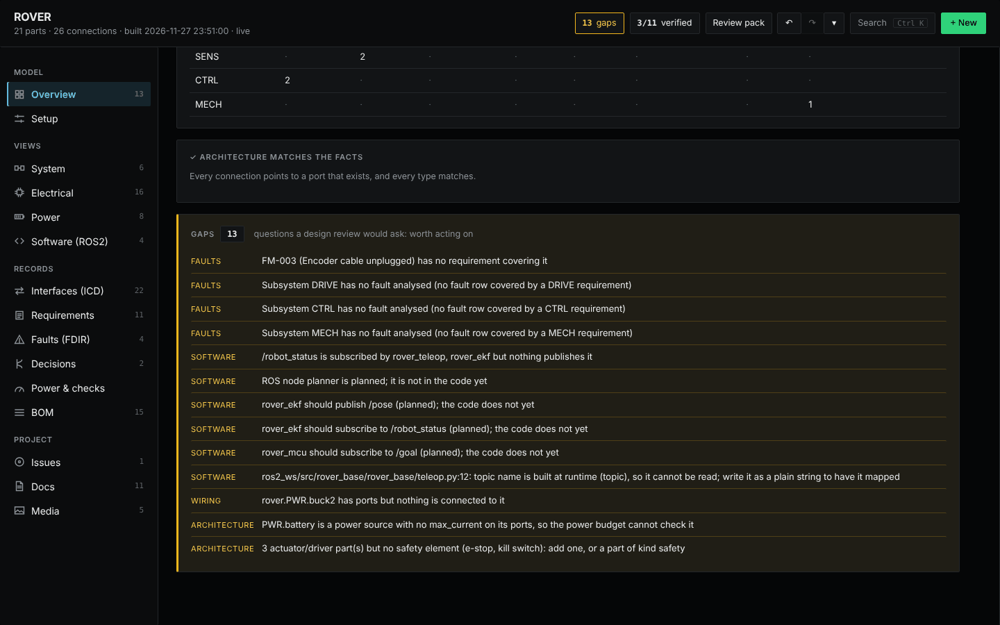

1. **Gaps**: how many, and what they are: the questions a design review would
   ask. They are not errors.
2. **Its area**: faults, software, wiring, power or architecture.
3. **A gap**, e.g. a fault no requirement covers. Click one that names a part to open it.
4. **An architecture check** (section 6), here: actuators but no safety element.

The page remembers where you are in its address (`#electrical/sel:...`), so a
bookmark or a reload brings you back to the same view with the same part open.

---

## 3. Setup: subsystems, boards, code

**Setup** (under *Model*) is where a new project starts. Nothing is filled in
for you: you add your own subsystems, point each board at its `.ioc` file, and
say where your ROS2 code is.

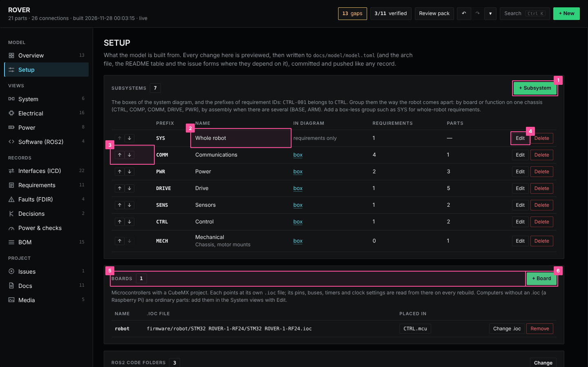

1. **+ Subsystem** adds one (below).
2. **A subsystem row**: prefix, name, whether it is a box in the diagram, how
   many requirements and parts it holds. A subsystem is a box in the system
   diagram *and* the prefix of requirement IDs: `COMM-002` belongs to `COMM`.
   *Requirements only* groups (here `SYS`, the whole robot) have no box.
3. **↑ ↓** set the order of the requirement sections and of the lists on the page.
4. **Edit / Delete.** A prefix that requirements already use cannot change
   (IDs never change); change the name instead. Deleting is refused while the
   subsystem holds parts or live requirements. One whose old, deleted
   requirements used its prefix is kept as *deleted*, so those IDs are never reused.
5. **Boards**: microcontrollers with a CubeMX project, each pointing at its own `.ioc`.
6. **+ Board** adds one (below).

Further down: **ROS2 code folders** (**Change**; scanned for nodes, publishers,
subscribers and launch files, the robot does not need to be on), then **Part
kinds** and the **Parts library**.

**Port types** live in the **Electrical** view (**+ Port type**, next to
**+ Part**): a port connects only to a port of the same type. The common ones
are built in (SPI, I²C, UART, USB, CAN, GPIO, PWM, encoder, analog, Ethernet,
WiFi, radio link, power, mechanical). Add your own when you want a check to
be stricter, e.g. `Power5V` so a 12 V output cannot be wired to a 5 V input.

### Part kinds

Every part has a kind: what it is in the architecture.

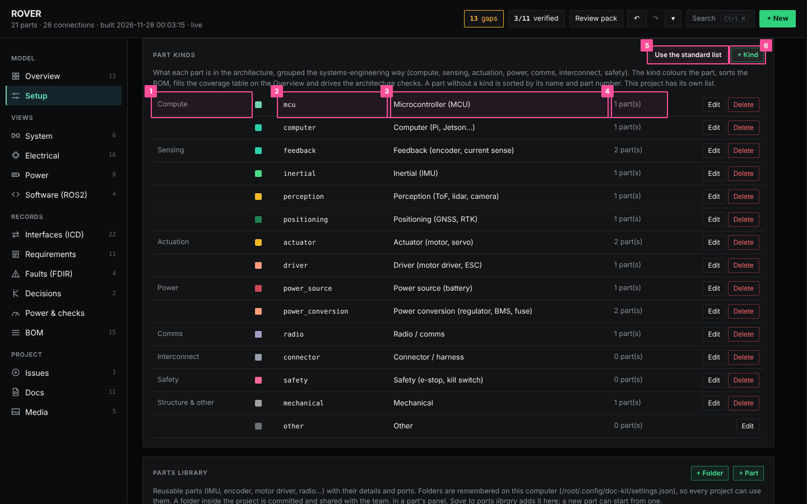

1. **A group**, from the systems-engineering list below.
2. **A kind**, with its colour: one colour family per group.
3. **What it means**, shown in the dropdowns.
4. **How many parts** have it.
5. **Use the standard list** goes back to the table below.
6. **+ Kind** adds one; **Edit** and **Delete** on each row rename (parts
   follow), regroup, recolour or remove it. *other* stays.

| Group | Kinds |
|---|---|
| Compute | MCU, computer |
| Sensing | feedback (encoder, current sense), inertial (IMU), perception (ToF, lidar, camera), positioning (GNSS, RTK) |
| Actuation | actuator (motor, servo), driver (motor driver, ESC) |
| Power | power source (battery), power conversion (regulator, BMS, fuse) |
| Comms | radio / comms |
| Interconnect | connector / harness |
| Safety | safety (e-stop, kill switch) |
| Structure & other | mechanical, other |

The kind colours the part's band in the diagrams, sorts the BOM, fills the
coverage table and drives the architecture checks (section 6). A part without
a kind is sorted by its name, type and part number: an encoder becomes
*feedback*, a buck *power conversion*, a board from an `.ioc` an *MCU*.
The list is saved in `model.toml` as `[[kind]]` rows.

### Parts library

Reusable parts (an IMU, an encoder, a motor driver, a radio) with their
details and ports, so you describe each module once and use it in every project.

- **+ Folder** adds a parts folder: type a path, pick one of your recent
  folders from the list, or **Browse…** to choose it in Finder (Explorer on
  Windows). The dialog opens on the computer running `doc serve`. The folder
  is created if it does not exist. A folder **inside the project** (e.g. `docs/model/parts`)
  is committed and shared with the team. A folder **outside** (e.g.
  `~/robotics/parts`, or its own git repo) serves all your projects on this
  computer; it is written but never committed. The folder list and the
  **default** folder are remembered per computer, in
  `~/.config/doc-kit/settings.json`.
- **Save to parts library** in a part's panel, or **+ Part** here, stores a
  part. Its **Folder** field takes any folder, typed or picked; a new one is
  created and remembered. **Edit** and **Delete** manage them here.
- A new part can **start from the parts library**: it fills in the
  description, details and ports.

### Choosing subsystems

Group them the way the robot comes apart.

| Robot | Subsystems |
|---|---|
| One chassis, one MCU and a computer | by function: `CTRL` (MCU and what is wired to it), `COMP` (Raspberry Pi), `COMM` (radios), `DRIVE` (drivers, motors), `PWR` (battery, regulators), plus `SYS` and `FDIR` as requirements only |
| Several assemblies (a base and an arm, each with its own MCU) | by assembly: `BASE`, `ARM`, `PWR`, `SW`, plus `SYS`, `FDIR`. The base ↔ arm link then shows up as an interface |

Two radios (LoRa on the MCU, WiFi on the Pi) both go in `COMM`: a subsystem
holds as many parts as you need.

### Adding a subsystem

**+ Subsystem** asks for a **Prefix** (2 to 6 capitals, e.g. `ARM`; it starts
every requirement ID of this subsystem), a **Name** below it with an optional
line on what is in it, and **Box in the system diagram** (untick for a
requirements-only group).

**Save** writes `docs/model/model.toml`, the arch file, the subsystem table in
`docs/README.md` and the subsystem list of the GitHub issue forms (so issue
labels match your subsystems), and commits them together.

### Adding a board

**+ Board** asks for:

- **Its .ioc file**, from every `.ioc` in the repo. Library samples
  (`micro_ros_stm32cubemx_utils/sample_project.ioc`) and legacy copies are
  marked; one already used by another board cannot be picked. Each board
  names its exact file, so several projects in one folder are never confused.
- **Short name**: the part's name in the diagram (`mcu`, `base_mcu`, `arm_mcu`).
- **The subsystem** it sits in.
- **Scan its Core/Src**: adds the folder to the ROS2 code folders, for micro-ROS firmware.

The board appears in its subsystem with every pin, bus, timer and clock
setting from the `.ioc`, and stays in step with CubeMX: change the `.ioc`, and
the page shows it on the next rebuild. A computer without an `.ioc` (a
Raspberry Pi, a laptop) is an ordinary part: add it in Electrical with
**+ Part** and kind *computer*.

---

## 4. Building the robot: parts and wiring

Parts are added in the **Electrical** view (**+ Part**); wires are drawn in
Electrical and Power. There is no separate edit mode: every part and every
port of the view's kind is drawn, connected or not.

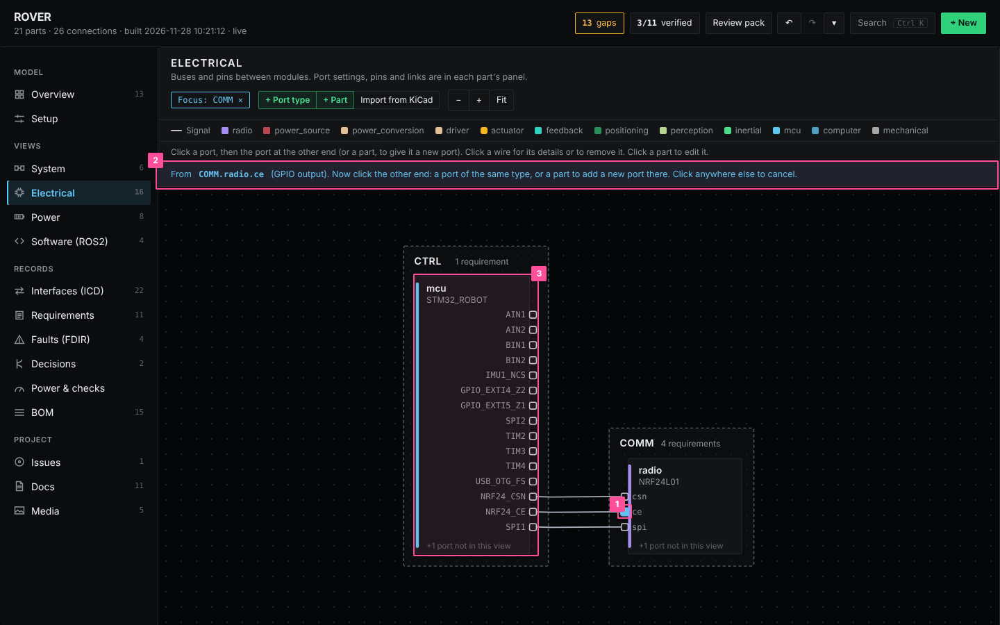

1. **Click a port** to start a wire: it lights up.
2. **The cyan bar** says what the next click does.
3. **Click the other end**: a port of the same type, or a part (it offers to
   give that part a new port of the right type). The connect form then shows
   **From**, **To part**, **Port** (its ports of the same type, or
   **+ new … port**) and the wire details, folded away.

Click empty space or press Esc to drop a picked port. A part cannot be wired to itself.

You never deal with port direction: doc-kit marks one end as the mirror of the
other (`~SpiBus` in the file) by itself. Several devices on one SPI bus are fine:
connect the same MCU port to each.

### Parts

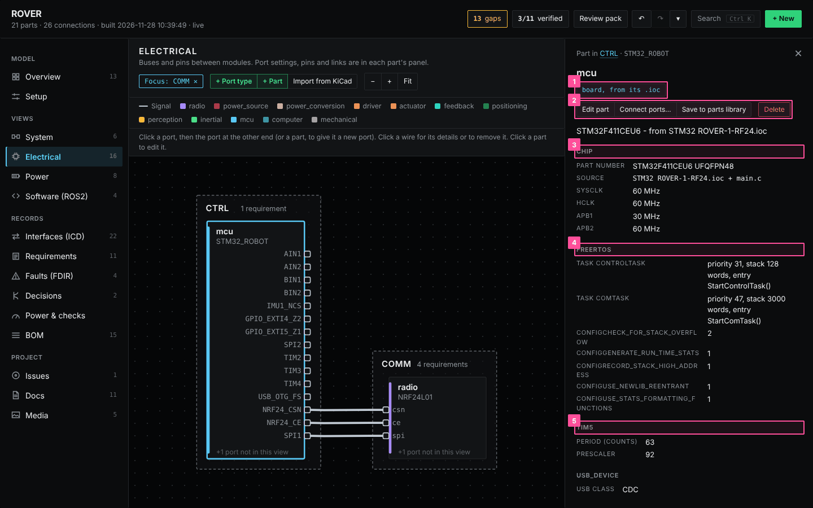

Click a part to open its panel. Anything with a dotted underline is an
object (a part, a port, a subsystem): click it to open it.

1. **Where it comes from**: a board, from its `.ioc`, or a part you added.
2. **Edit part**, **Connect ports…** (the Electrical view of its subsystem),
   **Save to parts library**, **Delete**. Only in Electrical.
3. **The chip**: part number, the `.ioc`, clock tree.
4. **Middleware**: FreeRTOS tasks with priority, stack and entry function.
5. **Internal peripherals**: timers, USB class and the like.

Further down: its ports (click a row for its pins and saved settings), what
each connects to (**✕** removes that connection, **wire** opens the wire's
details), and the requirements, faults, decisions, open issues and photos
that belong to the part.

**Settings come from two places.** The `.ioc` keeps only the values you
changed in CubeMX. The code CubeMX generates (`MX_SPI1_Init` and the like in
`Core/Src/main.c`, `spi.c`, `usart.c`…, next to the `.ioc`) writes every field,
defaults included, so doc-kit reads it too: clock polarity and phase, data
size, first bit, chip select, frame format, timer counting, channel pulses. A
value read from the code is tagged with its file (`main.c`); a speed worked
out from the APB clock and the prescaler is tagged *computed*. When neither
the `.ioc` nor the code has a value it says *CubeMX default*, never guessed.
Regenerate the code in CubeMX after changing the `.ioc`, and both stay in step. Settings are shown in plain words: speed, role, clock
polarity and phase, and derived facts such as *SPI mode 3*.

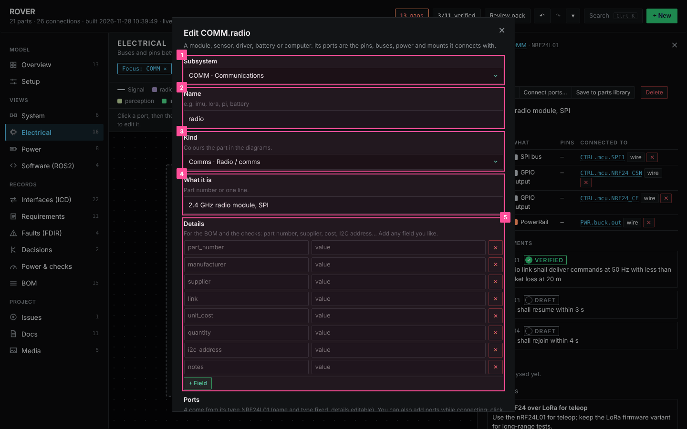

**+ Part** and **Edit part** open the same form:

1. **Subsystem**.
2. **Name**, below it.
3. **Kind** (section 3).
4. **What it is**: part number or one line.
5. **Details**: named fields with a value (below). **+ Field** adds any field.

Further down, **Ports**: a name and a type each, with **Details** for each
port. **+ Port** adds one; *Missing a type? Add one* opens the port type form
on top, and brings you back. Renaming a port keeps its wires; removing one
removes its wires. **Start from the parts library** (at the top, when the
library has parts) fills in everything.

Deleting a part removes its wires, and the links of requirements and ROS nodes
to it (you confirm first). Boards get their ports from the `.ioc`; for those,
the form edits the name, kind, description and details only. Parts cannot sit
inside other parts.

### Details: part numbers, voltages, addresses

Every part, port and wire can carry **details**: named fields with a value.
The forms suggest the common ones, and **+ Field** adds any field you like.

| On | Suggested fields | Used by |
|---|---|---|
| a part | part_number, manufacturer, supplier, link, unit_cost, quantity, i2c_address | BOM, I²C check |
| a power port | voltage, max_current (what it can supply), current (what it draws) | power budget, voltage check |
| an I²C port | address | I²C check |
| a wire | gauge, length, connector, cable, color | BOM, Interfaces |

In the part form, **Details** next to a port opens its fields. Ports that
come from a board's `.ioc` or a part's type keep their name and type, but take
details too (e.g. the MCU's power input).

### Import from KiCad

**Import from KiCad** (Electrical toolbar) turns a KiCad schematic into parts,
ports and wires, so you do not draw them twice.

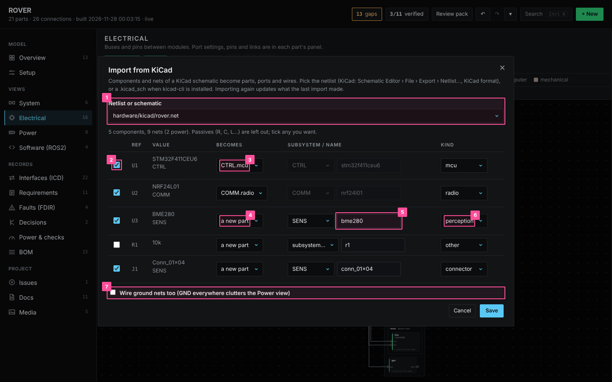

1. **The netlist or schematic** to read.
2. **Tick** a component to import it.
3. **Matched**: the board's MCU is matched to that board (and a part whose
   part number matches, to that part).
4. **Becomes** a new part, or a part already on the page.
5. **Subsystem and name** for a new part.
6. **Kind**, suggested from the component.
7. **Ground nets**: left out unless ticked.

Step by step:

1. **Pick the file.** A netlist exported from KiCad (Schematic Editor › File ›
   Export › Netlist…, *KiCad* format, saved in the repo), or the `.kicad_sch`
   itself when `kicad-cli` (KiCad 7+) is installed on the computer running
   `doc serve`.
2. **Check the components.** Each row is one symbol: tick it to import it,
   pick what it **becomes** (a new part in a subsystem, with a name and kind,
   or a part already on the page; a part whose part number matches is
   preselected, and the MCU of a board is matched to that board), and untick
   what you do not want. Resistors, capacitors, jumpers, test points and holes
   start unticked: they do not belong in the architecture. The name and kind
   are suggestions; a short name (`tof_left`, `pwr_in_3v3`) reads better in
   the diagrams than one built from the value.

   A connector that stands for something off the board (a motor plugged into
   `J1`, a battery into `J3`) can take that thing's kind (*actuator*,
   *power source*), so the architecture shows what is really there. Use one
   rule for all of them.
3. **Save.** What you get:
   - nets that reach a **board** pin are wired to that board's port from its
     `.ioc` (`SPI1_SCK`, `SPI1_MISO` and `SPI1_MOSI` to the radio become one
     `SPI1` wire); a board pin not set up in the `.ioc` is listed and left out;
   - **power nets** (`+5V`, `3V3`, `VBAT`, `VCC`…) become `PowerRail` ports with
     their voltage, shown in the Power view; **ground** is left out unless you
     tick it;
   - every other net becomes a port named after the net on each part, and a
     wire between them;
   - a connection you already drew by hand is kept and not doubled.

Imported ports and wires are marked (`kicad` in their details). **Importing
again** after the schematic changed replaces exactly those, so the page
follows the schematic; details you added to imported ports (voltage,
current…) are kept.

### Wires

Click a wire for its **wire details** (gauge, length, connector,
cable…) or to remove it. The connect form has the same fields, folded away.
In a part's panel, **wire** next to each connection opens them; the details
show under the connection, in the Interfaces table and in the BOM.

### Which computer runs a ROS node

In the **Software** view, **drag the node into a computer's box** (or click it,
then **Change** next to *Runs on*). Nodes that run nowhere yet are grouped
under *Not allocated to hardware*. A micro-ROS node whose source file sits
inside a board's folder (the folder of its `.ioc`) is placed on that board's
part by itself.

doc-kit also reads your **launch files** (`.launch.py`, `.launch.xml`) in the
ROS2 code folders. A node's panel shows which launch file starts it, with its
package, executable, remappings and parameters. A launch file runs on one
computer, so *Apply to: every node started by …* places all its nodes at once.

### Which part a requirement belongs to

A requirement belongs to the subsystem of its prefix. When one part carries it
(the battery for a runtime requirement), open the requirement and click
**Pin to a part**. Once it is pinned, the same button reads **Pin to other
parts**: pick different parts, or none to give it back to its subsystem. A
pinned requirement also counts on the box of the subsystem its part sits in.

### What gets written

Parts, ports, wires, allocations and pins are kept in
`docs/model/<name>_arch.sysml`, a SysML v2 text file the page writes in a fixed
layout: readable in a git diff, and checked against the facts on every build.
You never have to open it. Hand edits are fine, but the page rewrites the
layout (and drops `//` comments) on its next change.

---

## 5. The views

**Moving blocks.** In every view you can drag the outer boxes where you
want them (subsystem boxes in System, Electrical and Power; computers and
topics in Software) and the wires re-route. Parts inside a subsystem box move
with it, not on their own. The layout is saved per view in
`docs/model/layout.json` and committed (`doc: layout: …`), so the whole team
sees the same arrangement, and **↶** can undo a move. **Auto layout**
(toolbar, once something was moved) lets the page arrange the view again.

**Each thing is edited in its own view.** Parts are edited, connected,
deleted and saved to the parts library in **Electrical**; wires in
Electrical and Power; ROS nodes and topics in **Software**. Clicking a part
anywhere else shows it, without the editing buttons. The one shortcut kept:
**+ Part here** in a subsystem's panel.

**Zoom.** − / + / Fit in the toolbar. On a laptop, scroll to zoom and drag
empty space to pan. Clicking empty space closes the panel and drops the
selection.

### System

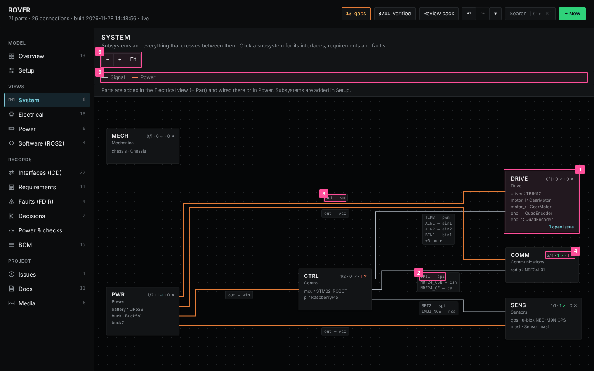

1. **A subsystem**, with the parts inside (`name · type`). Click it for its panel.
2. **A signal connection** crossing between subsystems, as `pin — pin` with
   the pin names as CubeMX writes them (`SPI1 — spi`), up to four per line,
   then *+N more*. No arrows: a wire carries data both ways.
3. **A power connection** (orange).
4. **Requirements** verified out of total, and how many failed. **N open
   issues** on a box opens Issues filtered to that subsystem.
5. **Legend.**
6. **Zoom**: − / + / Fit.

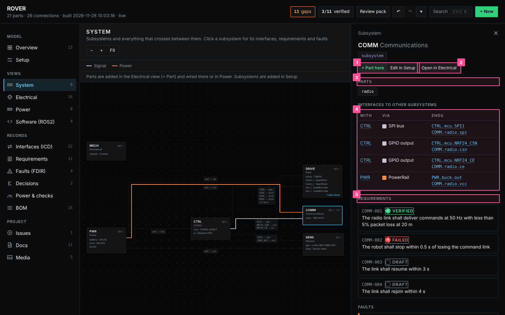

1. **+ Part here** and **Edit in Setup**.
2. **Open in Electrical**: only this subsystem and what it is wired to.
3. **Its parts.**
4. **Interfaces** to other subsystems, with both ends.
5. **Requirements** that belong here (every `COMM-###` lands in `COMM`), then
   faults, decisions and open issues.

### Electrical

Two views of the same parts, each showing only the ports of its kind:
signal buses and pins in Electrical, power in Power.


Here the view is focused on `COMM` (from its panel).

1. **Focus**: the view shows one subsystem and what it is wired to; **×** shows them all.
2. **+ Port type**, **+ Part**, **Import from KiCad**.
3. **Legend**: part kinds and their colours.
4. **The hint**: what clicks do.
5. **A board**, from its `.ioc` (cyan band: an MCU), inside its subsystem's dashed box.
6. **A port**: a pin or bus as CubeMX names it. Hover it for its pins.
7. **A part** you added; its band is the colour of its kind.
8. **Ports not in this view**, e.g. its power input, drawn in Power.

Hover a part to highlight its wires.

### Power

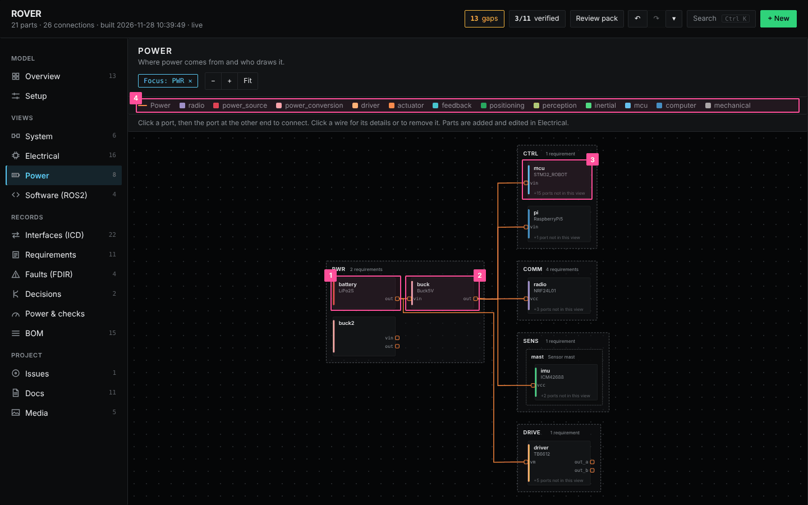

The same parts with only their **power ports**. Here focused on `PWR`.

1. **A source**: the battery's `out`.
2. **A regulator**: a load on its input rail and a source on its output rail.
3. **A load**: the MCU's supply input.
4. **Legend.**

- **Wire** a source to each device's input the same way as in Electrical:
  click one port, then the other.
- **Details** on a power port are what the power checks use: `voltage` on
  every port, `max_current` on a source (what it can supply), `current` on a
  load (what it draws). Set them in the part form (**Details** next to the
  port) or in the connect form.
- **Every group of wired power ports is a rail.** Its load against what is
  available, and any rail that is overloaded or mixes voltages, are in
  **Power & checks** and among the Overview's gaps.
- Enter a regulator's input draw by hand (output load ÷ efficiency, scaled by voltage).

A typical chain: `battery.out → buck.vin`, `buck.vout → mcu.vin`,
`buck.vout → radio.vcc`. Use your own port types (Electrical › **+ Port type**, e.g.
`Power5V`) to make the check stricter, so a 12 V output cannot be wired to a
5 V input.

### Software (ROS2)

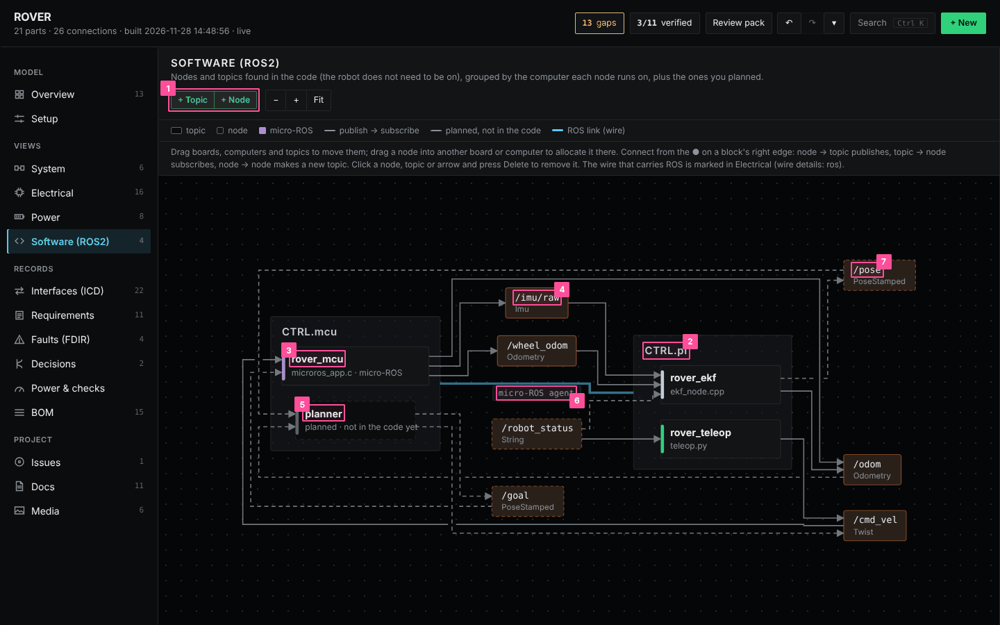

1. **+ Topic** and **+ Node** (planned, below).
2. **A computer**: an MCU or a computer part, with the nodes that run on it.
3. **A node**: its name and the file it was found in; violet band for
   micro-ROS. Click it for its topics with line numbers and its launch file.
4. **A topic** with its message type. Arrows go publisher → topic → subscriber.
5. **A planned node** (dashed): not in the code yet.
6. **The ROS link**: the wire that carries ROS between two computers.
7. **A planned topic** (dashed), or one with only one side.

Nodes no computer runs yet sit in *Not allocated to hardware* (a dashed box).
Where two arrows cross, the horizontal one has a small gap, so you can follow
each line through the crossing.

Everything solid is read from the code in the ROS2 code folders, so the robot
can be off. A topic name built at runtime (`'debug/' + name`) cannot be read
for certain, so it is listed as a gap instead of guessed.

#### Moving, connecting and deleting

- **Drag a computer or a topic** to move it. A node stays inside its
  computer: drag it into another computer to run it there (dropped anywhere
  else, it goes back).
- **Connect from the ● handle** on a block's right edge (it shows on hover):

| Drag the ● of | onto | does |
|---|---|---|
| a node | a topic | the node publishes that topic |
| a topic | a node | the node subscribes to it |
| a node | another node | **New topic** form: the first publishes, the second subscribes |

- **+ Topic** adds a topic on its own; connect it afterwards from its ●.
- **Click an arrow, a topic or a node, then press Delete** to remove it.
  Only planned things can be deleted here; something that is in the code
  says where it is (file and line), so you remove it there.
- A planned topic's panel has **Rename / change type** and **Delete**.
- The **ROS link** (cyan line between two computers) is a wire
  detail, set where wires live: in **Electrical**, click the wire (USB, UART,
  Ethernet…) and add the detail `ros` = `micro-ROS agent` (or `Ethernet`…).

#### Planning nodes and topics before the code

**+ Node** plans a node that does not exist yet: its name, what it does, where
it runs, and the topics it publishes and subscribes to. Planned nodes, topics
and arrows are **dashed** until doc-kit finds them in the code, then they turn
solid by themselves. In a node's panel, **Plan topics** / **Edit plan** changes
the plan and **✕** drops one planned topic.

The plan is kept in the arch file as SysML actions, next to the hardware:

```
action planner {
    doc /* plans a path to the goal */
    out item '/cmd_vel' : 'geometry_msgs/msg/Twist';
    in item '/odom' : 'nav_msgs/msg/Odometry';
}
```

Gaps (Overview) keep the plan and the code honest:

- a planned node that is not in the code yet;
- a planned topic a node does not publish or subscribe to in its code yet;
- a topic a node uses in its code that is not in its plan (only for nodes with a plan);
- micro-ROS topics travelling between two computers with no wire marked as
  their ROS link.

---

## 6. The records

Each record page has its own green **+** buttons under its title (**+ Requirement**
and **+ Test result**, **+ Fault**, **+ Decision**, **+ Connection**), the same
forms as **+ New**. Buttons that add something are green, buttons that remove
something are red.

### Interfaces (ICD)

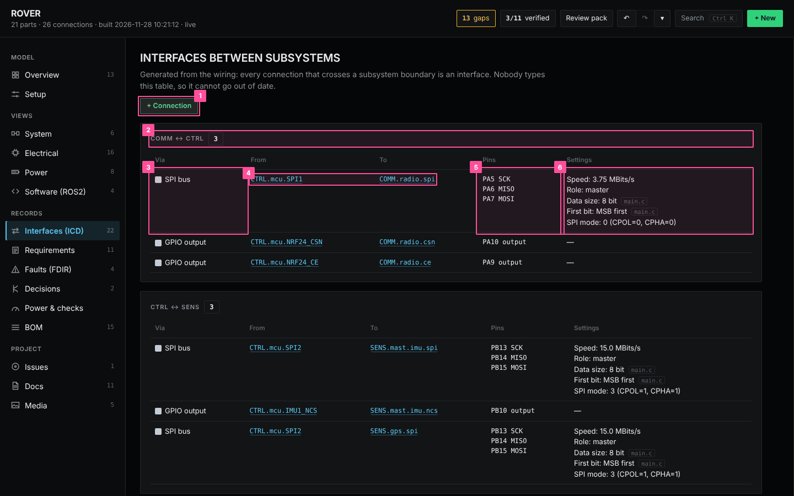

1. **+ Connection** opens the connect form.
2. **A pair of subsystems** and how many links cross between them.
3. **One link** and its kind.
4. **Both ends**. Click to open the part.
5. **Pins** on the MCU side.
6. **Bus settings** that matter at the interface: speed, role, SPI mode, data
   size, first bit, UART frame. A value tagged `main.c` was read from the
   generated init code, because the `.ioc` leaves defaults out (section 4).

Nobody types this table. It is generated from the wiring, so it cannot drift
from it.

### Requirements

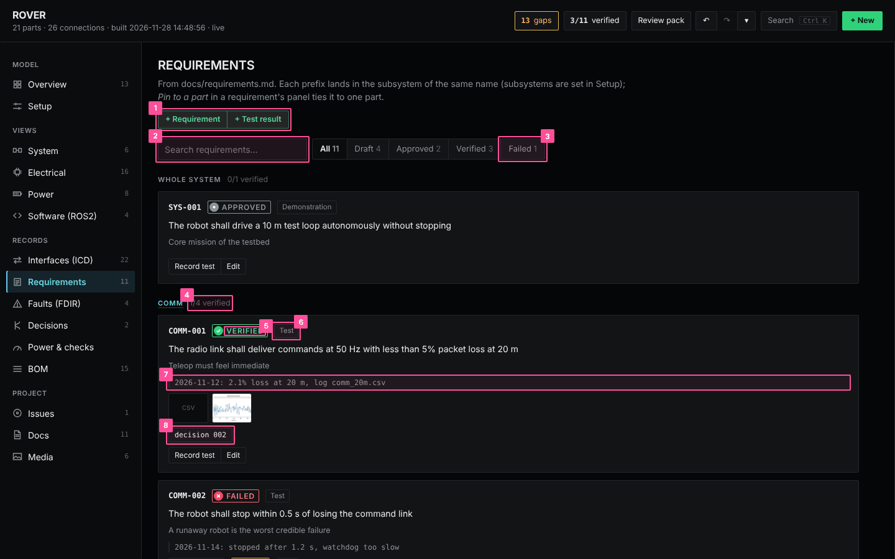

1. **+ Requirement** and **+ Test result**.
2. **Search** across IDs, text and rationale.
3. **Filter by status**, e.g. everything that failed.
4. **A subsystem group** with its progress.
5. **Status**: Draft, Approved, Verified, Failed or Deleted.
6. **How it is verified**: Test, Inspection, Analysis or Demonstration.
7. **Evidence**: one dated line per test, with any file in `docs/media/` whose name it mentions.
8. **Links**: the part it is pinned to, faults it covers, decisions, open issues.
   Then **Record test** and **Edit**.

### Faults (FDIR)

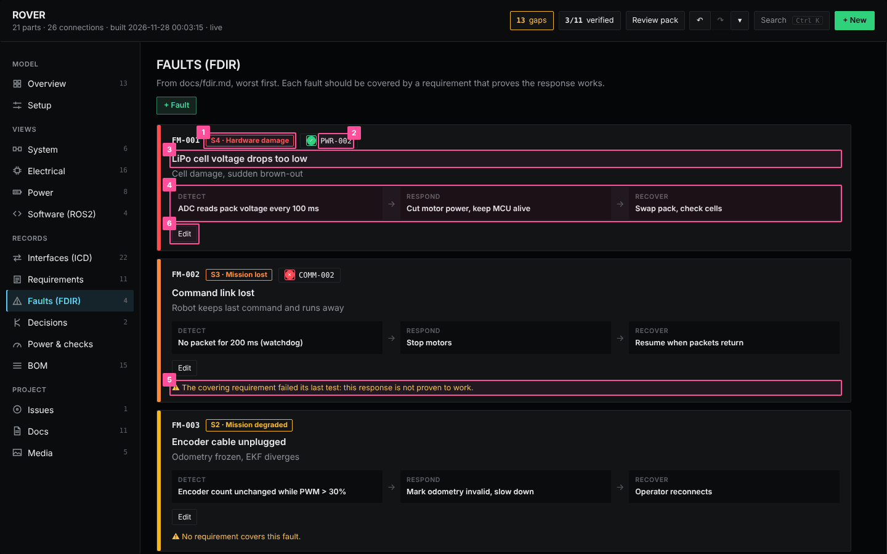

Worst severity first.

1. **Severity.**
2. **The requirement that covers it**, with that requirement's status.
3. **What fails** and its effect.
4. **Detect → respond → recover.**
5. **A warning** when the covering requirement failed its last test, or when
   nothing covers the fault at all.
6. **Edit** any column.

### Decisions

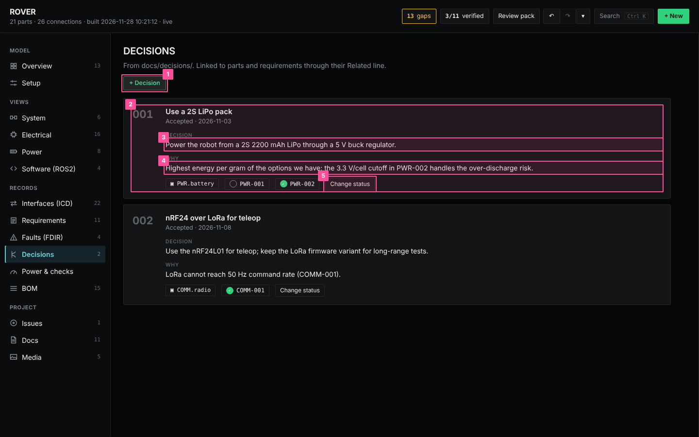

1. **+ Decision.**
2. **Number, status and date.**
3. **The decision.**
4. **Why.**
5. **Links** to the parts and requirements on its Related line, and
   **Change status**. Decisions are never rewritten: change the status, or
   supersede with a new one.

### Architecture checks and coverage

The **Overview** has an **Architecture coverage** table: parts per subsystem
and kind group, so an empty cell (DRIVE without feedback, SENS without
positioning) shows at a glance; the review pack has it too. Among the gaps:

- a sensing part with no data link to an MCU or computer (through connectors
  counts);
- a feedback part (encoder, current sense) in a subsystem with no actuator or
  driver it could be measuring;
- a power source with no `max_current`, which the power budget then cannot
  check;
- actuators or drivers but no safety element (e-stop, kill switch) anywhere.

The **BOM** has a **Category** column and is ordered by group: compute,
sensing, actuation, power, comms, interconnect, safety, structure.

### Power and checks

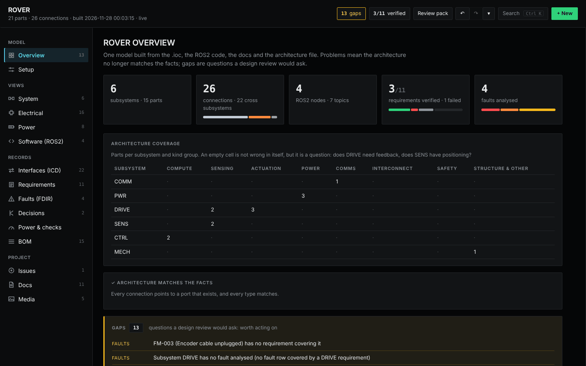

Every group of wired power ports is a **rail**. Ports with *max_current*
supply it, ports with *current* draw from it; the bar shows the load against
what is available. Flagged (also among the Overview's gaps):

- a rail drawing more than its sources supply;
- a rail joining ports with different voltages (a 5 V output wired to a 3.3 V input);
- two devices with the same address on one I²C bus.

Ports with no current set are listed under each rail, so you see what is
still missing. A regulator's input draw is entered by hand (from its output
load and efficiency).

### BOM

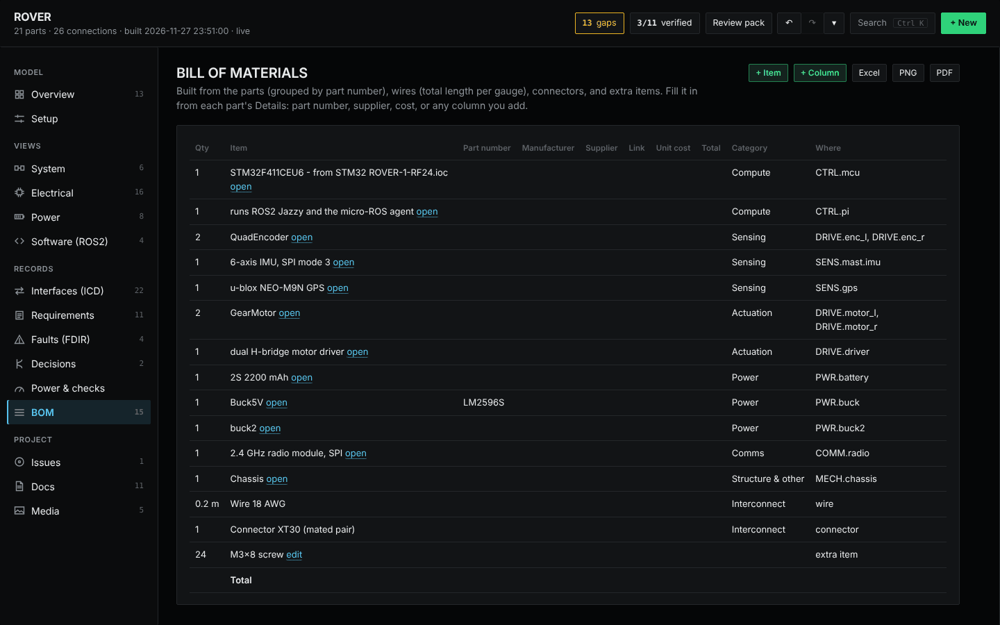

1. **+ Item** for things that are not parts in the diagram (screws,
   heat-shrink, zip ties); **+ Column** adds your own column, filled from the
   part detail of the same name; **Edit** turns the table into a form (below).
2. **Currency**: RM, US$ or ¥ for unit cost and total. Every price carries its
   sign, so nobody mistakes one currency for another. The choice is remembered
   in your browser.
3. **Export** as Excel (`.xlsx`), PNG or PDF, in the currency shown. In Excel
   the unit costs and totals are numbers with a currency format (RM, US$ or
   ¥), so they can be summed and sorted, and the total is a `SUM` formula that
   follows any change you make in the sheet. Without a server, Excel becomes a
   CSV.
4. **An item**: click it to open the part. A board shows just its chip.
5. **A price.** It keeps the currency it was typed in: typed as `¥30`, it is
   ¥30.00 in yuan, and the ringgit and dollar figures follow the market rate.
   Hover a converted price to see it as typed.
6. **Category**, from the part's kind; rows are ordered by group.
7. **Where** each part is in the model; each name opens that part.
8. **The rates**: live market rates (open.er-api.com), fetched by `doc serve`
   when the page opens and every hour after, and kept for offline use (then
   marked *last known*). **Currency of unmarked prices…** sets the currency
   of prices typed without a sign (ringgit unless you change it).

The bill of materials is built from the model: parts grouped by part number
(or description), with quantity, item, part number, manufacturer, supplier,
link, unit cost and total. Wires are totalled by gauge from their lengths,
connectors counted from the wires.

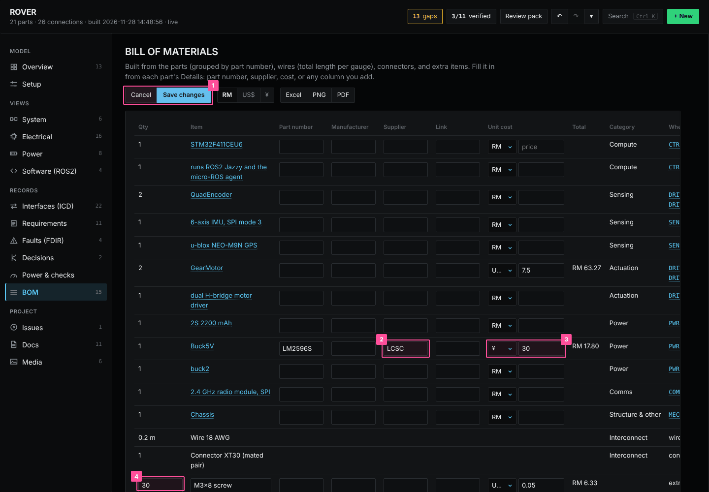

1. **Cancel** or **Save changes** (Enter saves, Esc cancels).
2. **A detail** of a part: part number, manufacturer, supplier, link or any
   column you added. It is saved on every part of the row (both encoders, for
   example), in the part's Details.
3. **A price and its currency.** Pick RM, US$ or ¥ for each row, then type
   the amount. That price stays exactly as typed; the other currencies follow
   the market rate. (In a part's Details you can write it the same way:
   `¥20`, `US$3.50`, `RM 12`, `20 CNY`.)
4. **Extra items** (+ Item) can change their name and quantity too.

Wires and connectors are counted from the wiring, so they are not edited here.

### Design review pack

**Review pack** (top right) downloads a PDF straight away: summary, subsystems,
requirements with their evidence, faults, interfaces with wire details, power
budget, decisions, BOM, and the open problems and gaps. Use it for a design
review, a report or URC documentation.

PDFs (the review pack and the BOM) are made by the computer running
`doc serve`, with a headless Chrome, Chromium, Edge or Brave it finds there.
Another browser can be named with the `DOC_PDF_BROWSER` environment variable.
With none of them installed, or on a page opened without `doc serve`, the
print window opens instead: choose **Save as PDF** there.

---

## 7. Issues, docs and media

### Issues

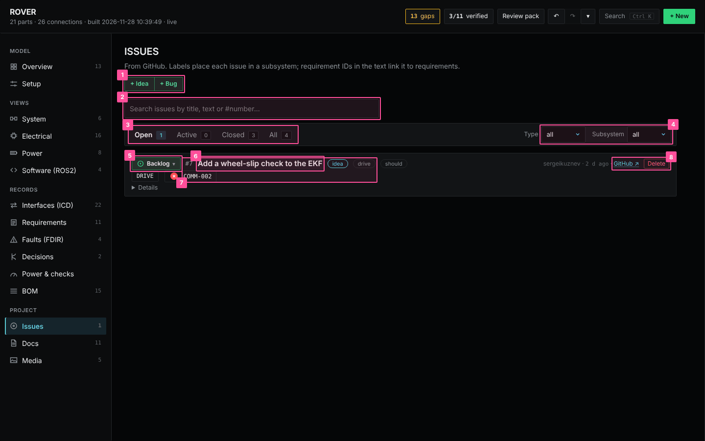

1. **+ Idea / + Bug** create a GitHub issue from a form.
2. **Search** by title, text or `#number`.
3. **Status tabs**: Open, Active, Closed, All, each with its count.
4. **Type** and **Subsystem** narrow the list.
5. **Status pill**: click to change it; GitHub follows.
6. **Title and labels**, coloured as on GitHub. Click the title for its panel.
7. **Placement**: its subsystem and the requirements it names.
8. **GitHub ↗** and **Delete** (asks first; needs admin rights).

The issue's subsystem label (the prefix in lowercase, e.g. `comm`) places it
in a subsystem; requirement IDs in its text link it to those requirements.

**Status** is GitHub's own issue status, the same dropdown as on GitHub
(Backlog, Todo, In progress, In review; Done, Not planned, Duplicate when
closed). Click the pill to change it; GitHub follows. The tabs split issues
by it: **Open** (everything not closed), **Active** (Todo, In progress, In
review), **Closed** (Done, Not planned, Duplicate) and **All**, each with its
count. **Delete** asks first and deletes it on GitHub too (needs admin rights).

Repos without GitHub's issue status fall back to a **GitHub Project** Status
column (run `gh auth refresh -s project` once so `gh` may read and move
project items), and otherwise to a `status: …` label. Issues are checked
every 30 seconds.

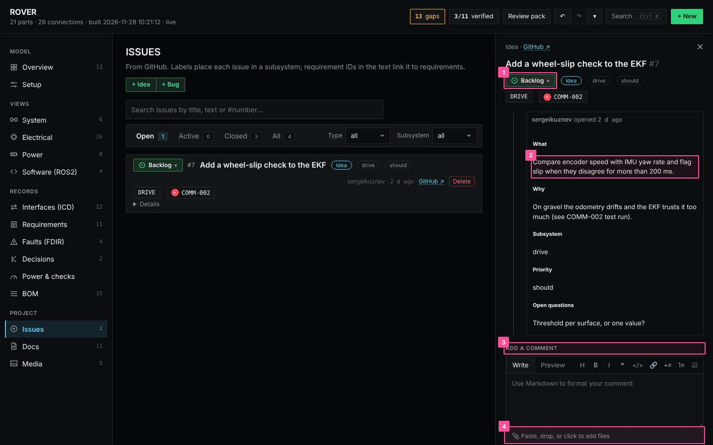

1. **Status**, the same dropdown as on GitHub.
2. **The description**, then its activity (comments, labels, closed as…, reopened).
3. **A comment box** like GitHub's: **Write / Preview**, a formatting bar
   (⌘B, ⌘I, ⌘Enter to send).
4. **Files** by paste, drop or click: they go to `docs/media/` and are linked in the comment.

Below: **Comment**, **Mark as Done** (▾ for not planned or duplicate) or
**Reopen**, and **Delete issue…**. Closing as *Not planned* keeps the history.

Issues need the GitHub CLI (`gh auth login`) on the machine running `doc serve`.

### Docs

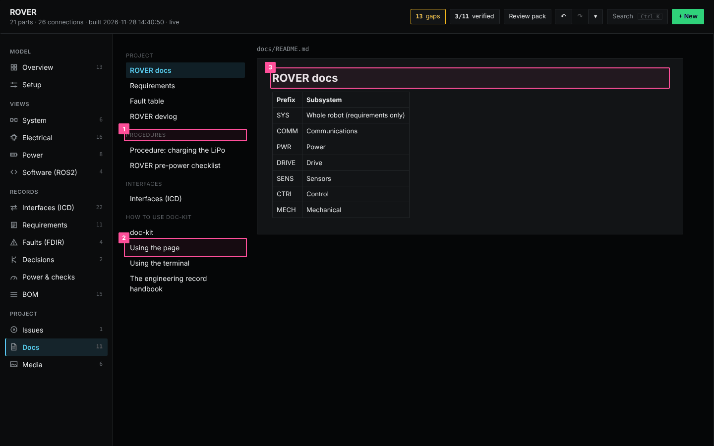

1. **Your docs**: project notes, requirements, faults, devlog, procedures,
   checklist, interface notes.
2. **How to use doc-kit**: the README and these guides, inside the page.
3. **The doc.** Requirement and fault IDs in the text are links.

Links between docs open inside the page; links to anything else open in a new tab.
Mermaid flowcharts (a ```` ```mermaid ```` block with `flowchart LR` or `TD`, as
GitHub draws them) are drawn as diagrams here too.

### Media

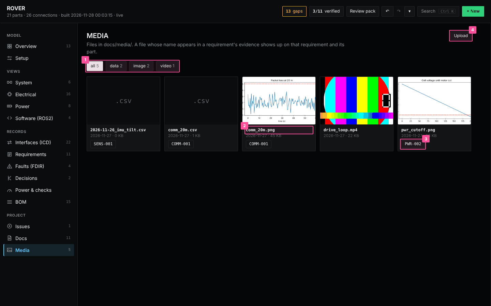

1. **Filter by kind**: image, video, data, PDF.
2. **A file.** Click for full size: photos and videos play, logs and CSVs show their text.
3. **The requirement** whose evidence names this file.
4. **Upload** adds files to `docs/media/` and commits them.

---

## 8. Writing records

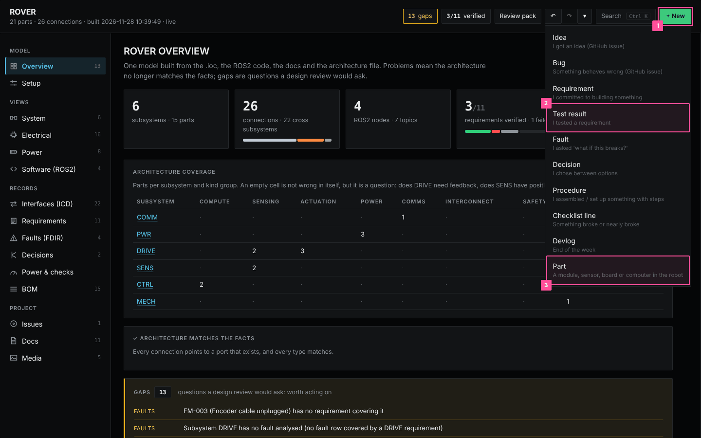

1. **+ New**, top right on every page.
2. **What just happened?** Pick the record that fits.
3. **Part** opens the part form.

Cards also have their own buttons: *Record test* and *Edit* on requirements,
*Edit* on faults, *Change status* on decisions, *Mark deleted* in a
requirement's panel.


1. **Pick the record**: here, which requirement you tested.
2. **Choices are menus**, never free text, so IDs and statuses are always valid.
3. **Free text**, with a hint of what a good answer looks like.
4. **Upload**: the file goes to `docs/media/` with today's date in its name,
   and its name goes into the field.
5. **Save** writes, commits and pushes. Removing something asks *Yes, do it*
   first. Every window has **✕** to close it.

Hints appear in the form without blocking you, e.g. a requirement with no
*shall* or no number to measure. If a change breaks the model (a wire to a
pin that does not exist), a red notice says so after saving, and the Overview
lists it.

| Form | Fields | Writes |
|---|---|---|
| Idea | title, what, why, subsystem, priority, open questions | GitHub issue |
| Bug | title, what happened, what should have, steps, subsystem, firmware, logs and photos | GitHub issue |
| Requirement | subsystem, the *shall* sentence, rationale, verification method, status | `docs/requirements.md`, next ID |
| Test result | requirement, passed/failed, what you measured, evidence (upload), date | the requirement's status and evidence |
| Fault | what fails, effect, detection, response, recovery, severity, covering requirement | `docs/fdir.md`, next FM-ID |
| Decision | title, status, related IDs, what it replaces, context, options with pros and cons, the decision, deciding factor, consequences | `docs/decisions/NNN-title.md` |
| Procedure | title, applies to, time, tools and parts, steps, warnings, photo | `docs/procedures/<title>.md` |
| Checklist line | the check, why it was added, section | `docs/procedures/pre_power_checklist.md`, with a history row |
| Devlog | done, broke or learned, next, media | this week's entry in `docs/devlog.md` |
| Edit requirement | status, text, rationale or method; *Mark deleted* asks why | the row, plus a line in the change log |
| Edit fault | any column | the row |
| Change decision status | Proposed, Accepted, Rejected, Superseded by NNN, or the Related line | the decision file |

Each save is one commit with a readable message (`doc: test COMM-002 verified`);
the push follows in the background (section 9). An upload is its own commit.
If someone else pushed in the meantime, the server rebases onto their change
and pushes again.

### Undo and redo

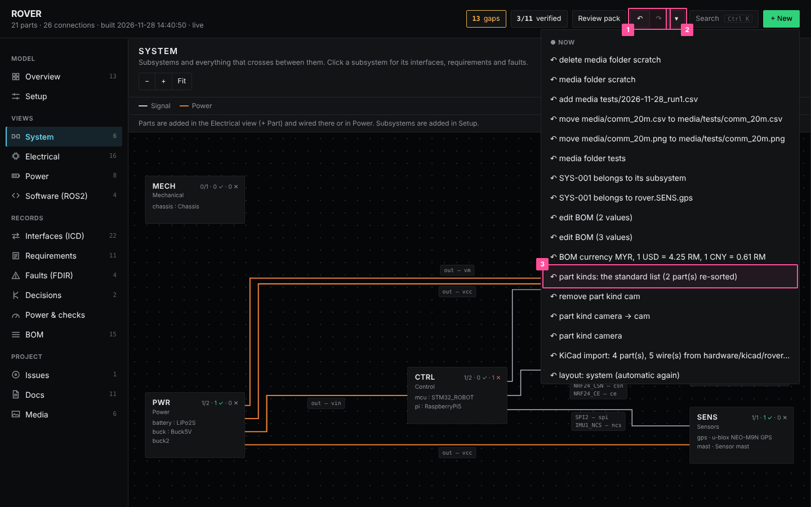

1. **↶ / ↷**: undo the newest change made by the page, redo the newest one
   you undid. Hover either to see which change it is.
2. **▾** lists the history.
3. **A step**: click it to go back to just before it, or forward to just
   after it, several steps at once.

Each step is a new commit (`doc: undo …` / `doc: redo …`), so git history
keeps everything and teammates' pages follow. Making a new change after
undoing clears what could be redone, as in any editor. A step that conflicts
with a later hand-made commit stops with a message instead of guessing.

### Who made a change

When someone opens the page through Tailscale, Tailscale tells the server who
they are, and their changes are committed under their name. Opened directly on
the server's computer, changes use that computer's git identity.

---

## 9. Staying up to date

The page never reloads by itself, and you never wait for GitHub:

- **Saving is instant.** A form writes its files and commits on the server's
  computer, and the page shows the result right away, in place: same view,
  same scroll, same panel. Pushing to GitHub and GitHub calls (new issues,
  status changes, comments) happen in the background; a new issue shows as
  `#…` until GitHub gives it a number.
- The background work is silent. Only a problem shows: **⚠ Sync failed**
  next to the counters (hover for why) means GitHub could not be reached or
  refused; the commit is kept on the server's computer and is pushed with the
  next change.
- **Changes from elsewhere** (someone pushed, a file changed on the server)
  appear on their own within seconds, in place; GitHub issues within about
  30 seconds.
  Reloading the browser tab rebuilds from the current files at once.

---

## 10. When the wiring no longer matches the hardware

Rename a pin label in CubeMX, for example `NRF24_CE` to `RADIO_CE`, and the
wire to `NRF24_CE` now points at a pin that is gone.

The page does not draw the old wire as if nothing happened:

- the red **Model problems** counter appears in the top bar, on every page;
- the Overview's **Problems** names the wire and the pin that is gone, with a
  hint about the likely cause;
- in Electrical the port that is gone is drawn in red (`NRF24_CE (gone)`) and
  the wire to it red and dashed. **Focus** on the subsystem (from its panel)
  to see just the affected wiring.

Fix it on the page: click the red wire to remove it, then connect
`RADIO_CE` to the module's `ce`. The red counter disappears.

The pre-commit hook stops a commit from your own clone with the same message,
so a broken model never reaches GitHub unnoticed. Other things the check
catches: an SPI bus wired to a GPIO (types do not match), a node assigned to a
part that does not exist, a requirement that does not exist, one topic used
with two message types.

---

## 11. Workflows

### A. First setup on a project

1. In the terminal, once: `doc init`, `doc install-hook`, `doc serve`
   (see the [README](../README.md#quick-start)).
2. **Setup → + Subsystem** for each subsystem (section 3).
3. **Setup → + Board** for each microcontroller: pick its `.ioc`, name it, pick its subsystem.
4. **Setup → ROS2 code folders → Change**: add the folders with your ROS2 and micro-ROS code.
5. **Electrical → + Part** for every module, sensor, battery and computer, with
   its kind. Or **Import from KiCad** if the schematic exists.
6. **Electrical**: click a board pin, then the module, for every wire.
   Then **Power** the same way.
7. **Software**: drag each node from *Not allocated* into its computer.
8. **Overview**: Problems should say *Architecture matches the facts*.
9. Optional: `tailscale serve --bg 8765` to open it from your phone.

### B. Record a test at the bench, from your phone

1. Open the page on your phone (section 12).
2. **Requirements**, find the one you tested (filter *Approved* or search), tap **Record test**.
3. Passed or Failed, what you measured (*stopped after 0.4 s, 5 runs*).
4. **Upload photo / video / log**: take the photo or pick the video.
5. **Save**.
6. The requirement turns Verified or Failed, the photo appears on its card and on its part.

If it failed: go to the fault that requirement covers and check the warning,
then file a bug (**+ New → Bug**) with the same photo.

### C. From an idea to a verified requirement

1. **+ New → Idea**: what, why, subsystem. It becomes a GitHub issue and shows in **Issues** and on the subsystem.
2. Compare options, then **+ New → Decision** with the options, pros and cons and the deciding factor. Put the issue number on the Related line.
3. **+ New → Requirement**: the measurable promise (*The robot shall stop within 0.5 s of losing the command link*). It lands in its subsystem.
4. **+ New → Fault** for what happens if it breaks, covered by that requirement.
5. If a single part carries it, open the requirement and **Pin to a part**.
6. Build it, then **Record test** (workflow B). Close the issue with `fixes #N` in the commit.

### D. A test fails

1. **Record test** with *Failed* and what you saw.
2. **Faults**: the fault this requirement covers now shows *not proven to work*.
3. **+ New → Bug** with the steps and the evidence file.
4. If something nearly broke, **+ New → Checklist line**, so it is checked before every power-up.
5. Fix, test again, record *Passed*. The evidence keeps both lines, so the history shows the failure and the fix.

### E. A pin changed in CubeMX

1. Save the `.ioc` and push (or commit on the server's machine). The page shows the problem (section 10).
2. **Electrical**: click the red wire to remove it, connect the renamed pin.
3. The red counter disappears. The **Interfaces** table updates itself with the new pin.

From your own clone, the commit hook stops the `.ioc` commit with the same
message; commit with the fix from the page, or `git commit --no-verify` and fix it on the page right after.

### F. Adding a module

1. **Electrical → + Part** (or **+ Part here** in a subsystem's panel): subsystem, name, kind, ports.
2. **Electrical**: click the board pin, then the module. Repeat for power in **Power**.
3. If it carries a requirement, pin the requirement to it.
4. If assembling it has steps someone could get wrong, **+ New → Procedure**.

### G. Weekly review

1. **Overview**: read Problems (must be zero), the coverage table and Gaps (pick the ones worth acting on).
2. **Requirements → Failed** and **Approved** (approved but not yet tested).
3. **Faults**: any warning lines.
4. **Issues**: what is open in each subsystem.
5. **+ New → Devlog**: what was done, what broke, what is next.

### H. Showing the project to someone

1. In the Tailscale admin console, share the machine running `doc serve` with them (Machines → ⋯ → Share).
2. Send the `https://…ts.net/` address. Start them on **System**, then a subsystem panel, then **Requirements**.
3. Anyone you share with can also use the forms; share only with people who should be able to write.

---

## 12. On your phone

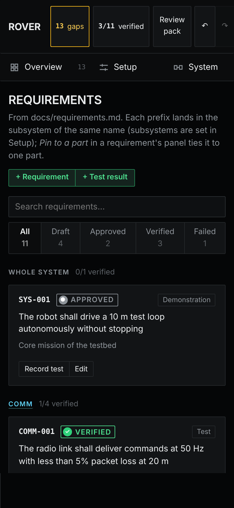

The page works on a phone: sections scroll across the top, forms fill the
screen, panels open full screen. Diagrams use the − / + / Fit buttons instead
of a scroll wheel; drag to pan. The camera is offered directly when you upload
from a form. Wiring is easier on a laptop: the ports are small on a phone screen.

---

## 13. What the page will and will not do

**It writes** your records (requirements, tests, faults, decisions, procedures,
checklist lines, devlog), the model (`docs/model/model.toml` and the arch
file), the generated subsystem table and issue-form lists, GitHub issues,
files you upload into `docs/media/`, and parts in your parts library folders. It regenerates `<name>_facts.sysml` with
each commit.

**It never writes** the `.ioc` (CubeMX owns it) or your code. It never deletes a
record: a dropped requirement is marked Deleted with a reason, a replaced
decision is Superseded, a subsystem whose prefix was used is kept as deleted.
Parts and wires are really removed (git history keeps them, and **↶** brings
them back).

**It refuses** to write a file that has uncommitted changes on the machine
running the server, so it never commits half of your own edit. Commit or stash
first, then try again.

**Who can reach it:** only this machine. Tailscale makes it reachable from your
own devices and anyone you share the machine with. Forms only accept requests
from the page itself, so other websites cannot post to it.

---

## 14. Running the server long-term

The server is one command in a clone of the project, so moving it is easy:

1. On the always-on machine (a lab PC), clone the project, install Python 3.11+
   and git, run `gh auth login`, and make sure it can push.
2. Run `doc serve` in that clone, and `tailscale serve --bg 8765` there.
3. Use that machine's `.ts.net` address from now on.

Use a dedicated clone for the server, not the one you edit in: then the
uncommitted-changes guard never gets in your way. Everyone without access to
that machine can still run `doc serve` in their own clone: the page works the
same anywhere, and pushes like everyone else.
