# Using the page

The page is how you use doc-kit. It shows the whole robot in one place (wiring,
software, requirements, faults, decisions, issues, docs, photos), and it is
where you change it: subsystems and boards, parts and wires, test results with
a photo, ideas, decisions, procedures. **Save** writes the change to plain
files in your repo, commits and pushes it; **↶ Undo** reverses the last one.

Concepts (what a requirement is, what makes a good fault row) are in the
[handbook](HANDBOOK.md). The few terminal commands (install, hooks, CI) are in
[TERMINAL.md](TERMINAL.md).

All screenshots come from a demo project: the `.ioc` is real, the modules,
wiring, ROS2 code and records are invented.

**Contents**

1. [Opening the page](#1-opening-the-page)
2. [Finding your way around](#2-finding-your-way-around)
3. [Setup: subsystems, boards, code](#3-setup-subsystems-boards-code)
4. [Building the robot: parts and wiring](#4-building-the-robot-parts-and-wiring)
5. [The views](#5-the-views)
6. [The records](#6-the-records)
7. [Issues, docs and media](#7-issues-docs-and-media)
8. [Writing records](#8-writing-records)
9. [Staying up to date](#9-staying-up-to-date)
10. [When the wiring no longer matches the hardware](#10-when-the-wiring-no-longer-matches-the-hardware)
11. [Workflows](#11-workflows)
12. [On your phone](#12-on-your-phone)
13. [What the page will and will not do](#13-what-the-page-will-and-will-not-do)
14. [Running the server long-term](#14-running-the-server-long-term)

---

## 1. Opening the page

In your project (after `doc init`, see the [README](../README.md#quick-start)):

```bash
doc serve
```

It opens `http://127.0.0.1:8765` in your browser. Leave that terminal window open; Ctrl+C stops
the server. Options: `--port 8765`, `--interval 60` (seconds between GitHub
checks), `--no-push` (commit locally only), `--no-open` (don't open the browser).

**Why `127.0.0.1`?** It means only this computer can connect. The page can
commit and push to your repo and has no login, so it must not be open to
everyone on the Wi-Fi. **Why 8765?** Just a free port; any other works with `--port`.

**From your phone or another laptop**, share it through
[Tailscale](https://tailscale.com):

```bash
tailscale serve --bg 8765
```

It prints an address like `https://your-mac.tailXXXX.ts.net/`. Open that on any
device signed into your tailnet: your tailnet is the login.
`tailscale serve --https=443 off` stops sharing.

**Without a server**, `doc model` writes the same page to `docs/system.html`:
read-only, a snapshot of when you ran it.

---

## 2. Finding your way around


1. **Counters and + New.** *Model problems* (red) means the wiring no longer
   matches the hardware; *gaps* are open questions; *verified* is how many
   requirements are proven. **+ New** opens the forms. Click a counter to jump to it.
2. **Sections.** *Model* has the overview and **Setup**; *Views* draw the
   robot; *Records* hold what it must do and why; *Project* holds issues, docs
   and media. The grey number is how many items each has.
3. **Tiles.** Size of the model, connections by kind (signal, power,
   mechanical), requirement progress and faults by severity.
4. **Problems.** Every line is something the commit check would stop on.
   When the wiring is consistent it says so.
5. **Gaps.** The questions a design review would ask: a subsystem with no
   requirements, a fault with no requirement covering it, a topic nobody
   subscribes to, a ROS node not assigned to any computer. Gaps are not errors;
   click one that names a part to open it.

The page remembers where you are in its address (`#electrical/sel:...`), so a
bookmark or a reload brings you back to the same view with the same part open.

---

## 3. Setup: subsystems, boards, code

**Setup** (under *Model*) is where a new project starts. Nothing is filled in
for you: you add your own subsystems, point each board at its `.ioc` file, and
say where your ROS2 code is.


1. **Subsystems** and **+ Subsystem**. A subsystem is a box in the system
   diagram *and* the prefix of requirement IDs: `COMM-002` belongs to `COMM`.
2. **Requirements only**: a group with no box, for requirements about the
   whole robot (`SYS`) or fault handling (`FDIR`). Its requirements belong to
   the whole system.
3. **Order.** The arrows set the order of the requirement sections and of the
   lists on the page.
4. **Edit / Delete.** A prefix that requirements already use cannot change
   (IDs never change); change the name instead. Deleting is refused while the
   subsystem holds parts or live requirements. One whose old, deleted
   requirements used its prefix is kept as *deleted*, so those IDs are never reused.
5. **Boards**: microcontrollers with a CubeMX project, each pointing at its own `.ioc`.

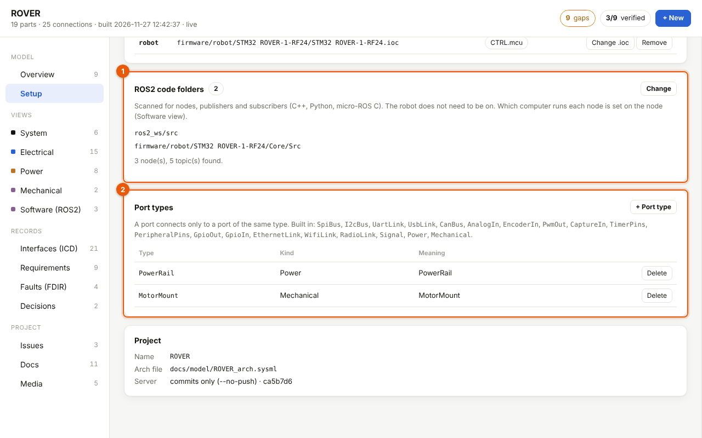

1. **ROS2 code folders**: scanned for nodes, publishers and subscribers. The
   robot does not need to be on.
2. **Port types**: a port connects only to a port of the same type. The common
   ones are built in (SPI, I²C, UART, USB, CAN, GPIO, PWM, encoder, analog,
   Ethernet, WiFi, radio link, power, mechanical). Add your own when you want a
   check to be stricter, e.g. `Power5V` so a 12 V output cannot be wired to a 5 V input.

### Parts library

Reusable parts (an IMU, an encoder, a motor driver, a radio) with their
details and ports, so you describe each module once and use it in every project.

- **+ Folder** adds a parts folder: type a path or pick one from the list
  (folders of this project and of your home folder). It is created if it
  does not exist. A folder **inside the project** (e.g. `docs/model/parts`)
  is committed and shared with the team. A folder **outside** (e.g.
  `~/robotics/parts`, or its own git repo) serves all your projects on this
  computer; it is written but never committed. The folder list and the
  **default** folder are remembered per computer, in
  `~/.config/doc-kit/settings.json`.
- **Save to parts library** in a part's panel, or **+ Part** here, stores a
  part. Its **Folder** field takes any folder, typed or picked; a new one is
  created and remembered. **Edit** and **Delete** manage them here.
- A new part can **start from the parts library**: it fills in the
  description, details and ports.

### Choosing subsystems

Group them the way the robot comes apart.

| Robot | Subsystems |
|---|---|
| One chassis, one MCU and a computer | by function: `CTRL` (MCU and what is wired to it), `COMP` (Raspberry Pi), `COMM` (radios), `DRIVE` (drivers, motors), `PWR` (battery, regulators), plus `SYS` and `FDIR` as requirements only |
| Several assemblies (a base and an arm, each with its own MCU) | by assembly: `BASE`, `ARM`, `PWR`, `SW`, plus `SYS`, `FDIR`. The base ↔ arm link then shows up as an interface |

Two radios (LoRa on the MCU, WiFi on the Pi) both go in `COMM`: a subsystem
holds as many parts as you need.

### Adding a subsystem

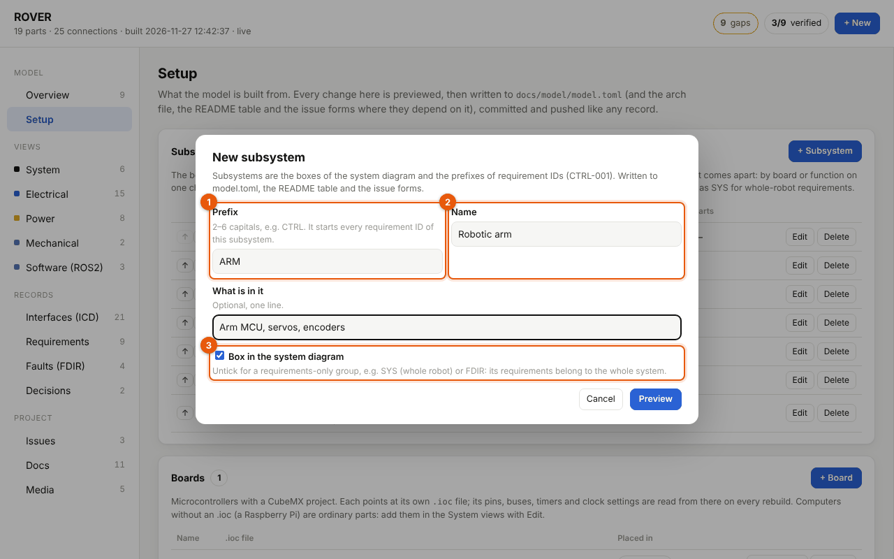

1. **Prefix**: 2 to 6 capitals, e.g. `ARM`. It starts every requirement ID of
   this subsystem.
2. **Name** (and an optional line on what is in it).
3. **Box in the system diagram**: untick for a requirements-only group.

**Save** writes `docs/model/model.toml`, the arch file, the subsystem table in
`docs/README.md` and the subsystem list of the GitHub issue forms (so issue
labels match your subsystems), and commits them together.

### Adding a board

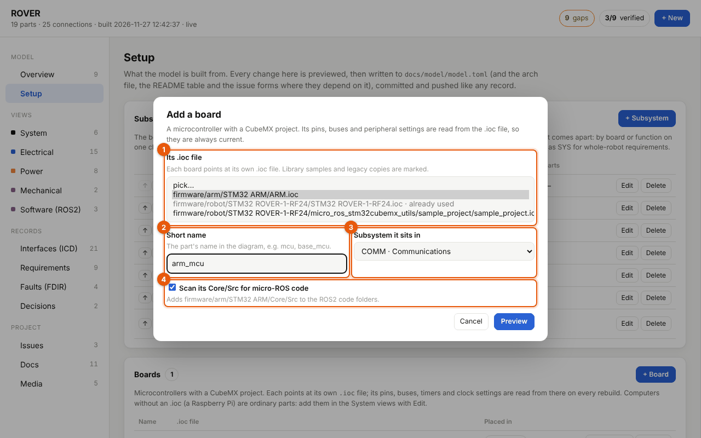

1. **Its .ioc file**, from every `.ioc` in the repo. Library samples
   (`micro_ros_stm32cubemx_utils/sample_project.ioc`) and legacy copies are
   marked; one already used by another board cannot be picked. Each board
   names its exact file, so several projects in one folder are never confused.
2. **Short name**: the part's name in the diagram (`mcu`, `base_mcu`, `arm_mcu`).
3. **The subsystem** it sits in.
4. **Scan its Core/Src**: adds the folder to the ROS2 code folders, for micro-ROS firmware.

The board appears in its subsystem with every pin, bus, timer and clock
setting from the `.ioc`, and stays in step with CubeMX: change the `.ioc`, and
the page shows it on the next rebuild. A computer without an `.ioc` (a
Raspberry Pi, a laptop) is an ordinary part: add it in the System views.

---

## 4. Building the robot: parts and wiring

Parts and wires are added straight in the System, Electrical and Power
views: there is no separate edit mode. Every part and every port of the
view's kind is drawn, connected or not.


1. **The hint** under the title says what clicks do.
2. **+ Part** adds a module, sensor, driver, battery or computer.
3. **The hint bar** appears once you pick a port and says what the next click does.
4. **Click a port** to start a wire. It is highlighted.
5. **Click the other end**: a port of the same type, or a part. Clicking a
   part offers to give it a new port of the right type.

Click a wire for its details (and **Remove**); click a part to open its panel.
Click empty space or press Esc to drop a picked port.

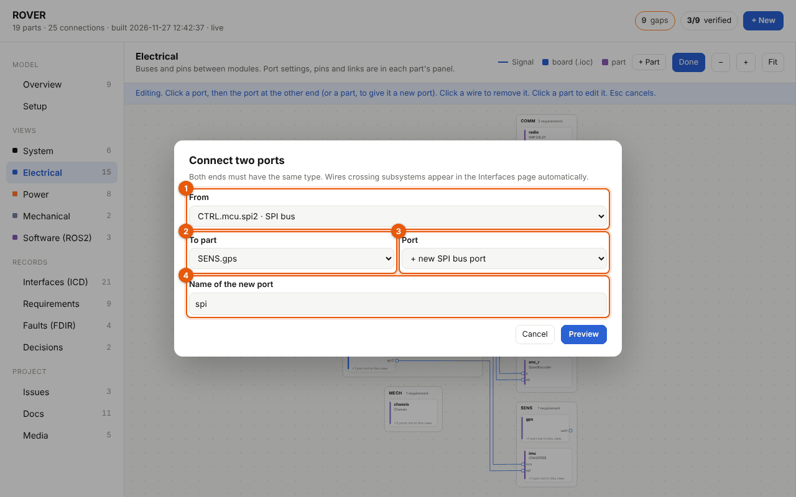

1. **From**: the port you clicked.
2. **To part**: the part you clicked.
3. **Port**: its ports of the same type, or **+ new … port**.
4. **Name of the new port**, when you add one.

You never deal with port direction: doc-kit marks one end as the mirror of the
other (`~SpiBus` in the file) by itself. Several devices on one SPI bus are fine:
connect the same MCU port to each.

### Parts

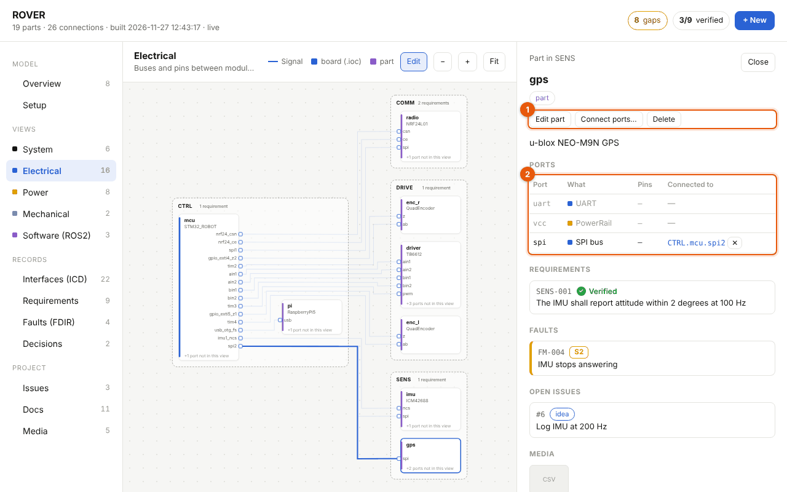

1. **Edit part / Connect ports… / Delete** in the part's panel.
   *Connect ports…* opens the Electrical view of its subsystem.
2. **Ports and what each connects to.** **✕** removes that connection.

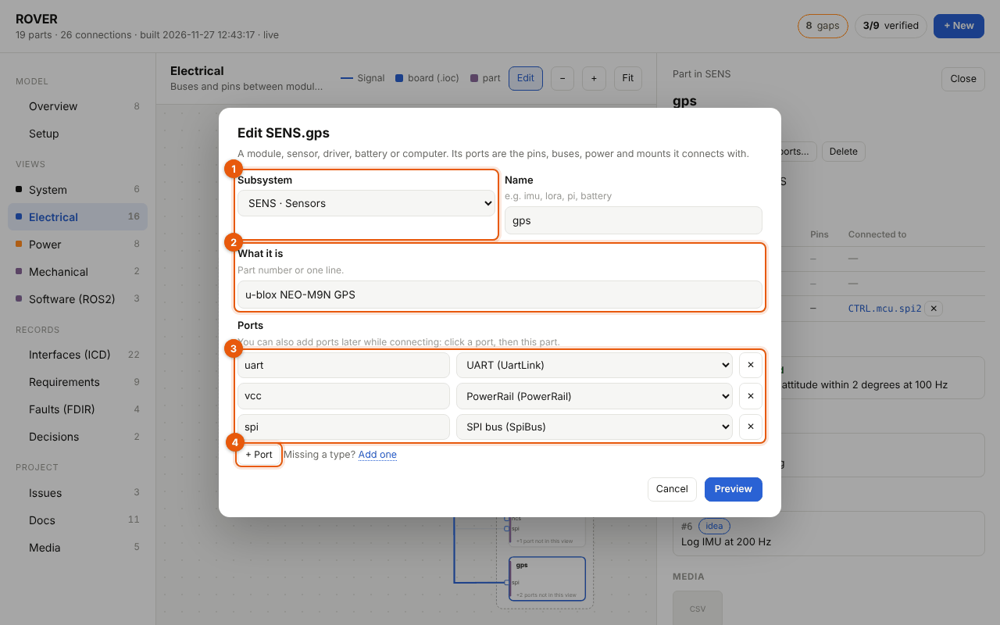

1. **Subsystem**: moving a part keeps its wires.
2. **What it is**: part number or one line.
3. **Ports**: a name and a type each. Renaming a port keeps its wires;
   removing one removes its wires.
4. **+ Port.** Missing a type? *Add one* opens the port type form.

Deleting a part removes its wires, and the links of requirements and ROS nodes
to it (you confirm first). Boards get their ports from the
`.ioc` and parts made before doc-kit 0.3 may get theirs from a type in the arch
file; for those, the form edits the name and description only.

### Details: part numbers, voltages, addresses

Every part, port and wire can carry **details**: named fields with a value.
The forms suggest the common ones, and **+ Field** adds any field you like.

| On | Suggested fields | Used by |
|---|---|---|
| a part | part_number, manufacturer, supplier, link, unit_cost, quantity, i2c_address | BOM, I²C check |
| a power port | voltage, max_current (what it can supply), current (what it draws) | power budget, voltage check |
| an I²C port | address | I²C check |
| a wire | gauge, length, connector, cable, color | BOM, Interfaces |

In the part form, **Details** next to a port opens its fields. Ports that
come from a board's `.ioc` or a part's type keep their name and type, but take
details too (e.g. the MCU's power input).

### Wires

Click a wire for its **wire details** (gauge, length, connector,
cable…) or to remove it. The connect form has the same fields, folded away.
In a part's panel, **wire** next to each connection opens them; the details
show under the connection, in the Interfaces table and in the BOM.

### Which computer runs a ROS node

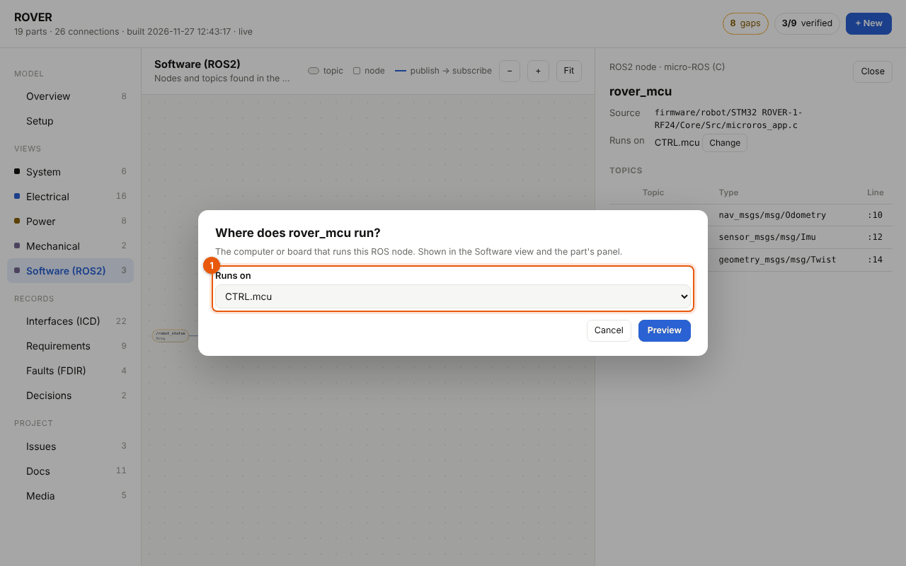

In the **Software** view, click a node, then **Change** next to *Runs on*.
Nodes that run nowhere yet are grouped under *Not allocated to hardware*.
A micro-ROS node whose source file sits inside a board's folder (the folder
of its `.ioc`) is placed on that board's part by itself.

doc-kit also reads your **launch files** (`.launch.py`, `.launch.xml`) in the
ROS2 code folders. A node's panel shows which launch file starts it, with its
package, executable, remappings and parameters. A launch file runs on one
computer, so *Apply to: every node started by …* places all its nodes at once.

### Which part a requirement belongs to

A requirement belongs to the subsystem of its prefix. When one part carries it
(the battery for a runtime requirement), open the requirement and click
**Pin to a part**.

### What gets written

Parts, ports, wires, allocations and pins are kept in
`docs/model/<name>_arch.sysml`, a SysML v2 text file the page writes in a fixed
layout: readable in a git diff, and checked against the facts on every build.
You never have to open it. Hand edits are fine, but the page rewrites the
layout (and drops `//` comments) on its next change.

---

## 5. The views

### System


1. **A subsystem** with its name and the parts inside it. Click it for its panel.
2. **What crosses between subsystems**: one line per kind, labelled with each
   connection as `part.port → part.port` (`mcu.spi1 → radio.spi`), up to four,
   then *+N more*. **+ Part** in a subsystem adds a part to it.
3. **Open issues** placed in this subsystem.
4. **Requirement progress**: verified out of total, and how many failed.
5. **Legend.** Blue is signal, amber is power, dashed purple is mechanical.
6. **Zoom.** − / + / Fit. On a laptop, scroll to zoom and drag to pan.

Clicking empty space closes the panel.

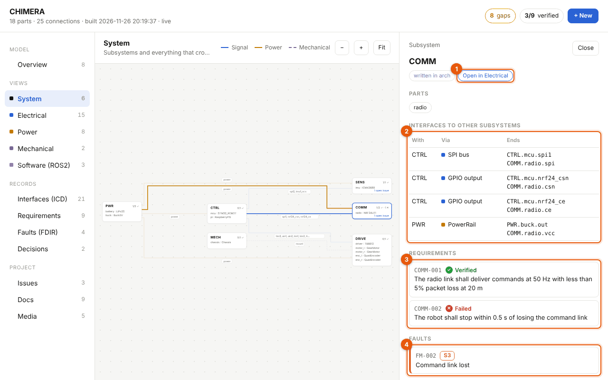

1. **Open in Electrical** shows only this subsystem and what it is wired to.
2. **Interfaces**: everything that crosses into other subsystems, with both ends.
3. **Requirements** that belong here (every `COMM-###` lands in `COMM`).
4. **Faults** covered by those requirements. Decisions and open issues follow below.

### Electrical

Two views of the same parts, each showing only the ports of its kind:
signal buses and pins in Electrical, power in Power. Mechanical links (mounts)
show as dashed lines in the System view.

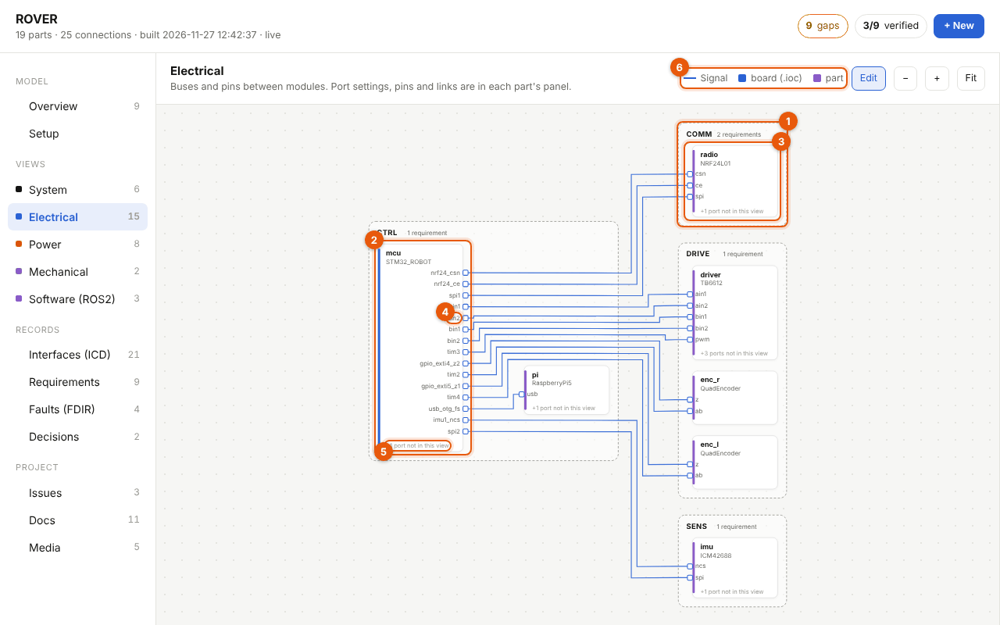

1. **A subsystem** drawn as a dashed box around its parts.
2. **A board**, read from its `.ioc` (blue band).
3. **A part** you added (purple band).
4. **A port.** Hover it for its pins.
5. **Ports not shown** in this view, for example the power input in the Electrical view.
6. **Legend.**

Layout is automatic: you never place a box. Hover a part to highlight its wires.


Click a part to open its panel.

1. **A port.** The arrow means it has saved settings; click the row to open them.
2. **Its pins** and what each pin does, from the `.ioc`.
3. **What it connects to.** Click to jump to that part.
4. **Its settings** as CubeMX saved them, in plain words: speed, role, clock
   polarity and phase, and derived facts such as *SPI mode 3*. CubeMX only
   saves values you changed; a missing one is shown as *CubeMX default*,
   never guessed.

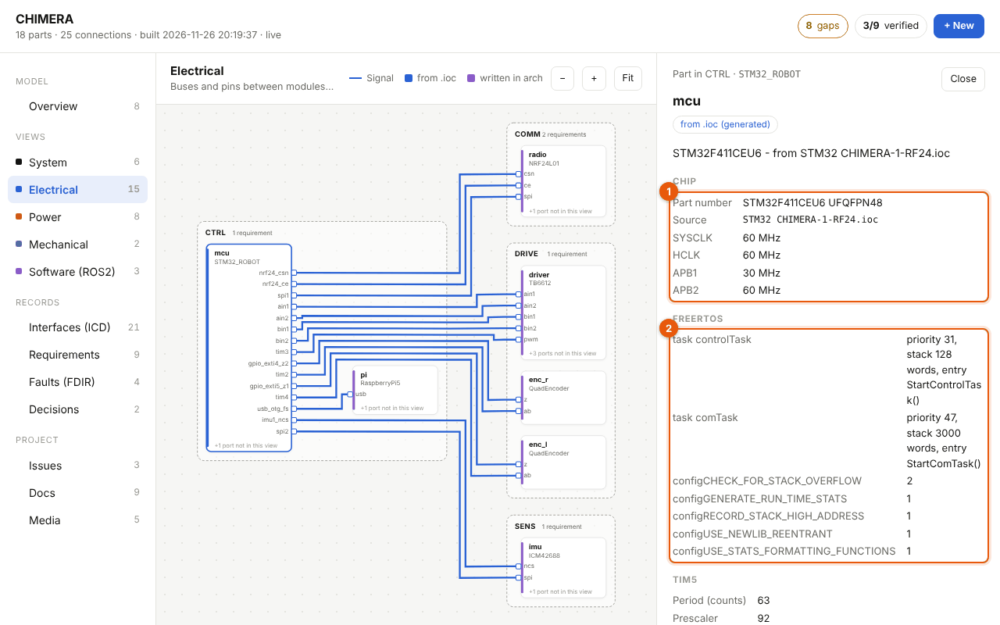

1. **The chip**: part number, package, the `.ioc` it came from, clock tree.
2. **Middleware and internal peripherals**: FreeRTOS tasks with priority,
   stack and entry function; timebases; USB class.

Further down the panel: requirements, faults, decisions, open issues and
photos that belong to this part, and any gap that names it.

### Power

The same parts with only their **power ports**: battery outputs, regulator
inputs and outputs, supply pins of boards and modules. Amber lines are power.

1. **A power port.** Wire a source (battery `out`, buck `vout`) to each
   device's input (`vin`, `vcc`) the same way as in Electrical: click one port,
   then the other.
2. **Details** on a power port are what the power checks use: `voltage` on
   every port, `max_current` on a source (what it can supply), `current` on a
   load (what it draws). Open them in the part form, **Details** next to the
   port, or in the connect form.
3. **Every group of wired power ports is a rail.** Its load against what is
   available, and any rail that is overloaded or mixes voltages, are in
   **Power & checks** and among the Overview's gaps.
4. A regulator is both: a load on its input rail and a source on its output
   rail. Enter its input draw by hand (output load ÷ efficiency, scaled by
   voltage).

A typical chain: `battery.out → buck.vin`, `buck.vout → mcu.vin`,
`buck.vout → radio.vcc`. Use your own port types (Setup › Port types, e.g.
`Power5V`) to make the check stricter, so a 12 V output cannot be wired to a
5 V input.

### Software (ROS2)

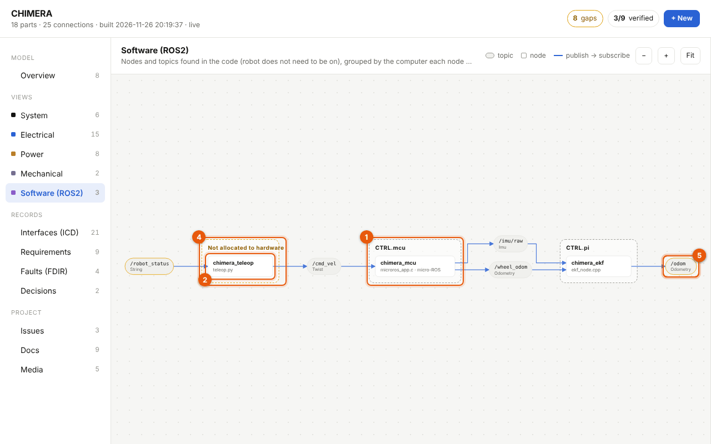

1. **A computer** with the nodes that run on it.
2. **A node**, with the file it was found in. Click for its topics and line numbers.
3. **A topic** with its message type. Arrows go publisher → topic → subscriber.
4. **Not allocated to hardware**: nodes no computer runs yet (dashed box). Click one and set *Runs on*.
5. **A topic with only one side** (amber border): published but never
   subscribed, or the other way round.

Everything here is read from the code in the ROS2 code folders, so the robot
can be off. A topic name built at runtime (`'debug/' + name`) cannot be read
for certain, so it is listed as a gap instead of guessed.

---

## 6. The records

### Interfaces (ICD)

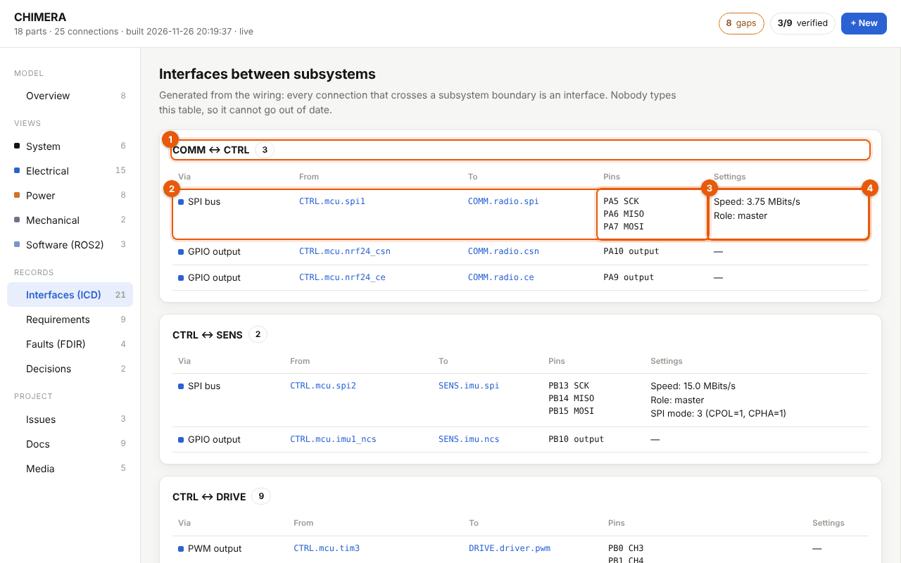

1. **A pair of subsystems** and how many links cross between them.
2. **One link**: its kind, and both ends (click to open the part).
3. **Pins** on the MCU side.
4. **Bus settings** that matter at the interface: speed, role, SPI mode.

Nobody types this table. It is generated from the wiring, so it cannot drift
from it.

### Requirements


1. **A subsystem group** with its progress.
2. **Status**: Draft, Approved, Verified, Failed or Deleted.
3. **How it is verified**: Test, Inspection, Analysis or Demonstration.
4. **Evidence**: one dated line per test.
5. **Media**: any file in `docs/media/` whose name appears in the evidence.
6. **Links**: the part it is pinned to, the faults it covers, decisions, open issues.
7. **Actions**: *Record test* and *Edit*.


1. **Search** across IDs, text and rationale.
2. **Filter by status**, for example everything that failed.

### Faults (FDIR)


1. **Severity**, worst first.
2. **The requirement that covers it**, with that requirement's status.
3. **Detect → respond → recover.**
4. **A warning** when the covering requirement failed its last test, or when
   nothing covers the fault at all.
5. **Edit** any column.

### Decisions


1. **Status and date.** Decisions are never rewritten: change the status, or
   supersede with a new one.
2. **Decision and why.**
3. **Links** to the parts and requirements named on its Related line, and *Change status*.

### Power and checks

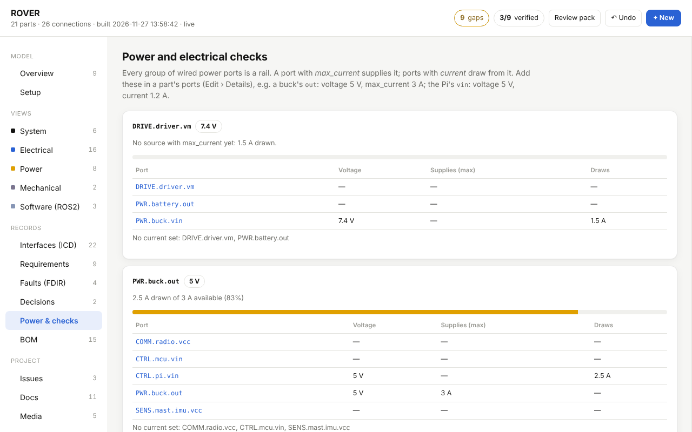

Every group of wired power ports is a **rail**. Ports with *max_current*
supply it, ports with *current* draw from it; the bar shows the load against
what is available. Flagged (also among the Overview's gaps):

- a rail drawing more than its sources supply;
- a rail joining ports with different voltages (a 5 V output wired to a 3.3 V input);
- two devices with the same address on one I²C bus.

Ports with no current set are listed under each rail, so you see what is
still missing. A regulator's input draw is entered by hand (from its output
load and efficiency).

### BOM

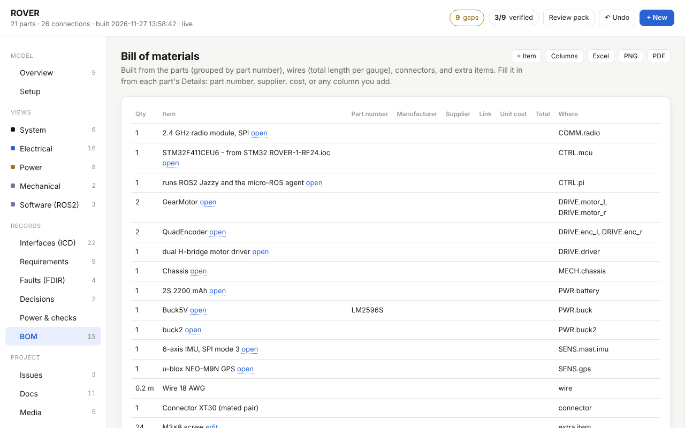

The bill of materials is built from the model: parts grouped by part number
(or description), wires totalled by gauge from their lengths, connectors
counted from the wires, plus **+ Item** for things that are not parts in the
diagram (screws, heat-shrink, zip ties). Columns: quantity, item, part number,
manufacturer, supplier, link, unit cost, total, where. **Columns** adds your own;
a part fills a column from its detail of the same name. Export as **Excel**
(`.xlsx`), **PNG** or **PDF** (print dialog). Without a server, Excel becomes a CSV.

### Design review pack

**Review pack** (top right) opens a printable document: summary, subsystems,
requirements with their evidence, faults, interfaces with wire details, power
budget, decisions, BOM, and the open problems and gaps. Print it or save it as
PDF, for a design review, a report or URC documentation.

---

## 7. Issues, docs and media

### Issues


1. **Search and filters**: open/closed, idea/bug, subsystem.
2. **+ Idea / + Bug** create a GitHub issue from a form.
3. **Placement**: the issue's subsystem label (the prefix in lowercase, e.g.
   `comm`) puts it in a subsystem; requirement IDs in its text link it to those requirements.
4. **GitHub ↗** opens it on GitHub, where comments and closing happen.
5. **Details** shows the issue body.

**Status.** Each issue has a status pill: Backlog, Todo, In progress, In review
(kept as a `status: …` label on GitHub), or Done, Not planned, Duplicate
(GitHub's close reasons). Click it to change it.

The list shows open issues first, then closed ones under **Closed**, the most
recently closed first (*open + done* is the default filter; *closed* and *all*
also show not planned and duplicates).

**An issue's panel** (click its title) shows the description, its activity
(comments, labels added, closed as…, reopened), and a comment box like
GitHub's: **Write / Preview**, a formatting bar (heading, bold, italic, quote,
code, link, lists, task list; ⌘B, ⌘I, ⌘Enter to send), and files by paste,
drop or click (they go to `docs/media/` and are linked in the comment). Then
**Comment**, **Mark as Done** (▾ for not planned or duplicate), or **Reopen**
for a closed one. **Delete issue…** deletes it on GitHub for good, after a confirm; it needs
admin rights on the repo. Closing as *Not planned* keeps the history instead.

Issues need the GitHub CLI (`gh auth login`) on the machine running `doc serve`.

### Docs

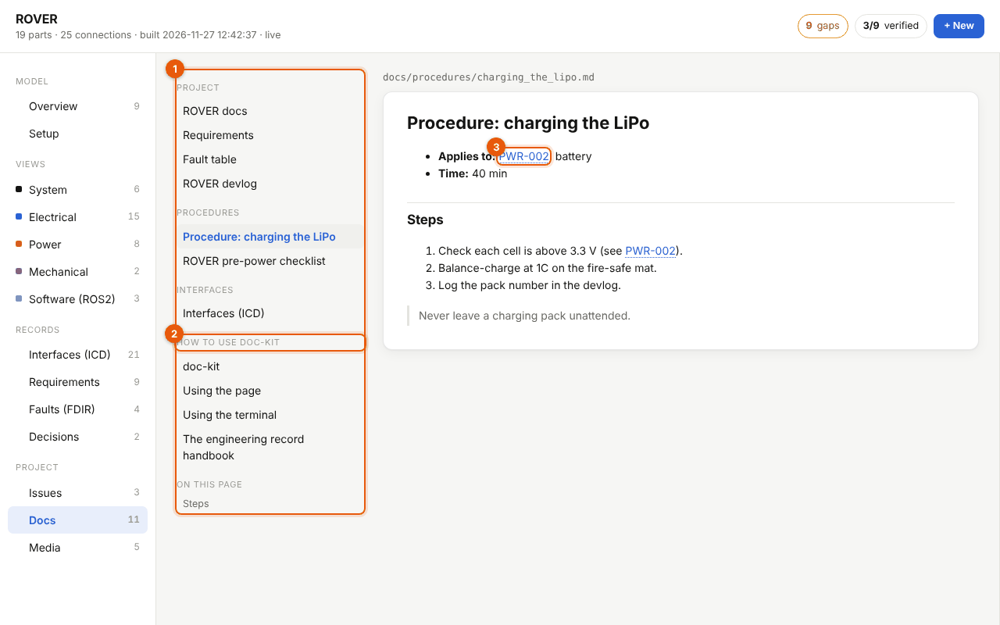

1. **Your docs**: project notes, requirements, faults, devlog, procedures,
   checklist, interface notes.
2. **How to use doc-kit**: the README and these guides, inside the page.
3. **Requirement and fault IDs** in the text are links.

Links between docs open inside the page; links to anything else open in a new tab.

### Media

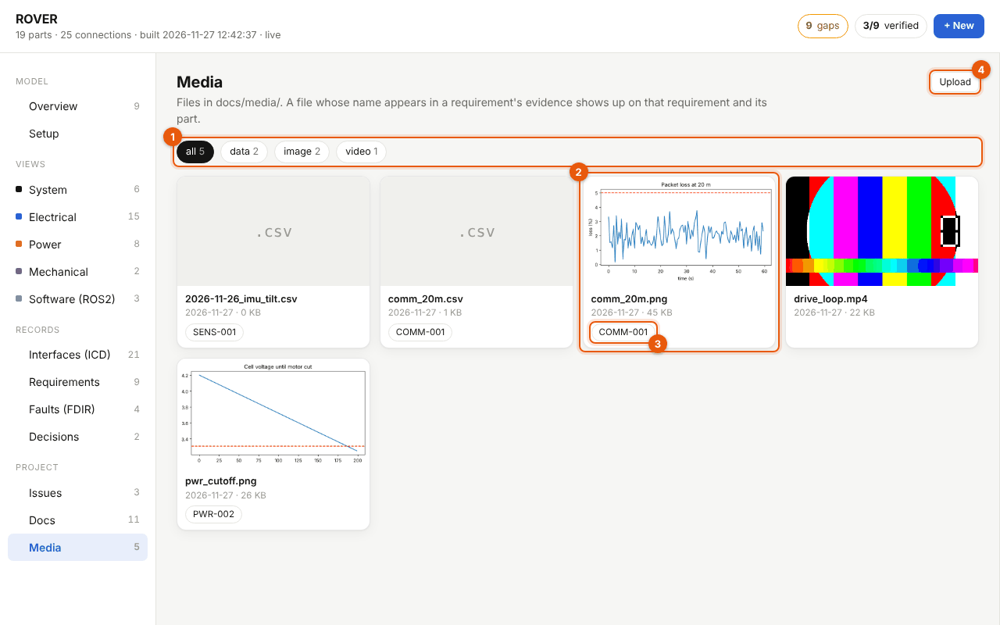

1. **Filter by kind**: image, video, data, PDF.
2. **A file.** Click for full size.
3. **The requirement** whose evidence names this file.
4. **Upload** adds files to `docs/media/` and commits them.

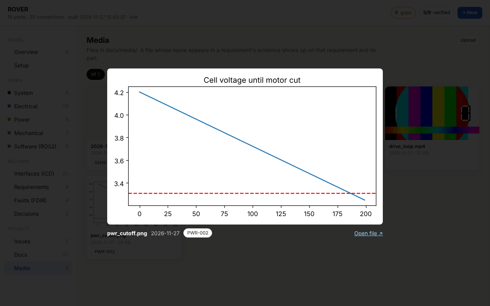

Photos and videos open full size; logs and CSVs show their text.

---

## 8. Writing records


1. **+ New**, top right on every page.
2. **What just happened?** Pick the record that fits.

Cards also have their own buttons: *Record test* and *Edit* on requirements,
*Edit* on faults, *Change status* on decisions, *Mark deleted* in a
requirement's panel.


1. **Pick the record**: here, which requirement you tested.
2. **Choices are menus**, never free text, so IDs and statuses are always valid.
3. **Free text** with a hint of what a good answer looks like.
4. **Upload**: the file goes to `docs/media/` with today's date in its name,
   and its name goes into the field.
5. **Save** writes, commits and pushes. Removing something asks *Yes, do it* first.

Hints appear in the form without blocking you, e.g. a requirement with no
*shall* or no number to measure. If a change breaks the model (a wire to a
pin that does not exist), a red notice says so after saving, and the Overview
lists it.

| Form | Fields | Writes |
|---|---|---|
| Idea | title, what, why, subsystem, priority, open questions | GitHub issue |
| Bug | title, what happened, what should have, steps, subsystem, firmware, logs and photos | GitHub issue |
| Requirement | subsystem, the *shall* sentence, rationale, verification method, status | `docs/requirements.md`, next ID |
| Test result | requirement, passed/failed, what you measured, evidence (upload), date | the requirement's status and evidence |
| Fault | what fails, effect, detection, response, recovery, severity, covering requirement | `docs/fdir.md`, next FM-ID |
| Decision | title, status, related IDs, what it replaces, context, options with pros and cons, the decision, deciding factor, consequences | `docs/decisions/NNN-title.md` |
| Procedure | title, applies to, time, tools and parts, steps, warnings, photo | `docs/procedures/<title>.md` |
| Checklist line | the check, why it was added, section | `docs/procedures/pre_power_checklist.md`, with a history row |
| Devlog | done, broke or learned, next, media | this week's entry in `docs/devlog.md` |
| Edit requirement | status, text, rationale or method; *Mark deleted* asks why | the row, plus a line in the change log |
| Edit fault | any column | the row |
| Change decision status | Proposed, Accepted, Rejected, Superseded by NNN, or the Related line | the decision file |

Each save is one commit with a readable message (`doc: test COMM-002 verified`);
the push follows in the background (section 9). An upload is its own commit.
If someone else pushed in the meantime, the server rebases onto their change
and pushes again.

### Undo

**↶ Undo** (top right) appears when the last commit was made by the page. It
shows what that change was, then adds a commit that reverses it: the history
keeps both. Anything older, or a commit made outside the page, is undone with git.

### Who made a change

When someone opens the page through Tailscale, Tailscale tells the server who
they are, and their changes are committed under their name. Opened directly on
the server's computer, changes use that computer's git identity.

---

## 9. Staying up to date

The page never reloads by itself, and you never wait for GitHub:

- **Saving is instant.** A form writes its files and commits on the server's
  computer, and the page shows the result right away, in place: same view,
  same scroll, same panel. Pushing to GitHub and GitHub calls (new issues,
  status changes, comments) happen in the background; a new issue shows as
  `#…` until GitHub gives it a number.
- The background work is silent. Only a problem shows: **⚠ Sync failed**
  next to the counters (hover for why) means GitHub could not be reached or
  refused; the commit is kept on the server's computer and is pushed with the
  next change.
- **Changes from elsewhere** (someone pushed, a file changed on the server, an
  issue moved) appear on their own within about 10 seconds, also in place.
  Reloading the browser tab rebuilds from the current files at once.

---

## 10. When the wiring no longer matches the hardware

Rename a pin label in CubeMX, for example `NRF24_CE` to `RADIO_CE`, and the
wire to `nrf24_ce` now points at a pin that is gone.


1. **The red counter** appears on every page.
2. **The problem**, with a hint about the likely cause.

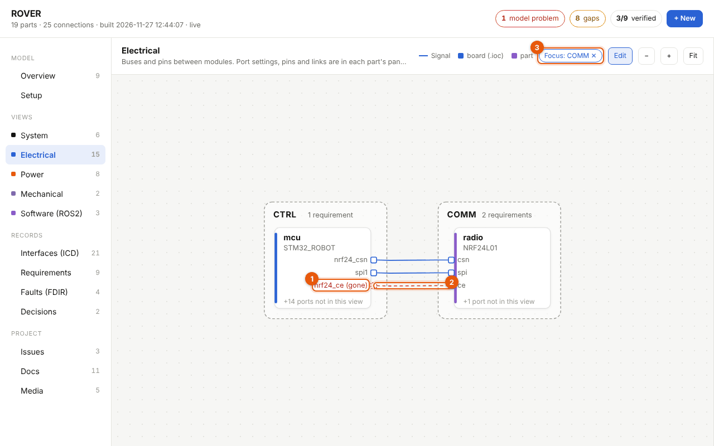

1. **The port that is gone** from the `.ioc`, in red.
2. **The link to it**, red and dashed, instead of silently drawing the old wire.
3. **Focus** on one subsystem (from its panel) to see just the affected wiring.

Fix it on the page: click the red wire to remove it, then connect
`radio_ce` to the module's `ce`. The red counter disappears.

The pre-commit hook stops a commit from your own clone with the same message,
so a broken model never reaches GitHub unnoticed. Other things the check
catches: an SPI bus wired to a GPIO (types do not match), a node assigned to a
part that does not exist, a requirement that does not exist, one topic used
with two message types.

---

## 11. Workflows

### A. First setup on a project

1. In the terminal, once: `doc init`, `doc install-hook`, `doc serve`
   (see the [README](../README.md#quick-start)).
2. **Setup → + Subsystem** for each subsystem (section 3).
3. **Setup → + Board** for each microcontroller: pick its `.ioc`, name it, pick its subsystem.
4. **Setup → ROS2 code folders → Change**: add the folders with your ROS2 and micro-ROS code.
5. **System → Edit → + Part** for every module, sensor, battery and computer.
6. **Electrical → Edit**: click a board pin, then the module, for every wire.
   Then **Power** and **Mechanical** the same way, if you want those views.
7. **Software**: click each node in *Not allocated* and set *Runs on*.
8. **Overview**: Problems should say *Architecture matches the facts*.
9. Optional: `tailscale serve --bg 8765` to open it from your phone.

### B. Record a test at the bench, from your phone

1. Open the page on your phone (section 12).
2. **Requirements**, find the one you tested (filter *Approved* or search), tap **Record test**.
3. Passed or Failed, what you measured (*stopped after 0.4 s, 5 runs*).
4. **Upload photo / video / log**: take the photo or pick the video.
5. **Save**.
6. The requirement turns Verified or Failed, the photo appears on its card and on its part.

If it failed: go to the fault that requirement covers and check the warning,
then file a bug (**+ New → Bug**) with the same photo.

### C. From an idea to a verified requirement

1. **+ New → Idea**: what, why, subsystem. It becomes a GitHub issue and shows in **Issues** and on the subsystem.
2. Compare options, then **+ New → Decision** with the options, pros and cons and the deciding factor. Put the issue number on the Related line.
3. **+ New → Requirement**: the measurable promise (*The robot shall stop within 0.5 s of losing the command link*). It lands in its subsystem.
4. **+ New → Fault** for what happens if it breaks, covered by that requirement.
5. If a single part carries it, open the requirement and **Pin to a part**.
6. Build it, then **Record test** (workflow B). Close the issue with `fixes #N` in the commit.

### D. A test fails

1. **Record test** with *Failed* and what you saw.
2. **Faults**: the fault this requirement covers now shows *not proven to work*.
3. **+ New → Bug** with the steps and the evidence file.
4. If something nearly broke, **+ New → Checklist line**, so it is checked before every power-up.
5. Fix, test again, record *Passed*. The evidence keeps both lines, so the history shows the failure and the fix.

### E. A pin changed in CubeMX

1. Save the `.ioc` and push (or commit on the server's machine). The page shows the problem (section 10).
2. **Electrical → Edit**: remove the red wire, connect the renamed pin.
3. The red counter disappears. The **Interfaces** table updates itself with the new pin.

From your own clone, the commit hook stops the `.ioc` commit with the same
message; commit with the fix from the page, or `git commit --no-verify` and fix it on the page right after.

### F. Adding a module

1. **System → Edit → + Part** (or **+ Part here** in a subsystem's panel): name, what it is, ports.
2. **Electrical → Edit**: click the board pin, then the module. Repeat for power in **Power**.
3. If it carries a requirement, pin the requirement to it.
4. If assembling it has steps someone could get wrong, **+ New → Procedure**.

### G. Weekly review

1. **Overview**: read Problems (must be zero) and Gaps (pick the ones worth acting on).
2. **Requirements → Failed** and **Approved** (approved but not yet tested).
3. **Faults**: any warning lines.
4. **Issues**: what is open in each subsystem.
5. **+ New → Devlog**: what was done, what broke, what is next.

### H. Showing the project to someone

1. In the Tailscale admin console, share the machine running `doc serve` with them (Machines → ⋯ → Share).
2. Send the `https://…ts.net/` address. Start them on **System**, then a subsystem panel, then **Requirements**.
3. Anyone you share with can also use the forms; share only with people who should be able to write.

---

## 12. On your phone

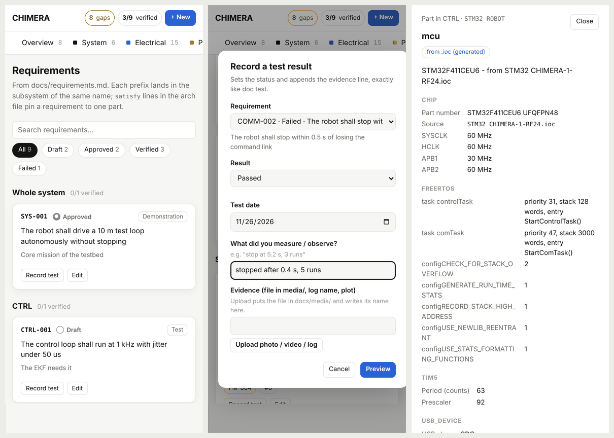

The page works on a phone: sections scroll across the top, forms fill the
screen, panels open full screen. Diagrams use the − / + / Fit buttons instead
of a scroll wheel; drag to pan. The camera is offered directly when you upload
from a form. Wiring is easier on a laptop: the ports are small on a phone screen.

---

## 13. What the page will and will not do

**It writes** your records (requirements, tests, faults, decisions, procedures,
checklist lines, devlog), the model (`docs/model/model.toml` and the arch
file), the generated subsystem table and issue-form lists, GitHub issues,
files you upload into `docs/media/`, and parts in your parts library folders. It regenerates `<name>_facts.sysml` with
each commit.

**It never writes** the `.ioc` (CubeMX owns it) or your code. It never deletes a
record: a dropped requirement is marked Deleted with a reason, a replaced
decision is Superseded, a subsystem whose prefix was used is kept as deleted.
Parts and wires are really removed (git history keeps them, and **↶ Undo**
brings back the last change).

**It refuses** to write a file that has uncommitted changes on the machine
running the server, so it never commits half of your own edit. Commit or stash
first, then try again.

**Who can reach it:** only this machine. Tailscale makes it reachable from your
own devices and anyone you share the machine with. Forms only accept requests
from the page itself, so other websites cannot post to it.

---

## 14. Running the server long-term

The server is one command in a clone of the project, so moving it is easy:

1. On the always-on machine (a lab PC), clone the project, install Python 3.11+
   and git, run `gh auth login`, and make sure it can push.
2. Run `doc serve` in that clone, and `tailscale serve --bg 8765` there.
3. Use that machine's `.ts.net` address from now on.

Use a dedicated clone for the server, not the one you edit in: then the
uncommitted-changes guard never gets in your way. Everyone without access to
that machine can still run `doc serve` in their own clone: the page works the
same anywhere, and pushes like everyone else.
