# Using the page

The page is the main way to use doc-kit. It shows the whole robot in one place
(wiring, software, requirements, faults, decisions, issues, docs, photos), and
it is where you record what happens: a test result with a photo, a new idea, a
decision. Every change you make on it is written to your Markdown files and
committed to git, exactly as if you had typed it in the terminal.

Concepts (what a requirement is, what makes a good fault row) are in the
[handbook](HANDBOOK.md). The same actions in a shell are in
[TERMINAL.md](TERMINAL.md). Each step below ends with its terminal equivalent
in grey, so you can switch at any point.

All screenshots come from a mock project: the `.ioc` is real, the modules,
wiring, ROS2 code and records are invented.

**Contents**

1. [Opening the page](#1-opening-the-page)
2. [Finding your way around](#2-finding-your-way-around)
3. [The views](#3-the-views)
4. [The records](#4-the-records)
5. [Issues, docs and media](#5-issues-docs-and-media)
6. [Writing from the page](#6-writing-from-the-page)
7. [Staying up to date](#7-staying-up-to-date)
8. [When the wiring no longer matches the hardware](#8-when-the-wiring-no-longer-matches-the-hardware)
9. [Workflows](#9-workflows)
10. [On your phone](#10-on-your-phone)
11. [What the page will and will not do](#11-what-the-page-will-and-will-not-do)
12. [Running the server long-term](#12-running-the-server-long-term)

---

## 1. Opening the page

There are two ways to open it.

| | `doc serve` (live) | `doc model` (a file) |
|---|---|---|
| What you get | the page at `http://127.0.0.1:8765`, with forms | `docs/system.html`, read-only |
| Updates | pulls from GitHub every minute and offers a reload | rebuilt each time you run it |
| Issues | refreshed every 5 minutes | a snapshot from when you ran it |
| Writing | forms commit and push | none (use the terminal) |
| Needs | Python 3.11+, git; `gh` for issues | Python 3.11+ |

```bash
cd your-project
doc serve
```

Leave that terminal window open; Ctrl+C stops it. Options: `--port 8765`,
`--interval 60` (seconds between GitHub checks), `--no-push` (commit locally only).

**From your phone or another laptop.** The server listens on this machine
only, so nothing on your Wi-Fi can reach it. To open it from your own
devices, share it through [Tailscale](https://tailscale.com):

```bash
tailscale serve --bg 8765
```

It prints an address like `https://your-mac.tailXXXX.ts.net/`. Open that on any
device signed into your tailnet. `tailscale serve --https=443 off` stops sharing.

> The first time, set up the model once: `doc model setup` asks which `.ioc`
> file belongs to each board and which folders hold ROS2 code, then writes a
> starter `docs/model/<name>_arch.sysml`. Describing your modules and wiring in
> that file is explained in the [handbook](HANDBOOK.md#15-the-system-model).

---

## 2. Finding your way around

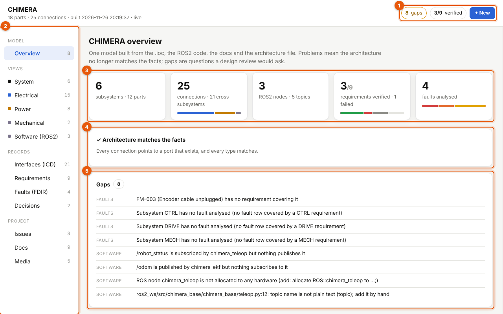

1. **Counters and + New.** *Model problems* (red) means the wiring in your arch
   file no longer matches the hardware; *gaps* are open questions; *verified*
   is how many requirements are proven. **+ New** opens the forms (only with
   `doc serve`). Click a counter to jump to it.
2. **Sections.** *Views* draw the robot, *Records* hold what it must do and why,
   *Project* holds issues, docs and media. The grey number is how many items each has.
3. **Tiles.** Size of the model, connections by kind (signal, power,
   mechanical), requirement progress and faults by severity.
4. **Problems.** Every line is something the pre-commit check will stop on, with
   the file and line number. When the wiring is consistent it says so.
5. **Gaps.** The questions a design review would ask: a subsystem with no
   requirements, a fault with no requirement covering it, a topic nobody
   subscribes to, a ROS node not assigned to any computer. Gaps are not errors;
   click one that names a part to open it.

The page remembers where you are in its address (`#electrical/sel:...`), so a
bookmark or a reload brings you back to the same view with the same part open.

---

## 3. The views

### System

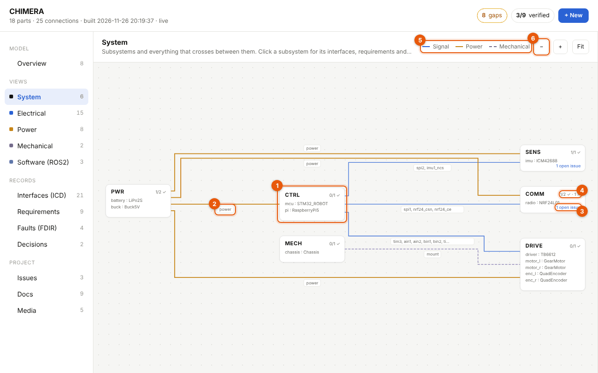

1. **A subsystem** with the parts inside it. Click it for its panel.
2. **What crosses between subsystems**: one line per kind, labelled with the
   ports it carries (`spi1, nrf24_csn, nrf24_ce`) or *power* / *mount*.
3. **Open issues** placed in this subsystem.
4. **Requirement progress**: verified out of total, and how many failed.
5. **Legend.** Blue is signal, amber is power, dashed purple is mechanical.
6. **Zoom.** − / + / Fit. On a laptop, scroll to zoom and drag to pan.

Clicking empty space closes the panel.


1. **Open in Electrical** shows only this subsystem and what it is wired to.
2. **Interfaces**: everything that crosses into other subsystems, with both ends.
3. **Requirements** that belong here (every `COMM-###` lands in `COMM`).
4. **Faults** covered by those requirements. Decisions and open issues follow below.

> Terminal: `doc model` writes the same page as `docs/system.html`.

### Electrical, Power, Mechanical

Three views of the same parts, each showing only the ports of its kind.


1. **A subsystem** drawn as a dashed box around its parts.
2. **A part from the facts**: the MCU, read from its `.ioc` (blue band).
3. **A part you wrote** in the arch file (purple band).
4. **A port.** Hover it for its pins.
5. **Ports not shown** in this view, for example the power input in the Electrical view.
6. **Legend.**

Layout is automatic: you never place a box. Hover a part to highlight its wires.

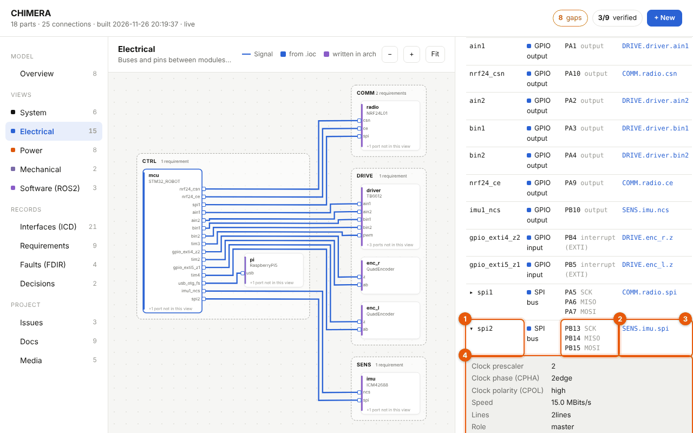

Click a part to open its panel.

1. **A port.** The arrow means it has saved settings; click the row to open them.
2. **Its pins** and what each pin does, from the `.ioc`.
3. **What it connects to.** Click to jump to that part.
4. **Its settings** as CubeMX saved them, in plain words: speed, role, clock
   polarity and phase, and derived facts such as *SPI mode 3*. CubeMX only
   saves values you changed; a missing one is shown as *CubeMX default*,
   never guessed.


1. **The chip**: part number, package, the `.ioc` it came from, clock tree.
2. **Middleware and internal peripherals**: FreeRTOS tasks with priority,
   stack and entry function; timebases; USB class.

Further down the panel: requirements, faults, decisions, open issues and
photos that belong to this part, and any gap that names it.

### Software (ROS2)


1. **A computer** (a part in your arch file) with the nodes that run on it.
2. **A node**, with the file it was found in. Click for its topics and line numbers.
3. **A topic** with its message type. Arrows go publisher → topic → subscriber.
4. **Not allocated**: nodes no computer runs yet (amber). Add one line to the
   arch file: `allocate ROS::chimera_teleop to chimera.CTRL.pi;`
5. **A topic with only one side** (amber border): published but never
   subscribed, or the other way round.

Everything here is read from the code, so the robot can be off. A topic name
built at runtime (`'debug/' + name`) cannot be read for certain, so it is
listed as a gap instead of guessed.

---

## 4. The records

### Interfaces (ICD)


1. **A pair of subsystems** and how many links cross between them.
2. **One link**: its kind, and both ends (click to open the part).
3. **Pins** on the MCU side.
4. **Bus settings** that matter at the interface: speed, role, SPI mode.

Nobody types this table. It is generated from the wiring, so it cannot drift
from it.

### Requirements

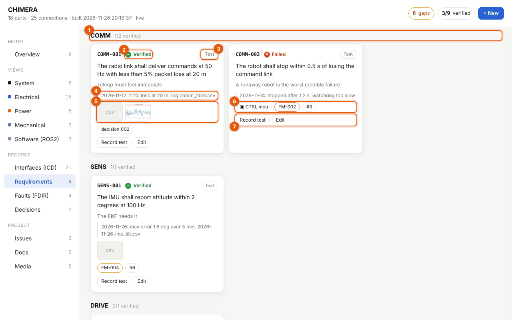

1. **A subsystem group** with its progress.
2. **Status**: Draft, Approved, Verified, Failed or Deleted.
3. **How it is verified**: Test, Inspection, Analysis or Demonstration.
4. **Evidence**: one dated line per test.
5. **Media**: any file in `docs/media/` whose name appears in the evidence.
6. **Links**: the part it is pinned to, the faults it covers, decisions, open issues.
7. **Actions**: *Record test* and *Edit* (with `doc serve`).

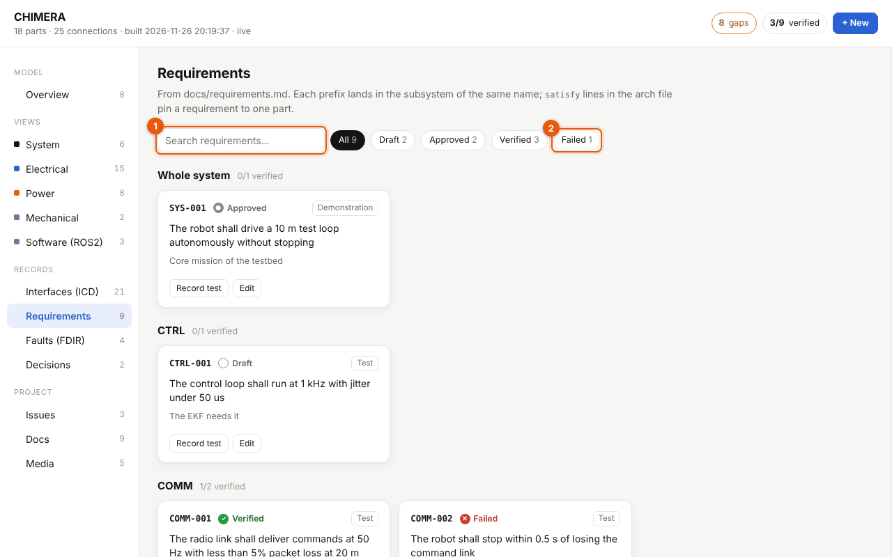

1. **Search** across IDs, text and rationale.
2. **Filter by status**, for example everything that failed.

### Faults (FDIR)

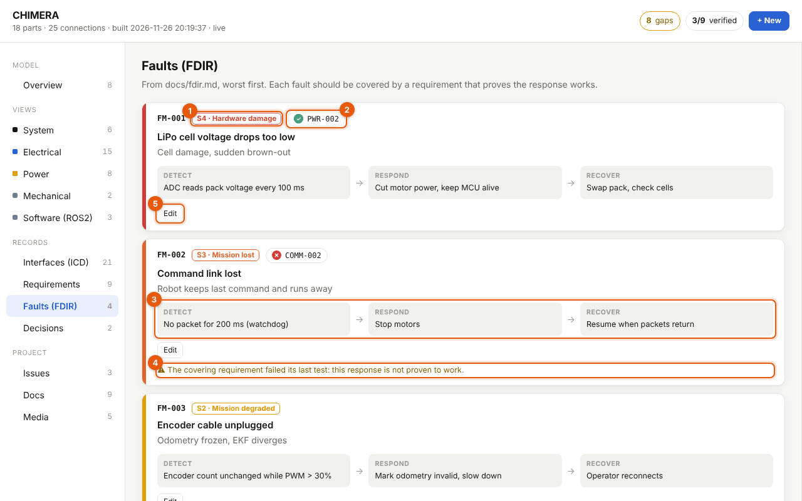

1. **Severity**, worst first.
2. **The requirement that covers it**, with that requirement's status.
3. **Detect → respond → recover.**
4. **A warning** when the covering requirement failed its last test, or when
   nothing covers the fault at all.
5. **Edit** any column.

### Decisions

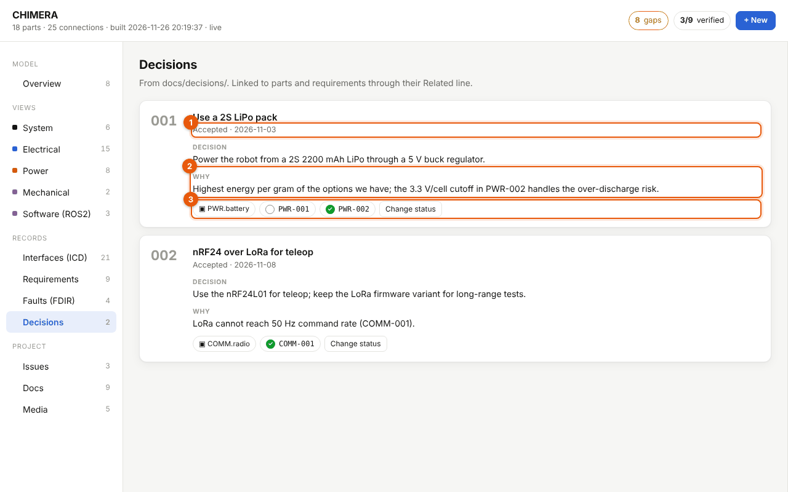

1. **Status and date.** Decisions are never rewritten: change the status, or
   supersede with a new one.
2. **Decision and why.**
3. **Links** to the parts and requirements named on its Related line, and *Change status*.

---

## 5. Issues, docs and media

### Issues

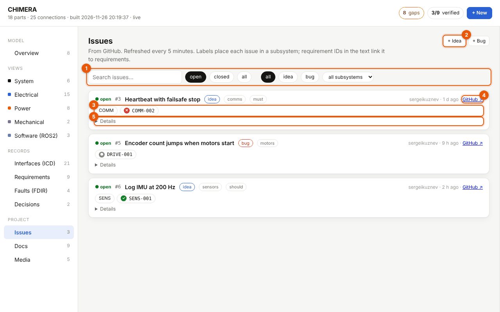

1. **Search and filters**: open/closed, idea/bug, subsystem.
2. **+ Idea / + Bug** create a GitHub issue from a form.
3. **Placement**: the issue's labels put it in a subsystem; requirement IDs in
   its text link it to those requirements.
4. **GitHub ↗** opens it on GitHub, where comments and closing happen.
5. **Details** shows the issue body.

Issues need the GitHub CLI (`gh auth login`) on the machine running `doc serve`.

### Docs


1. **Your docs**: project notes, requirements, faults, devlog, procedures,
   checklist, interface notes.
2. **How to use doc-kit**: the README and this handbook, inside the page.
3. **Requirement and fault IDs** in the text are links.

Links between docs open inside the page; links to anything else open in a new tab.

### Media


1. **Filter by kind**: image, video, data, PDF.
2. **A file.** Click for full size.
3. **The requirement** whose evidence names this file.
4. **Upload** adds files to `docs/media/` and commits them.


Photos and videos open full size; logs and CSVs show their text.

---

## 6. Writing from the page

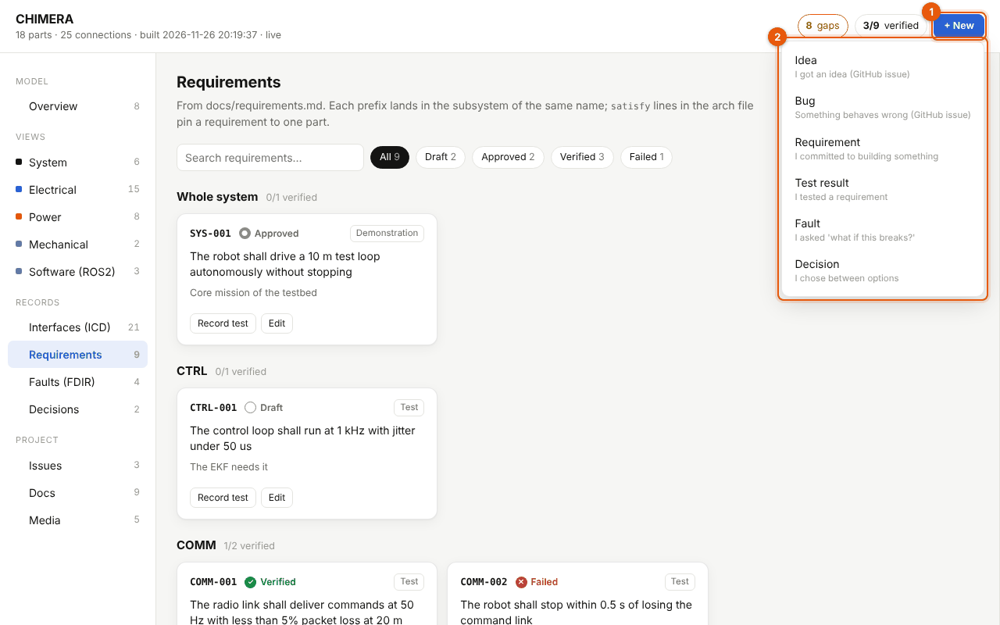

1. **+ New**, top right on every page.
2. **What just happened?** The same choices as the terminal menu.

Cards also have their own buttons: *Record test* and *Edit* on requirements,
*Edit* on faults, *Change status* on decisions, *Mark deleted* in a
requirement's panel.

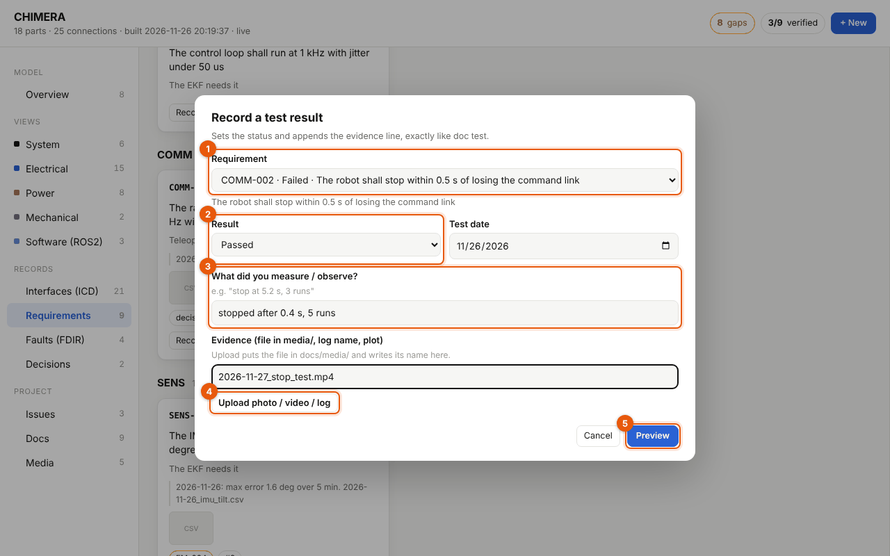

1. **Pick the record**: here, which requirement you tested.
2. **Choices are menus**, never free text, so the IDs and statuses are always valid.
3. **Free text** with a hint of what a good answer looks like.
4. **Upload**: the file goes to `docs/media/` with today's date in its name,
   and its name goes into the field.
5. **Preview** shows what will be written. Nothing is saved yet.

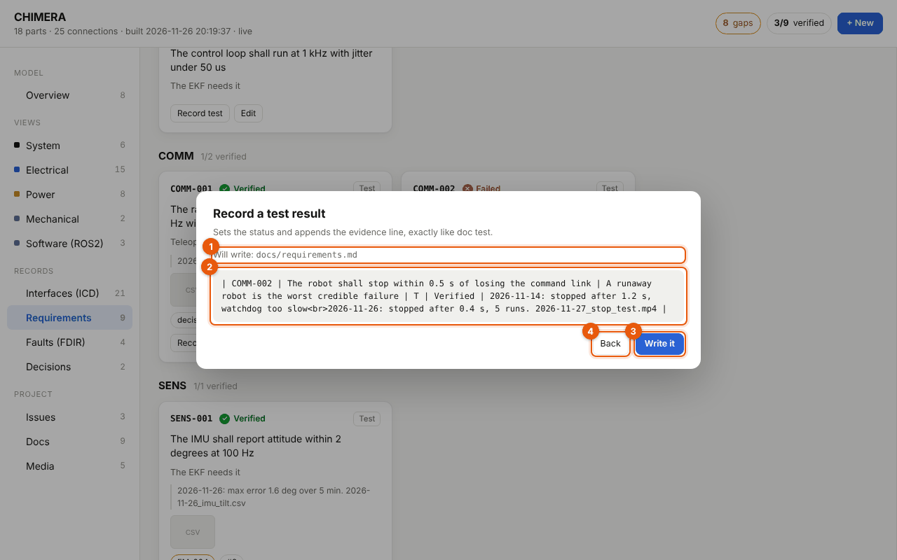

1. **The file** that will change.
2. **The exact text** that will be written: the same row `doc test` would write.
3. **Write it** saves, commits and pushes.
4. **Back** returns to the form with your answers kept.

Warnings appear on the preview without blocking you: a requirement with no
*shall* or no number to measure, a fault pointing to a requirement that does
not exist.

| Form | Fields | Writes |
|---|---|---|
| Idea | title, what, why, subsystem, priority, open questions | GitHub issue |
| Bug | title, what happened, what should have, steps, subsystem, firmware, logs and photos | GitHub issue |
| Requirement | subsystem, the *shall* sentence, rationale, verification method, status | `docs/requirements.md`, next ID |
| Test result | requirement, passed/failed, what you measured, evidence (upload), date | the requirement's status and evidence |
| Fault | what fails, effect, detection, response, recovery, severity, covering requirement | `docs/fdir.md`, next FM-ID |
| Decision | title, status, related IDs, what it replaces, context, options with pros and cons, the decision, deciding factor, consequences | `docs/decisions/NNN-title.md` |
| Edit requirement | status, text, rationale or method; *Mark deleted* asks why | the row, plus a line in the change log |
| Edit fault | any column | the row |
| Change decision status | Proposed, Accepted, Rejected, Superseded by NNN, or the Related line | the decision file |

Each save is one commit with a readable message (`doc: test COMM-002 verified`),
then a push. An upload is its own commit.

> Terminal: `doc` opens the same choices as a menu; see [TERMINAL.md](TERMINAL.md#3-commands).

---

## 7. Staying up to date

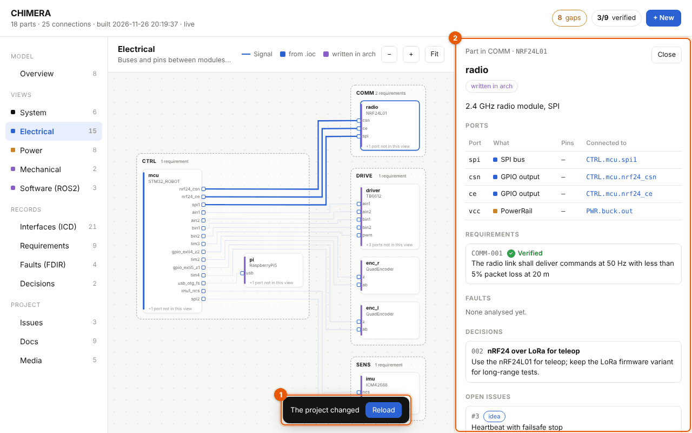

1. **The project changed.** Someone pushed, a file changed on the server, or an
   issue moved. The notice says what. Nothing reloads by itself, so you never
   lose what you were looking at.
2. **Reload** brings you back to the same view with the same part open, now
   with fresh data.

Without `doc serve` there is no notice: the file shows what it was built from.

---

## 8. When the wiring no longer matches the hardware

Rename a pin label in CubeMX, for example `NRF24_CE` to `RADIO_CE`, and the arch
file still says `connect CTRL.mcu.nrf24_ce to COMM.radio.ce;`.

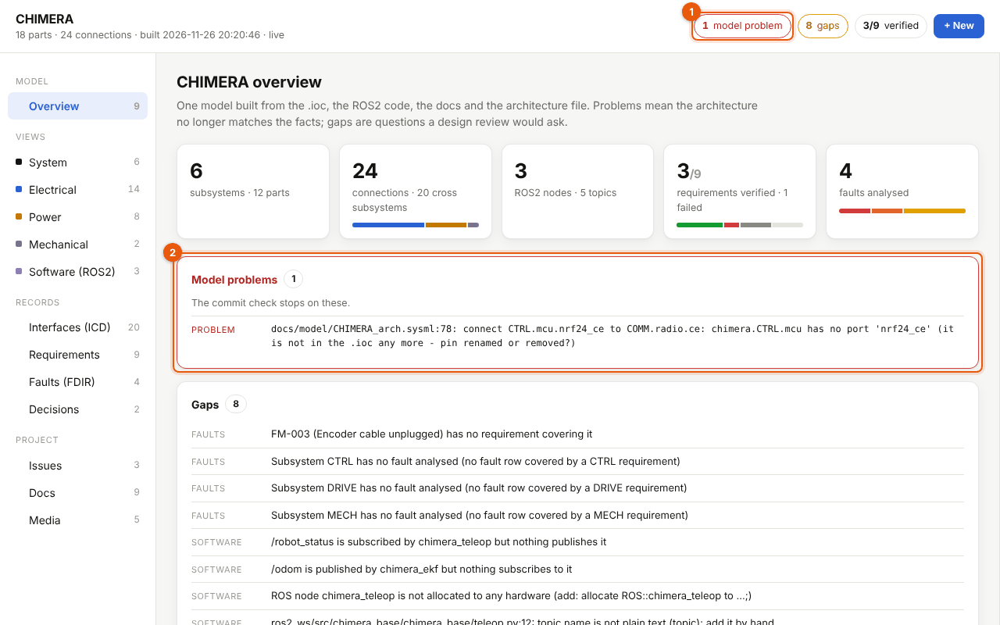

1. **The red counter** appears on every page.
2. **The problem**, with the arch file and line, and a hint about the likely cause.


1. **The port that is gone** from the facts, in red.
2. **The link to it**, red and dashed, instead of silently drawing the old wire.
3. **Focus** on one subsystem (from its panel) to see just the affected wiring.

The pre-commit hook stops the commit with the same message. Fix the arch file
(rename `nrf24_ce` to `radio_ce`) and commit both together.

Other things the check catches: an SPI bus wired to a GPIO (types do not match),
a part type that is not defined, a node assigned to a computer that does not
exist, a requirement that does not exist, one topic used with two message types.

---

## 9. Workflows

Each step shows what to do on the page, with the terminal equivalent in grey.

### A. First setup on a project

1. Install doc-kit into the project: `python3 path/to/doc-kit/doc.py init .`
2. `doc install-hook`, so every commit checks the wiring.
3. `doc model setup`: pick each board's `.ioc`, the ROS2 folders, and the subsystem each board sits in.
4. Write your modules and wiring in `docs/model/<name>_arch.sysml` ([how](HANDBOOK.md#15-the-system-model)).
5. `doc serve`, open the page, and read **Overview → Problems** until it says *Architecture matches the facts*.
6. Optional: `tailscale serve --bg 8765` to open it from your phone.

### B. Record a test at the bench, from your phone

1. Open the page on your phone (section 10).
2. **Requirements**, find the one you tested (filter *Approved* or search), tap **Record test**.
3. Passed or Failed, what you measured (*stopped after 0.4 s, 5 runs*).
4. **Upload photo / video / log**: take the photo or pick the video.
5. **Preview**, check the row, **Write it**.
6. The requirement turns Verified or Failed, the photo appears on its card and on its part.
   <br><sub>Terminal: copy the file into `docs/media/`, then `doc test COMM-002`.</sub>

If it failed: go to the fault that requirement covers and check the warning,
then file a bug (**+ New → Bug**) with the same photo.

### C. From an idea to a verified requirement

1. **+ New → Idea**: what, why, subsystem. It becomes a GitHub issue and shows in **Issues** and on the subsystem.
   <br><sub>Terminal: `doc idea`</sub>
2. Compare options, then **+ New → Decision** with the options, pros and cons and the deciding factor. Put the issue number on the Related line.
   <br><sub>Terminal: `doc decision`</sub>
3. **+ New → Requirement**: the measurable promise (*The robot shall stop within 0.5 s of losing the command link*). It lands in its subsystem.
   <br><sub>Terminal: `doc req`</sub>
4. **+ New → Fault** for what happens if it breaks, covered by that requirement.
   <br><sub>Terminal: `doc fault`</sub>
5. If a single part owns it, pin it there in the arch file: `satisfy 'COMM-002' by chimera.CTRL.mcu;`
6. Build it, then **Record test** (workflow B). Close the issue with `fixes #N` in the commit.
   <br><sub>Terminal: `doc test COMM-002`</sub>

### D. A test fails

1. **Record test** with *Failed* and what you saw.
2. **Faults**: the fault this requirement covers now shows *not proven to work*.
3. **+ New → Bug** with the steps and the evidence file.
4. If something nearly broke, add a checklist line so it never happens again (terminal only for now: `doc check`).
5. Fix, test again, record *Passed*. The evidence keeps both lines, so the history shows the failure and the fix.

### E. A pin changed in CubeMX

1. Save the `.ioc` and commit. The hook stops with the line in the arch file that points at the old name.
2. Or open the page: **Overview** shows the problem, the view shows the red dashed link (section 8).
3. Update the `connect` line, commit the `.ioc` and the arch file together.
4. The **Interfaces** table updates itself with the new pin.

### F. Weekly review

1. **Overview**: read Problems (must be zero) and Gaps (pick the ones worth acting on).
2. **Requirements → Failed** and **Approved** (approved but not yet tested).
3. **Faults**: any warning lines.
4. **Issues**: what is open in each subsystem.
5. Write the devlog entry: what was done, what broke, what is next (terminal: `doc log`).

### G. Showing the project to someone

1. In the Tailscale admin console, share the machine running `doc serve` with them (Machines → ⋯ → Share).
2. Send the `https://…ts.net/` address. Start them on **System**, then a subsystem panel, then **Requirements**.
3. Anyone you share with can also use the forms; share only with people who should be able to write.

---

## 10. On your phone


The page works on a phone: sections scroll across the top, forms fill the
screen, panels open full screen. Diagrams use the − / + / Fit buttons instead
of a scroll wheel; drag to pan. The camera is offered directly when you upload
from a form.

---

## 11. What the page will and will not do

**It writes** only what doc-kit writes: requirements, test results, faults,
decisions, GitHub issues, and files you upload into `docs/media/`. Every write
goes through the same code as the terminal, so the files are identical either way.

**It never writes** the `.ioc` (CubeMX owns it), your code, the arch file (you
write it in an editor), or the generated `<name>_facts.sysml`. It never deletes
anything: a dropped requirement is marked Deleted with a reason, a replaced
decision is Superseded.

**It refuses** to write a file that has uncommitted changes on the machine
running the server, so it never commits half of your own edit. Commit or stash
first, then try again.

**Who can reach it:** only this machine. Tailscale makes it reachable from your
own devices and anyone you share the machine with. Forms only accept requests
from the page itself, so other websites cannot post to it.

**Not on the page yet:** procedures, checklist lines and devlog entries
(terminal: `doc procedure`, `doc check`, `doc log`), and editing the wiring
(edit the arch file).

---

## 12. Running the server long-term

The server is one command in a clone of the project, so moving it is easy:

1. On the always-on machine (a lab PC), clone the project, install doc-kit's
   requirements (Python 3.11+, git, `gh auth login`), and make sure it can push.
2. Run `doc serve` in that clone, and `tailscale serve --bg 8765` there.
3. Use that machine's `.ts.net` address from now on.

Use a dedicated clone for the server, not the one you edit in: then the
uncommitted-changes guard never gets in your way.
